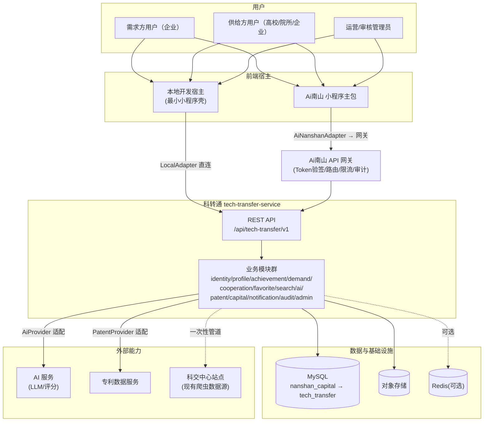
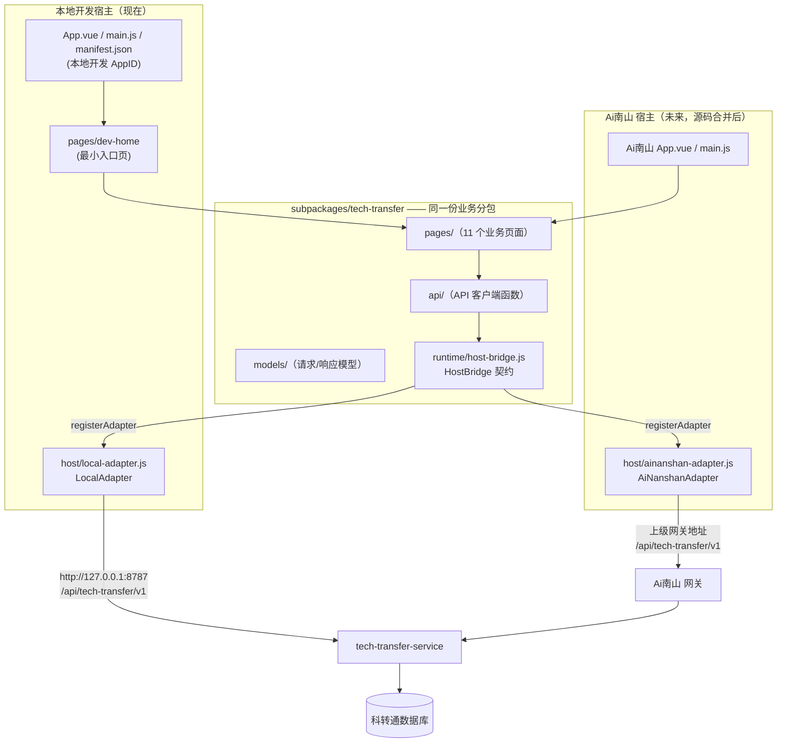
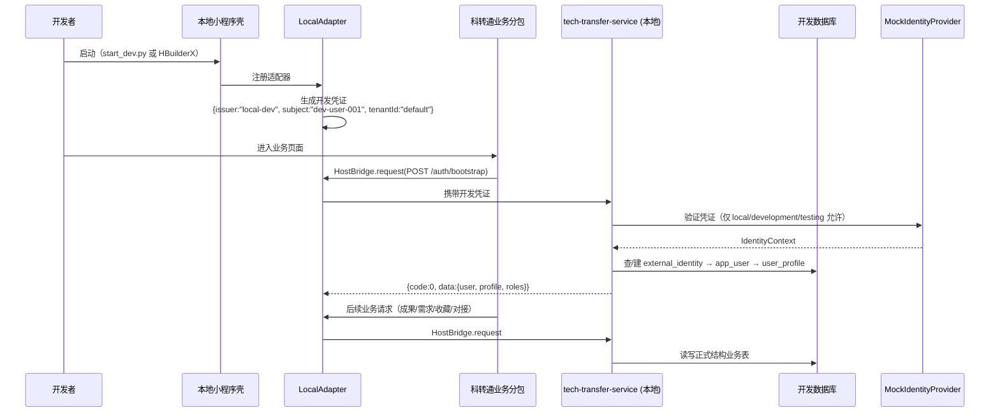
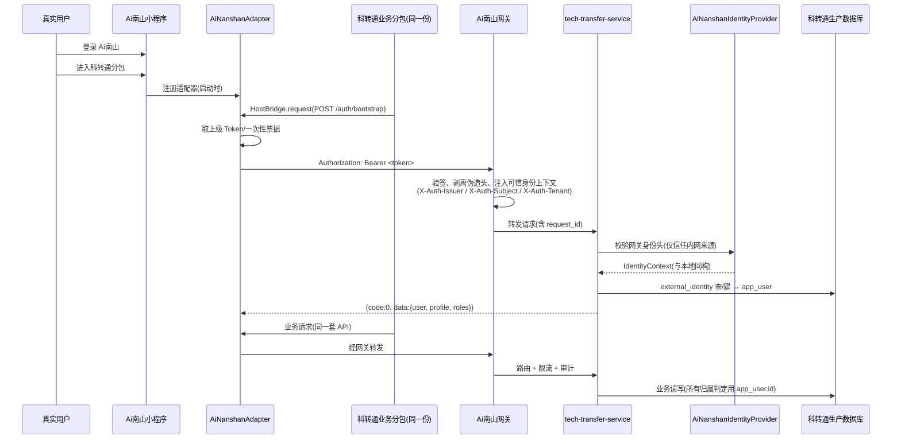
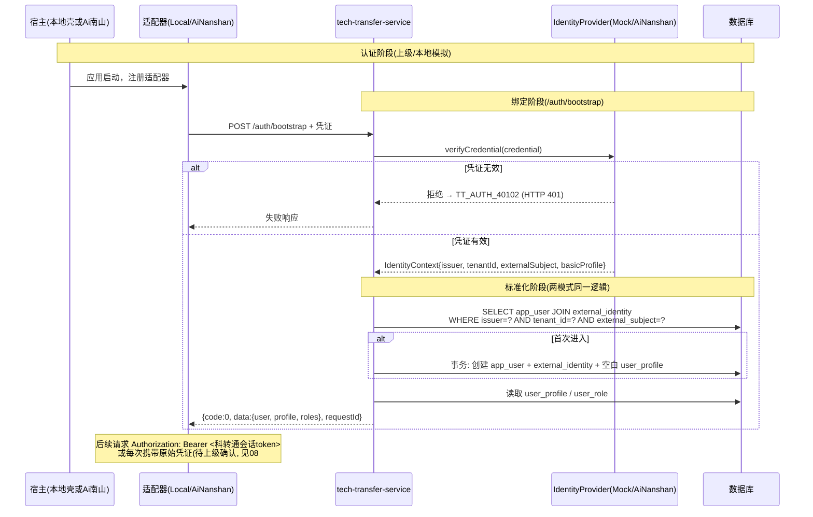
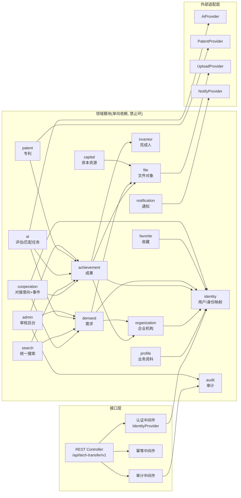
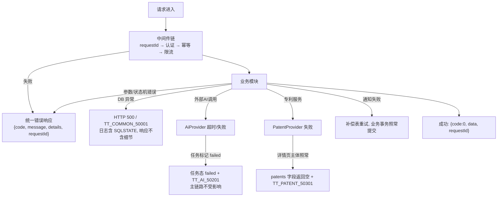

# 02 · 目标架构设计（Target Architecture）

> 文档状态：基线版
> 上游输入：`01-current-state-audit.md`（现状）、根目录《南山科转通_架构与接口设计.md》V2 评审稿（已评审决策）
> 本文只描述**目标态**；当前态与目标态的差异与迁移步骤见 `03`、`07`。

---

## 1. 架构原则（底层逻辑先行）

1. **双宿主、单代码源**：科转通业务分包只有一份。本地开发宿主与 Ai南山 正式宿主加载的是同一份页面、组件、API 客户端、请求/响应模型、错误码与状态机。禁止任何"独立版/嵌入版"分叉。
2. **宿主差异被适配器吸收**：身份凭证、网络入口、上传、导航、消息、错误上报这些"宿主能力"全部通过 HostBridge 契约隔离。业务代码只面向契约编程。
3. **科转通拥有自己的领域数据**：用户业务资料、成果、需求、收藏、对接、AI 记录归科转通数据库；上级身份只以"可信声明 → external_identity 映射"的方式进入，不作为业务主键。
4. **认证与授权分离**：上级负责认证（证明你是谁）；科转通负责授权（你能动哪些业务数据）。
5. **模块化单体**：`tech-transfer-service` 是一个可独立部署的领域服务，内部按模块划分边界，一期不拆网络微服务（理由见 ADR-003）。
6. **规模匹配**：当前数据量（百级成果、十级机构）不引入 Kafka/K8s/ES 集群/向量数据库集群；任何基础设施引入都必须写明必要性、触发条件与替代方案（§9）。

---

## 2. 系统上下文图



要点：
- 本地宿主与正式宿主到达**同一个**科转通 API（本地是服务直连，正式经网关）；
- 外部 AI/专利能力只被服务端适配层接触，前端永不直连；
- 现有爬虫降级为"一次性数据管道"，不再属于运行时架构。

---

## 3. 双宿主架构图



关键规则：

| 规则 | 说明 |
|------|------|
| 业务分包不感知宿主 | 页面只 import `subpackages/tech-transfer/api/*`，永不 import `host/*` |
| 适配器由宿主注册 | 本地壳在启动时 `HostBridge.registerAdapter(new LocalAdapter())`；Ai南山 工程注册 `AiNanshanAdapter`。业务分包不参与选择 |
| 未注册即失败 | HostBridge 在任何能力被调用前校验适配器，未注册时抛出 `TT_HOST_50001` 级启动错误并阻断页面渲染，绝不静默降级 |
| 请求契约一致 | 两个适配器的 `request()` 都指向 `/api/tech-transfer/v1/*`，仅 base URL 与鉴权头注入方式不同 |

---

## 4. 本地运行数据流



本地模式边界（强约束）：

- **允许 Mock**：上级身份凭证、上级导航入口、上级上传、上级消息、上级埋点/错误上报。
- **禁止 Mock**：用户资料、成果、需求、收藏、对接意向及状态流转、AI 任务与结果、审核状态、数据权限——这些必须打真实 API 落真实表。
- 本地身份固定使用 `issuer=local-dev`、`tenantId=default`，`MockIdentityProvider` 在 staging/production 直接拒绝启动。

## 5. 正式集成数据流



两种模式从 `IdentityContext` 之后的全部逻辑**完全一致**——这是"单代码源"在后端的对应物。

---

## 6. 身份认证时序（本地与正式统一视角）



身份链路核心规则：

1. `app_user.id`（BIGINT 本地主键）是所有业务表的外键；
2. `external_identity` 唯一约束 `UNIQUE (issuer, tenant_id, external_subject)`，`tenant_id` 用 `'default'` 兜底、**禁止 NULL**（MySQL 唯一索引对 NULL 不去重，会导致同一上级身份重复绑定）；
3. `external_subject`/OpenID 等机器标识只存映射表，**永不**作为姓名显示；`real_name` 为空时页面显示"未填写"；
4. 手机号、邮箱、姓名均不是身份主键，仅是可变的 profile 属性（加密存储 + 脱敏展示）；
5. 前端任何接口都**不接受** `ownerUserId` 一类的可信归属字段——归属一律来自后端解析的当前用户。

---

## 7. 核心业务模块图与依赖



依赖规则（评审时按此检查）：

| 规则 | 违反示例（禁止） |
|------|------------------|
| 模块单向依赖，禁止环 | achievement 不得 import cooperation |
| 业务模块不直接依赖第三方 SDK | ai 模块只 import AiProvider 接口 |
| 外部模块故障不阻断主链路 | patent 超时 → 返回 `TT_PATENT_50301`，成果详情主体照常返回 |
| 通知失败不回滚业务事务 | 发送失败进补偿表，接口仍成功 |
| 审计不信任前端操作者 | audit_log.operator_id 取自 IdentityContext |
| capital 是独立只读域 | 不依赖 identity/favorite，可单独做公开只读 |

---

## 8. 环境矩阵与生产硬保护

### 8.1 环境配置

```text
APP_ENV=local|development|testing|staging|production
HOST_MODE=local|ainanshan
AUTH_PROVIDER=mock|ainanshan
API_BASE=<本地服务或上级网关地址>
```

### 8.2 合法组合矩阵

| APP_ENV | HOST_MODE | AUTH_PROVIDER | API 入口 | 用途 |
|---------|-----------|---------------|----------|------|
| local | local | mock | `http://127.0.0.1:8787` | 开发者本机 |
| development | local | mock | 开发服务器地址 | 团队联调 |
| testing | local 或 ainanshan | mock 或 ainanshan | 测试服务/测试网关 | 自动化 + 集成测试 |
| staging | ainanshan | ainanshan | 预发布网关 | 上级联调验收 |
| production | ainanshan | ainanshan | 生产网关 | 正式运行 |

### 8.3 硬性保护（构建期/启动期，非运行期提示）

| 非法组合 | 拦截点 | 行为 |
|----------|--------|------|
| `APP_ENV ∈ {staging,production}` 且 `HOST_MODE=local` | 前端构建脚本 | **构建失败**（退出码非 0，输出违规项） |
| `APP_ENV ∈ {staging,production}` 且 `AUTH_PROVIDER=mock` | 后端服务启动 | **启动失败**（拒绝监听端口） |
| `APP_ENV ∈ {staging,production}` 且 `API_BASE` 含 `127.0.0.1`/`localhost` | 前端构建脚本 | **构建失败** |

实现落点：前端在构建入口脚本（如 `scripts/check-env.js`，HBuilderX 自定义 hook 或 CI 步骤）读取环境变量做白名单断言；后端在应用工厂函数开头做同样断言。两类断言都必须有单元测试覆盖（见 07 §9）。

---

## 9. 数据存储边界与基础设施决策

| 存储 | 承载内容 | 一期是否引入 | 决策依据 |
|------|----------|--------------|----------|
| MySQL（`tech_transfer` schema） | 全部业务事实：用户映射、资料、成果、需求、收藏、对接、AI 记录、审计、文件元数据 | 是（已有 MySQL 实例） | 数据量小、事务需求强、团队熟悉 |
| 对象存储 | 成果图片/附件、AI 报告文件 | 是（一期可本地磁盘目录起步，生产接上级或云 OSS） | 数据库不存二进制 |
| Redis | 幂等键、限流计数、任务状态缓存、热点缓存 | **可选，不强制** | 单实例 + 小流量下可用进程内缓存替代；引入触发条件见下 |
| Elasticsearch | 全文检索 | **否** | 223 条成果用 MySQL `FULLTEXT`/LIKE + 标签过滤足够；触发条件：成果 > 5 万条或搜索 P95 > 500ms |
| Kafka / 消息队列 | 异步任务 | **否** | AI 任务量小，用数据库任务表 + 进程内工作线程/定时器即可；触发条件：AI 任务日量 > 1 万或需跨服务事件 |
| Kubernetes / 服务网格 | 部署编排 | **否** | 单服务单库，普通虚机/容器即可；触发条件：服务数 > 3 或需弹性伸缩 |
| 独立向量库 | 语义检索 | **否** | 223 条成果的 embedding 可存 MySQL JSON 列内存检索；触发条件：语义召回成为主路径且数据 > 1 万条 |

> 原则：每项"看起来高级"的基础设施都必须回答"当前必要性、触发条件、替代方案"三问，答不上来就不引入。上述表格即本期全部基础设施决策记录。

---

## 10. 错误处理与降级路径



降级原则：
1. **外部能力分级**：AI（可降级为"评估暂不可用"）、专利（可降级为空列表+错误码）、通知（可延迟）均为可降级能力；成果/需求/对接主链路不可降级。
2. **失败可解释**：AI 任务必须落 `failed` 状态与失败原因，不允许无限 `running`。
3. **前端只认错误码**：`TT_AI_50201` → 显示"AI 服务暂时不可用"，`TT_PATENT_50301` → 专利区块显示"暂不可用"，不解析中文 message。

---

## 11. 部署拓扑

### 11.1 本地 / development

```text
开发者电脑
├─ 微信开发者工具 ← HBuilderX 编译产物(unpackage/dist/dev/mp-weixin)
│    └─ LocalAdapter → http://127.0.0.1:8787
├─ tech-transfer-service（Flask/FastAPI 进程, AUTH_PROVIDER=mock）
└─ MySQL（tech_transfer schema + 种子数据）
```

### 11.2 staging / production（目标态）

```text
微信客户端
  └─ Ai南山小程序（含 subpackages/tech-transfer 分包）
       └─ AiNanshanAdapter → HTTPS → Ai南山 API 网关
            ├─ Token 验签 / 限流 / 审计 / request_id 注入
            └─ 路由 /api/tech-transfer/v1/* → tech-transfer-service
                 ├─ MySQL（独立 schema、独立账号、禁 root）
                 ├─ 对象存储（上级统一或自建）
                 └─ 外部适配（AI / 专利，仅服务端可见）
```

科转通服务对上级平台而言是**一个微服务**；对内是模块化单体。与上级共用 MySQL 实例时仍必须独立 schema + 独立账号，禁止跨库直写。

### 11.3 健康检查与服务接口

```http
GET /health/live     # 进程存活
GET /health/ready    # DB 连通 + 关键依赖状态（含外部服务降级状态）
GET /metrics         # 若上级监控体系支持则暴露
```

---

## 12. 架构结论

> 南山科转通一期采用**双宿主、单代码源**：现在用最小本地小程序壳 + LocalAdapter + MockIdentityProvider 加载唯一的业务分包 `subpackages/tech-transfer`，直连本地 `tech-transfer-service` 读写正式结构的开发数据库；未来把同一份分包合并进 Ai南山，换 AiNanshanAdapter + 网关 + 真实身份。后端是单一可部署的模块化单体领域服务，外部 AI/专利能力经服务端适配层隔离，任何高级基础设施在达到触发条件前一律不引入。

相关文档：前端落地细节 → `03`；后端模块 → `04`；数据模型 → `05`；接口契约 → `06` + `openapi.yaml`；联调 → `07`；决策依据 → `adr/`。
