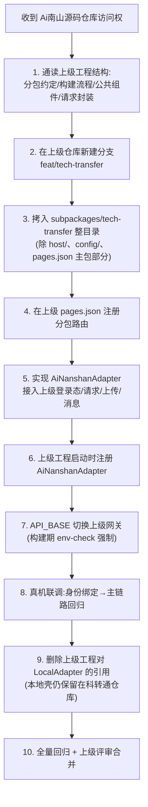

# 03 · 前端双宿主设计（Frontend Dual-Host Design）

> 文档状态：基线版
> 输入：`01`（现状文件清单）、`02`（架构目标）
> 决策依据：ADR-001（双宿主单代码源）

---

## 1. 设计原理

uni-app 小程序分包**不能脱离主包独立编译运行**，因此在拿到上级源码前，必须保留一个"本地最小宿主"承担编译载体职责。双宿主设计的本质是：

```text
把"会因宿主而变的东西"（入口、TabBar、身份凭证、请求通道、上传、消息）
从"不会因宿主而变的东西"（页面、业务逻辑、API 客户端、模型）
中物理分离，前者留在宿主工程，后者全部收进业务分包。
```

判断一个文件归属的唯一标准：**换一个宿主，这个文件要不要改？** 要改 → 属于宿主层；不改 → 属于业务分包。

---

## 2. 目标目录树

```text
南山\                                       # 本地开发工程根（HBuilderX 打开）
├─ App.vue                                  # 本地宿主入口：注册 LocalAdapter + 环境断言
├─ main.js                                  # uni-app 标准入口（不变）
├─ manifest.json                            # 本地开发 AppID（wxa65993c6516305c7）
├─ pages.json                               # 仅注册 dev-home + tech-transfer 分包路由
├─ project.config.json                      # 本地微信开发者工具配置
├─ uni.scss / uni.promisify.adaptor.js      # 保留
├─ pages\
│  └─ dev-home\dev-home.vue                 # 最小本地入口页：只负责跳进业务分包
├─ host\                                    # 【宿主层】只存在于本地工程，永不合并上级
│  ├─ local-adapter.js                      # LocalAdapter 实现
│  ├─ mock-identity.js                      # 本地开发身份（local-dev/dev-user-001）
│  └─ ainanshan-adapter.example.js          # AiNanshanAdapter 接口骨架示例（注释级，不可运行）
├─ config\
│  ├─ local.env.js                          # APP_ENV/HOST_MODE/AUTH_PROVIDER/API_BASE（本地组合）
│  └─ env-check.js                          # 构建期硬校验（staging/prod 组合违规即抛错）
├─ subpackages\tech-transfer\               # ★ 唯一业务分包（未来整体合并上级）
│  ├─ pages\                                # 11 个业务页面（从现 pages/ + packageA/ 迁入）
│  ├─ api\                                  # API 客户端（唯一允许发起请求的层）
│  │  ├─ client.js                          # 基于 HostBridge.request 的通用客户端
│  │  ├─ achievement.js
│  │  ├─ demand.js
│  │  ├─ favorite.js
│  │  ├─ cooperation.js
│  │  ├─ me.js
│  │  ├─ ai.js
│  │  ├─ patent.js
│  │  ├─ capital.js
│  │  ├─ search.js
│  │  └─ upload.js
│  ├─ models\                               # 请求/响应模型与字段映射（snake↔camel）
│  ├─ constants\
│  │  ├─ error-codes.js                     # 稳定错误码常量（前端唯一判据）
│  │  └─ states.js                          # 状态机枚举与流转表
│  ├─ components\                           # 业务组件（卡片、评分环、状态徽标…）
│  ├─ runtime\
│  │  └─ host-bridge.js                     # HostBridge 契约（随分包合并，稳定不变）
│  └─ assets\                               # 分包内图片
└─ static\                                  # TabBar 图标等宿主级静态资源（本地宿主用）
```

> 注意：目标结构中**不再有 `common/` 目录**。现有 10 个 common 模块按 §3 映射拆解：业务逻辑进分包 `api/`+`models/`，Mock 数据在迁移完成后删除。

---

## 3. 当前文件迁移映射（逐文件）

### 3.1 宿主层文件（保留在本地工程，不合并上级）

| 当前文件 | 去向 | 处置 |
|----------|------|------|
| `App.vue` | 本地宿主入口 | 改造：删除演示数据一次性清库逻辑，改为启动时 `HostBridge.registerAdapter(new LocalAdapter())` + 环境断言 |
| `main.js` | 保留 | 不变 |
| `manifest.json` / `project.config.json` | 保留 | 本地开发 AppID；`urlCheck:false` 仅本地允许，构建校验保证正式环境不可带出 |
| `pages.json` | 改造 | 只留 `pages/dev-home/dev-home` 主包页 + `subpackages/tech-transfer` 分包注册；TabBar 见 §6 |
| `uni.scss` / `uni.promisify.adaptor.js` | 保留 | 不变 |
| `static/`（tab 图标、logo、banner） | 拆分 | tab 图标留宿主；banner/logo 等业务图迁入分包 `assets/` |
| `start_dev.py`（工程外层） | 保留 | 本地联调工具，随迁移更新编译目标与后端地址检查 |
| `南山/tools/`（源码内副本） | 移出 uni-app 工程目录 | 避免进入编译范围；文件不删除，归档到工程外（见 01 §C7） |

### 3.2 业务分包文件（未来整体合并上级）

| 当前文件 | 去向 | 迁移要点 |
|----------|------|----------|
| `pages/index/index.vue` | `subpackages/tech-transfer/pages/home/home.vue` | 数据源从 `mock-data.js` 换 `api/`；TabBar 依赖移除（§6） |
| `pages/ai-match/ai-match.vue` | `.../pages/ai-match/ai-match.vue` | `buildDemoReply` 换 `api/ai.js` 任务接口 |
| `pages/mine/mine.vue` | `.../pages/mine/mine.vue` | 删除本地注册/登录表单，换 `/auth/bootstrap` + `/me` |
| `pages/capital-list/capital-list.vue` | `.../pages/capital-list/capital-list.vue` | `fetchPlatformList/fetchOrgList` 换 `api/capital.js` |
| `packageA/*.vue`（7 页） | `subpackages/tech-transfer/pages/*` | 同级平铺；路径前缀变化，页面间跳转改用 HostBridge.navigate |
| `common/capital.js` 的模块配置（CAPITAL_MODULES） | `.../constants/capital-modules.js` | 纯配置，随分包走 |
| `common/search.js` 的历史记录逻辑 | `.../api/search.js` + 本地缓存工具 | 历史仍可存本地（纯 UI 状态） |
| `common/patent-fee.js` 的费率表与计算 | 服务端 `patent` 模块 | 前端仅展示接口返回结果 |

### 3.3 演示/Mock 文件（分期删除）

| 当前文件 | 处置 | 时点 |
|----------|------|------|
| `common/mock-data.js` | **删除** | 阶段 B：首页/详情/我的列表全部接通 `/demands`、`/achievements` 后 |
| `common/user.js` | **删除** | 阶段 B：本地账号体系整体替换为身份适配 + `/me`（明文密码逻辑不允许进入任何正式分支） |
| `common/ai-chat.js` | **删除** | 阶段 C：AI 匹配任务接口可用后 |
| `common/ai-eval.js` | **删除** | 阶段 C：评估任务接口可用后 |
| `common/patent-fee.js`（演示数据部分） | **删除** | 阶段 C：专利接口可用后；`FEE_TABLE` 迁服务端 |
| `common/capital-demo-data.js` | **短期保留** | 资本接口稳定前的真机演示开关（`USE_CAPITAL_DEMO=true`），阶段 B 末删除 |
| `common/external-miniprogram.js` | **待上级确认后处置** | 与"源码合并"目标冲突（08 清单 #16）；确认前保留，检索 Tab 指向分包内搜索页 |

---

## 4. HostBridge 契约详细设计

### 4.1 契约定义（`subpackages/tech-transfer/runtime/host-bridge.js`）

```javascript
// 契约只定义接口形状，不含任何实现
const HostBridge = {
  _adapter: null,

  /** 宿主启动时调用；重复注册抛错，防止静默覆盖 */
  registerAdapter(adapter) {
    if (this._adapter) throw new Error('[HostBridge] adapter already registered')
    this._validate(adapter)
    this._adapter = adapter
  },

  getEnvironment() { return this._require()._getEnvironment() },
  getIdentityCredential() { return this._require()._getIdentityCredential() },
  request(options) { return this._require()._request(options) },
  upload(file, options) { return this._require()._upload(file, options) },
  navigate(path, params) { return this._require()._navigate(path, params) },
  showMessage(message) { return this._require()._showMessage(message) },
  reportError(error, context) { return this._require()._reportError(error, context) },

  _require() {
    if (!this._adapter) {
      // 未注册适配器 = 宿主装配错误，必须立即显性失败
      throw new Error('[HostBridge] no adapter registered — 宿主未完成装配，页面禁止渲染')
    }
    return this._adapter
  },
  _validate(adapter) { /* 校验 8 个必需方法齐全，缺一即启动失败 */ }
}
export default HostBridge
```

### 4.2 适配器接口

```text
Adapter（LocalAdapter 与 AiNanshanAdapter 实现同一接口）
├─ _getEnvironment() → { appEnv, hostMode, apiBase }     // 只读快照
├─ _getIdentityCredential() → Promise<Credential>          // 见下
├─ _request(options) → Promise<ApiResponse>                // 统一响应包
├─ _upload(file, options) → Promise<{ fileId, url }>       // 统一 fileId
├─ _navigate(path, params) → Promise<void>                 // 分包内路由
├─ _showMessage(message)                                   // toast/上级弹窗
└─ _reportError(error, context)                            // 携带 requestId 上报
```

### 4.3 两个适配器的实现要点

| 能力 | LocalAdapter（现在） | AiNanshanAdapter（未来） |
|------|----------------------|--------------------------|
| 注册时机 | 本地 `App.vue` onLaunch | Ai南山主包启动装配（由上级工程调用） |
| 身份凭证 | `mock-identity.js` 返回固定开发凭证 `{issuer:'local-dev', subject:'dev-user-001', tenantId:'default', displayName:'本地测试用户'}` | 从上级登录态取 Token/一次性票据（格式待上级确认，见 08 #4/#5） |
| 请求 | `uni.request` 直连 `API_BASE=/api/tech-transfer/v1`，注入 `Authorization: Bearer <dev-token>` | 走上级统一请求通道或 `uni.request` 打网关，注入上级 Token |
| 上传 | 直传本地服务 `/uploads/presign` 流程 | 走上级统一上传（规范待确认，08 #10），**返回值统一收敛为 `fileId`** |
| 导航 | `uni.navigateTo` 分包内路径 | 同左（分包内路由在两种宿主下路径一致）；跨分包跳宿主页走宿主注入的 route map |
| 消息 | `uni.showToast` | 上级消息能力（待确认，08 #11） |
| 错误上报 | `console.error` + 本地日志 | 上级埋点/错误上报通道（待确认，08 #13） |

### 4.4 页面为什么不能直接用 `uni.request`（强制规则）

1. **环境切换**：API_BASE 与鉴权头注入点在两个宿主中不同，散落在页面的 `uni.request` 意味着每个页面都要感知宿主——正是双宿主要消灭的东西。
2. **统一契约**：响应包解包（`code/message/data/requestId`）、错误码翻译、requestId 透传、超时与重试策略必须全局一致，只能收敛在 `api/client.js` 一处。
3. **可测试性**：API 客户端层可以脱离小程序运行时做契约测试（Mock HostBridge）。

### 4.5 页面为什么不能直接读取上级 `user_id`

1. 前端拿到的任何用户标识都是**不可信输入**：本地缓存可被改写，正式环境的 openId/unionId 也只是"上级给的字符串"，不能证明当前请求者。
2. 业务归属判定必须由后端基于验签后的凭证完成；前端读 `user_id` 只可能用于**显示**，而显示用的应该是 `user_profile.real_name`（空则"未填写"），永不是机器标识。
3. 因此分包内不存在"获取当前 userId 并拼进请求"的代码路径；`api/me.js` 是页面获取自身信息的唯一入口。

---

## 5. 页面统一调用 API 的方式

```text
页面 vue ──import──▶ subpackages/tech-transfer/api/achievement.js
                          │
                          ▼
                    api/client.js（唯一请求出口）
                          │  组装：method/path/query/body
                          │  注入：Authorization、X-Request-ID、X-Idempotency-Key
                          │  解包：code!==0 → 按 error-codes.js 抛业务错误
                          ▼
                    HostBridge.request(options)
                          │
                ┌─────────┴─────────┐
                ▼                   ▼
        LocalAdapter          AiNanshanAdapter
        （本地直连）             （经上级网关）
```

页面代码示例（目标态）：

```javascript
// subpackages/tech-transfer/pages/home/home.vue
import { listAchievements } from '../../api/achievement.js'
import { TT_AI_50201 } from '../../constants/error-codes.js'

export default {
  data: () => ({ list: [], loading: false }),
  async onShow() {
    this.loading = true
    try {
      const res = await listAchievements({ page: 1, pageSize: 20 })
      this.list = res.items
    } finally {
      this.loading = false
    }
  }
}
```

**禁止清单**（lint 规则 + 评审检查项）：

| 禁止 | 替代 |
|------|------|
| 页面内 `uni.request` | `api/*` 函数 |
| 页面内拼接 `API_BASE` | client.js 统一处理 |
| 页面内 `if (isLocal)` 分叉业务规则 | 宿主差异由适配器吸收；确需环境信息的只有开发调试页 |
| 页面 import `host/*` | 只 import `runtime/host-bridge.js` |
| 请求体携带 `ownerUserId`/`userId` 字段 | 归属由后端从凭证解析 |

---

## 6. 业务分包不依赖本地 TabBar

**问题**：当前 3 个 Tab（首页/AI匹配/我的）由本地 `pages.json` 的 `tabBar` 提供。合并进 Ai南山 后，TabBar 属于上级主包，科转通无权定义。

**方案**：

1. TabBar 属于宿主层：本地壳保留一个**精简 TabBar**（dev-home / 我的 等 2–3 个入口）仅服务于本地开发导航；Ai南山 工程中科转通页面通过上级 TabBar 或上级首页入口进入。
2. 业务分包内部跳转一律 `HostBridge.navigate(path, params)`，path 只使用**分包内相对路径**（如 `pages/home/home`），由适配器补全前缀（本地：`/subpackages/tech-transfer/pages/home/home`；上级合并后按上级分包根路径）。
3. 页面间不用 `uni.switchTab`（它绑定宿主 TabBar）；需要"回首页"等宿主级导航时走适配器注入的 `navigate('host:home')` 语义路由。
4. 当前 `user.js` 中 `ensureLoginForDock()` 使用 `uni.switchTab('/pages/mine/mine')` 引导登录——目标态中登录引导变为宿主能力（本地跳 dev-home 提示，正式环境上级已登录），业务页不再自行 switchTab。

---

## 7. 上级源码到位后的合并步骤



**不迁移清单**（永远留在本地工程）：`host/`、`config/local.env.js`、`pages/dev-home/`、`manifest.json`、`project.config.json`、`start_dev.py`、本地 TabBar 配置。

---

## 8. 降低上级源码升级冲突的策略

1. **物理隔离**：科转通代码 100% 位于 `subpackages/tech-transfer/` 单目录，与上级代码的接触面只有三处：上级 `pages.json`（分包注册块）、`AiNanshanAdapter` 注册点、`App.vue` 启动装配。升级冲突面被压缩到这三处。
2. **pages.json 注册块约定**：分包注册用独立注释块包裹（`/* tech-transfer begin/end */`），升级合并时整块平移。
3. **适配器不反向依赖上级内部**：AiNanshanAdapter 只调用上级**公开的**登录态 API 与请求工具；上级内部重构不波及适配器（若上级公开 API 变更，只改一个文件）。
4. **契约测试兜底**：HostBridge 契约测试（同一组用例分别跑 Local/AiNanshan 适配器，见 07 §9）保证换宿主后行为一致，升级后立即执行即可发现回归。
5. **业务分包版本化**：分包目录带 `version.js`（语义化版本 + 构建时间），合并冲突时可精确比对科转通侧变更范围。
