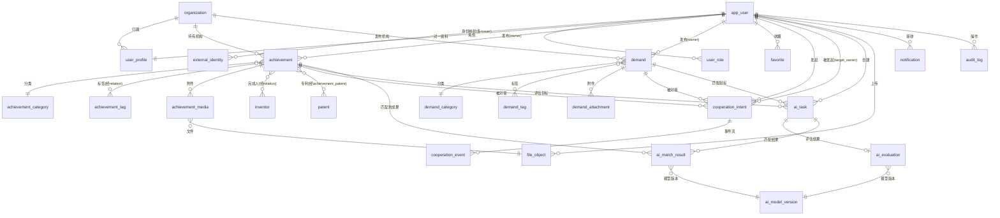

# 05 · 数据库领域模型设计（Data Model Design）

> 文档状态：基线版
> 目标库：MySQL 8.x，schema `tech_transfer`（utf8mb4），独立数据库账号（禁 root、禁与上级共表）
> 阅读前提：ADR-002（身份映射）、`04-backend-domain-design.md`（模块归属）
> 本文范围：字段级表设计、约束与索引、状态枚举、软删与脱敏策略、ER 图、现有数据迁移映射。
> 注意：本文是设计文档，不执行迁移（DDL 实施在阶段 B，由后端负责人执行）

---

## 1. 全库通用约定

| 约定 | 规则 |
|------|------|
| 主键 | `id BIGINT UNSIGNED AUTO_INCREMENT`，无业务含义；**任何业务表禁止使用外部 ID 作主键**（ADR-002） |
| 时间 | `created_at DATETIME NOT NULL DEFAULT CURRENT_TIMESTAMP`；`updated_at DATETIME NOT NULL DEFAULT CURRENT_TIMESTAMP ON UPDATE CURRENT_TIMESTAMP`；API 出参统一 ISO 8601 UTC（06 §4） |
| 软删 | `deleted_at DATETIME NULL`；查询默认 `deleted_at IS NULL`；唯一索引须含软删考量（见 §2.2 注） |
| 乐观锁 | 有状态流转的表（achievement/demand/cooperation_intent/ai_task）增加 `version INT NOT NULL DEFAULT 1`，UPDATE 带 `WHERE version=?` |
| 命名 | snake_case；布尔字段 `is_` 前缀；枚举存 VARCHAR(32) 代码而非数字（可读、可扩展），代码表见各节 |
| 金额与评分 | 金额用 `DECIMAL(14,2)`（单位：万元，字段名带 `_wan` 后缀）；评分 `DECIMAL(5,1)`（0.0–100.0，对齐现四维评分 0–100 整数+半分位） |
| 业务事实不进 Redis | Redis 仅缓存/幂等键（若引入），**任何业务事实（意向、状态、任务结果）必须先落 MySQL**（强制约束） |
| 外部身份不散落 | external_subject 仅存在于 `external_identity` 一张表；业务表一律 `user_id → app_user.id` |

---

## 2. 身份域

### 2.1 `app_user` —— 科转通本地用户（identity 模块）

| 字段 | 类型 | 空 | 默认 | 说明 |
|------|------|----|------|------|
| id | BIGINT UNSIGNED | 否 | 自增 | 科转通用户主键，全库业务表唯一用户外键 |
| user_no | VARCHAR(32) | 否 | — | 对外展示号（如 `U20260001`，避免暴露自增 id） |
| status | VARCHAR(16) | 否 | active | active / disabled |
| created_at / updated_at / deleted_at | DATETIME | 否/否/是 | 见通用约定 | |

索引：`UNIQUE uk_user_no (user_no)`。
设计说明：app_user 不存姓名/手机/邮箱（归 user_profile），也不存任何凭证——凭证在 external_identity 映射 + 宿主侧。这是"账号"与"资料"分离的落点。

### 2.2 `external_identity` —— 外部身份映射（identity 模块）

| 字段 | 类型 | 空 | 默认 | 说明 |
|------|------|----|------|------|
| id | BIGINT UNSIGNED | 否 | 自增 | |
| user_id | BIGINT UNSIGNED | 否 | — | → app_user.id |
| issuer | VARCHAR(32) | 否 | — | 身份签发方：`local-dev` / `ainanshan`（正式值待上级确认，08 C-01） |
| tenant_id | VARCHAR(32) | 否 | **default** | 租户。**NOT NULL**——MySQL UNIQUE 中多 NULL 互不冲突会破坏唯一性，默认 `'default'` |
| external_subject | VARCHAR(128) | 否 | — | 上级机器身份标识（open_id 等）。**禁止当姓名展示**（ADR-002 规则 3） |
| display_name_snapshot | VARCHAR(64) | 是 | NULL | 上级侧昵称快照（仅调试/审计参考，展示一律用 user_profile.display_name） |
| linked_at | DATETIME | 否 | CURRENT_TIMESTAMP | |
| unlinked_at | DATETIME | 是 | NULL | 软解绑时间（解绑后可重新绑定） |

索引：
```sql
UNIQUE uk_identity (issuer, tenant_id, external_subject)      -- 核心唯一约束
KEY idx_identity_user (user_id)
```
设计说明：唯一约束是并发首登幂等的兜底（04 §3.1）；软解绑不删行、不参与唯一冲突处理时配合 `unlinked_at IS NULL` 过滤（若未来需要"同 subject 反复解绑重绑"，再升级为 `(issuer, tenant_id, external_subject, unlinked_at)` 组合唯一——一期不需要）。

### 2.3 `user_profile` —— 用户业务资料（profile 模块）

| 字段 | 类型 | 空 | 默认 | 说明 |
|------|------|----|------|------|
| user_id | BIGINT UNSIGNED | 否 | — | 主键 = app_user.id（一对一） |
| display_name | VARCHAR(64) | 是 | NULL | 姓名。**空时前端显示"未填写"，后端不填默认值** |
| user_type | VARCHAR(32) | 是 | NULL | enterprise_staff / researcher / investor / service_org / other |
| phone | VARCHAR(32) | 是 | NULL | 资料字段，非身份键；脱敏展示见 §10 |
| email | VARCHAR(128) | 是 | NULL | |
| org_id | BIGINT UNSIGNED | 是 | NULL | → organization.id |
| org_title | VARCHAR(64) | 是 | NULL | 职务（对齐演示数据 contactTitle） |
| version | INT | 否 | 1 | 乐观锁（PATCH /me/profile） |
| created_at / updated_at | DATETIME | 否 | — | |

索引：`KEY idx_profile_org (org_id)`。手机变更写 audit_log（04 §4.1）。

### 2.4 `organization` —— 企业/机构（organization 模块）

| 字段 | 类型 | 空 | 默认 | 说明 |
|------|------|----|------|------|
| id | BIGINT UNSIGNED | 否 | 自增 | |
| org_name | VARCHAR(128) | 否 | — | 机构名（对齐演示数据 company / source） |
| org_type | VARCHAR(32) | 是 | NULL | company / university / institute / hospital / other |
| intro | TEXT | 是 | NULL | 机构简介（吸收演示数据 companyIntro） |
| region | VARCHAR(64) | 是 | NULL | 所在地（对齐演示数据 location，如"广东 · 深圳南山"） |
| status | VARCHAR(16) | 否 | active | active / disabled |
| created_at / updated_at / deleted_at | DATETIME | — | — | |

索引：`UNIQUE uk_org_name_active (org_name, status)`（活跃机构名唯一；软删以 status=disabled 退出唯一域）。

### 2.5 `user_role` —— 用户角色（identity 模块）

| 字段 | 类型 | 空 | 默认 | 说明 |
|------|------|----|------|------|
| id | BIGINT UNSIGNED | 否 | 自增 | |
| user_id | BIGINT UNSIGNED | 否 | — | → app_user.id |
| role_code | VARCHAR(32) | 否 | user | user / admin |
| granted_at | DATETIME | 否 | — | |

索引：`UNIQUE uk_user_role (user_id, role_code)`。一期 admin 由种子数据授予（04 §5.4）。

### 2.6 `auth_session` —— 会话吊销登记（identity 模块，冻结评审新增）

支撑双 token 生命周期（06 §2.1）：accessToken 无状态 2h；refreshToken 14d 由本表校验可吊销、刷新时轮换。

| 字段 | 类型 | 空 | 默认 | 说明 |
|------|------|----|------|------|
| id | BIGINT UNSIGNED | 否 | 自增 | |
| user_id | BIGINT UNSIGNED | 否 | — | → app_user.id |
| refresh_jti | CHAR(26) | 否 | — | refreshToken 的 jti（ULID），一次性消费 |
| status | VARCHAR(16) | 否 | active | active / revoked / consumed（刷新轮换后置 consumed） |
| issued_at | DATETIME | 否 | — | 签发时间 |
| expires_at | DATETIME | 否 | — | 过期时间（issued_at + 14d） |
| revoked_at | DATETIME | 是 | NULL | 吊销时间（logout） |
| created_at / updated_at | DATETIME | 否 | — | |

索引：
```sql
UNIQUE uk_auth_session_jti (refresh_jti)   -- jti 一次性消费的并发兜底
KEY idx_auth_session_user (user_id, status)
```
设计说明：业务事实性弱（会话凭证状态，非业务数据），但**仍落 MySQL 而非仅内存/Redis**——服务重启不得丢失吊销状态（强制约束"业务事实不进 Redis"的安全侧延伸）。accessToken 无黑名单为明示取舍（06 §2.1）。

---

## 3. 成果域

### 3.1 `achievement` —— 成果主表（achievement 模块）

| 字段 | 类型 | 空 | 默认 | 说明 |
|------|------|----|------|------|
| id | BIGINT UNSIGNED | 否 | 自增 | |
| owner_user_id | BIGINT UNSIGNED | 否 | — | → app_user.id。**服务端从 IdentityContext 注入，请求体传入的同名一律忽略** |
| org_id | BIGINT UNSIGNED | 是 | NULL | → organization.id（成果持有机构，吸收演示数据 source） |
| title | VARCHAR(200) | 否 | — | 成果名称 |
| category_id | BIGINT UNSIGNED | 是 | NULL | → achievement_category.id |
| tech_intro | TEXT | 是 | NULL | 技术简介（吸收 techIntro） |
| tech_route | TEXT | 是 | NULL | 技术路线（吸收 techPath，自由文本） |
| maturity_level | VARCHAR(16) | 否 | 01_idea | 成熟度枚举，见下 |
| maturity_desc | VARCHAR(255) | 是 | NULL | 成熟度补充说明（吸收演示数据 maturity 文本） |
| application_fields | JSON | 是 | NULL | **结构化应用领域**：`["光电探测器","柔性传感器"]`（吸收演示数据 purpose 拆分；223 条清洗时抽取） |
| innovation_points | JSON | 是 | NULL | **结构化创新点**：字符串数组，一条一个要点 |
| pricing_mode | VARCHAR(32) | 否 | negotiable | negotiable / license / transfer / cooperation / other |
| price_min_wan / price_max_wan | DECIMAL(14,2) | 是 | NULL | 期望价格区间（万元；"洽谈/技术许可"→ negotiable + NULL） |
| contact_name / contact_title / contact_phone / contact_email / contact_wechat | VARCHAR | 是 | NULL | 成果联系人（脱敏规则见 §10） |
| status | VARCHAR(16) | 否 | draft | **状态机**：draft / pending_review / published / rejected / offline |
| reject_reason | VARCHAR(500) | 是 | NULL | 最近一次驳回原因（重新编辑提示用） |
| version | INT | 否 | 1 | 乐观锁 |
| view_count | INT UNSIGNED | 否 | 0 | 浏览计数（异步累加，不参与事务） |
| published_at | DATETIME | 是 | NULL | |
| created_at / updated_at / deleted_at | DATETIME | — | — | |

成熟度枚举（maturity_level）：

| 代码 | 含义 | 对应演示数据文本示例 |
|------|------|---------------------|
| 01_idea | 概念/原理阶段 | — |
| 02_lab | 实验室验证完成 | "实验室验证完成，可提供样品" |
| 03_pilot_ready | 可进入中试 | "实验室验证完成，可进入中试" |
| 04_pilot_done | 中试/产线试点完成 | "已完成产线试点验证" |
| 05_mass_ready | 可量产 | — |

索引：
```sql
KEY idx_ach_status_published (status, published_at)   -- 列表主查询
KEY idx_ach_owner (owner_user_id, status)             -- 我的作品
KEY idx_ach_org (org_id)
KEY idx_ach_title (title)                             -- 搜索 LIKE 前缀
FULLTEXT ft_ach_text (title, tech_intro)              -- 全文检索（一期搜索主路径）
```

**明确：演示数据中 `patentHolder` / `patentNo` 两个字段从成果表移除**——专利是独立实体（§4），成果与专利经 `achievement_patent` 关联，一条成果可挂多件专利（演示数据单专利字段是建模缺陷）。

### 3.2 `achievement_category` —— 成果分类（字典表）

| 字段 | 类型 | 说明 |
|------|------|------|
| id | BIGINT UNSIGNED | |
| code | VARCHAR(32) | UNIQUE |
| name | VARCHAR(64) | 如"新材料""智能制造"（对齐演示数据 industry 前缀段） |
| sort_order | INT | |
| enabled | TINYINT(1) | |

### 3.3 `achievement_tag` + `achievement_tag_relation` —— 成果标签

`achievement_tag`：id / code（UNIQUE）/ name / enabled。
`achievement_tag_relation`：id / achievement_id / tag_id，`UNIQUE uk_ach_tag (achievement_id, tag_id)`，`KEY idx_tag (tag_id)`（反查：同标签成果）。

### 3.4 `achievement_media` —— 成果附件/图片（file 关联）

| 字段 | 类型 | 空 | 说明 |
|------|------|----|------|
| id | BIGINT UNSIGNED | 否 | |
| achievement_id | BIGINT UNSIGNED | 否 | → achievement.id |
| file_id | BIGINT UNSIGNED | 否 | → file_object.id（字节与元数据在 file 模块） |
| media_type | VARCHAR(16) | 否 | image / doc / video |
| sort_order | INT | 否 | 0 |
| created_at | DATETIME | 否 | |

索引：`UNIQUE uk_ach_media (achievement_id, file_id)`。

### 3.5 `inventor` + `achievement_inventor` —— 成果完成人

> **强制结构化：禁止"姓名1、姓名2、姓名3"三列**（现有 223 条成果数据的完成人字段是合并文本，阶段 C 必须拆分为记录——见 09 风险 R-05）

`inventor`（完成人主数据，可跨成果复用）：

| 字段 | 类型 | 空 | 说明 |
|------|------|----|------|
| id | BIGINT UNSIGNED | 否 | |
| name | VARCHAR(64) | 否 | 姓名 |
| org_name | VARCHAR(128) | 是 | 所属单位（快照文本，不强制关联 organization——完成人常非平台机构） |
| person_type | VARCHAR(16) | 是 | first_inventor / co_inventor / team_member |

索引：`UNIQUE uk_inventor (name, org_name)`（同名同单位视为同一人；同名不同单位为两人）。

`achievement_inventor`（成果—完成人关联）：

| 字段 | 类型 | 空 | 说明 |
|------|------|----|------|
| id | BIGINT UNSIGNED | 否 | |
| achievement_id | BIGINT UNSIGNED | 否 | → achievement.id |
| inventor_id | BIGINT UNSIGNED | 否 | → inventor.id |
| sort_order | INT | 否 | 第一完成人 = 0 |
| contribution | VARCHAR(255) | 是 | 贡献说明 |

索引：`UNIQUE uk_ach_inv (achievement_id, inventor_id)`、`KEY idx_inv (inventor_id)`。

---

## 4. 专利域

### 4.1 `patent` —— 专利主数据（patent 模块）

**专利与成果是两个独立实体**：专利有独立生命周期（法律状态随国家知识产权局变化），可独立检索；一件专利未来可关联多条成果。

| 字段 | 类型 | 空 | 默认 | 说明 |
|------|------|----|------|------|
| id | BIGINT UNSIGNED | 否 | 自增 | |
| publication_no | VARCHAR(64) | 否 | — | 公开号/专利号（如 ZL2023XXXXXXX.1，吸收演示数据 patentNo） |
| title | VARCHAR(200) | 否 | — | 专利名称 |
| patent_type | VARCHAR(16) | 否 | — | invention / utility_model / design（年费三档费率的依据，沿用 patent-fee.js 真实费率表） |
| applicant | VARCHAR(128) | 是 | — | 申请人（吸收演示数据 patentHolder） |
| apply_date | DATE | 是 | — | 申请日（**年费截止计算输入**：现 `calcLatestPayDate` 规则迁服务端） |
| legal_status | VARCHAR(32) | 是 | — | valid / invalid / pending / expired / unknown |
| fee_reduced_level | VARCHAR(16) | 否 | standard | standard / reduce_70 / reduce_85（费率减档标志） |
| annual_fee_current_wan | DECIMAL(10,2) | 是 | — | 当前年度年费（内部缓存值；API 输出为 annualFees 全量数组，见 openapi PatentDetail） |
| latest_pay_date | DATE | 是 | — | 最近缴费截止日（缓存值；API 输出 latestPayDate，计算规则=申请日+N年前一日） |
| source | VARCHAR(16) | 否 | manual | manual / provider（数据来源：手工/专利 SaaS） |
| created_at / updated_at | DATETIME | 否 | — | |

索引：`UNIQUE uk_patent_pubno (publication_no)`、`KEY idx_patent_apply_date (apply_date)`、`KEY idx_patent_status (legal_status)`。

### 4.2 `achievement_patent` —— 成果—专利关联

| 字段 | 类型 | 空 | 说明 |
|------|------|----|------|
| id | BIGINT UNSIGNED | 否 | |
| achievement_id | BIGINT UNSIGNED | 否 | → achievement.id |
| patent_id | BIGINT UNSIGNED | 否 | → patent.id |
| linked_by_user_id | BIGINT UNSIGNED | 否 | 操作者（仅成果 owner 可挂接，04 §4.5） |
| created_at | DATETIME | 否 | |

索引：`UNIQUE uk_ach_patent (achievement_id, patent_id)`（幂等挂接）。

---

## 5. 需求域

### 5.1 `demand` —— 需求主表（demand 模块）

| 字段 | 类型 | 空 | 默认 | 说明 |
|------|------|----|------|------|
| id | BIGINT UNSIGNED | 否 | 自增 | |
| owner_user_id | BIGINT UNSIGNED | 否 | — | → app_user.id（服务端注入） |
| org_id | BIGINT UNSIGNED | 是 | — | → organization.id（吸收演示数据 company） |
| title | VARCHAR(200) | 否 | — | 需求标题（演示数据无独立标题，取 demandDesc 摘要，正式字段必须有） |
| category_id | BIGINT UNSIGNED | 是 | — | → demand_category.id |
| description | TEXT | 否 | — | 需求描述（吸收 demandDesc） |
| region | VARCHAR(64) | 是 | — | 所在地（吸收 location） |
| coop_mode | JSON | 是 | — | **结构化合作方式**：`["技术合作","联合开发"]`（吸收演示数据 cooperationType 按 `/` 拆分） |
| budget_min_wan / budget_max_wan | DECIMAL(14,2) | 是 | — | 预算区间；"面议" → 两 NULL + `budget_negotiable=1` |
| budget_negotiable | TINYINT(1) | 否 | 0 | |
| expect_deadline | DATE | 是 | — | 期望完成时间 |
| deadline_desc | VARCHAR(128) | 是 | — | 期限描述（吸收演示数据 deadline 文本，如"本年度内完成中试"） |
| contact_name / contact_title / contact_phone / contact_email / contact_wechat | VARCHAR | 是 | — | 需求联系人（脱敏见 §10） |
| status | VARCHAR(16) | 否 | draft | **状态机**：draft / pending_review / published / rejected / matched / closed / cancelled |
| reject_reason | VARCHAR(500) | 是 | — | |
| version | INT | 否 | 1 | 乐观锁 |
| published_at | DATETIME | 是 | — | |
| created_at / updated_at / deleted_at | DATETIME | — | — | |

索引：
```sql
KEY idx_dmd_status_published (status, published_at)
KEY idx_dmd_owner (owner_user_id, status)
KEY idx_dmd_org (org_id)
FULLTEXT ft_dmd_text (title, description)
```

### 5.2 `demand_category` / `demand_tag` / `demand_tag_relation` / `demand_attachment`

与成果域同构：

- `demand_category`：id / code（UNIQUE）/ name / sort_order / enabled；
- `demand_tag`：id / code（UNIQUE）/ name / enabled；
- `demand_tag_relation`：`UNIQUE uk_dmd_tag (demand_id, tag_id)`；
- `demand_attachment`：demand_id / file_id（→ file_object）/ media_type / sort_order，`UNIQUE uk_dmd_att (demand_id, file_id)`。

---

## 6. 交互域

### 6.1 `favorite` —— 收藏（favorite 模块）

| 字段 | 类型 | 空 | 说明 |
|------|------|----|------|
| id | BIGINT UNSIGNED | 否 | |
| user_id | BIGINT UNSIGNED | 否 | → app_user.id |
| target_type | VARCHAR(16) | 否 | achievement / demand（多态目标，一期两类；扩类型需评审） |
| target_id | BIGINT UNSIGNED | 否 | 目标表 id |
| created_at | DATETIME | 否 | |

索引：`UNIQUE uk_fav (user_id, target_type, target_id)`（PUT 幂等兜底）、`KEY idx_fav_target (target_type, target_id)`（反查收藏数）。
设计说明：无软删——取消收藏即物理 DELETE（收藏是纯关系，无审计价值；删除留 audit_log 即可）。

### 6.2 `cooperation_intent` —— 对接意向（cooperation 模块）

| 字段 | 类型 | 空 | 默认 | 说明 |
|------|------|----|------|------|
| id | BIGINT UNSIGNED | 否 | 自增 | |
| initiator_user_id | BIGINT UNSIGNED | 否 | — | 发起人 → app_user.id（服务端注入） |
| target_type | VARCHAR(16) | 否 | achievement / demand | 我方要对接的对象类型（成果 owner 或需求 owner 为被发起方） |
| target_id | BIGINT UNSIGNED | 否 | — | 目标 achievement.id / demand.id |
| target_owner_user_id | BIGINT UNSIGNED | 否 | — | 被发起方（冗余自目标表，避免每次反查；目标表 owner 变更场景不存在——发布人不可变） |
| message | VARCHAR(1000) | 是 | — | 对接留言 |
| status | VARCHAR(16) | 否 | pending | **状态机**：pending / accepted / rejected / confirmed / completed / cancelled |
| version | INT | 否 | 1 | 乐观锁 |
| accepted_at / confirmed_at / completed_at / closed_at | DATETIME | 是 | — | 各状态时间戳 |
| created_at / updated_at | DATETIME | 否 | — | |

索引：
```sql
UNIQUE uk_coop_active (initiator_user_id, target_type, target_id, status)  -- 见下方说明
KEY idx_coop_target_owner (target_owner_user_id, status)                    -- 被发起方列表
KEY idx_coop_initiator (initiator_user_id, status)                          -- 我发起的
```
唯一约束说明：MySQL 不支持条件唯一索引，`uk_coop_active` 的 status 参与索引仅约束"同一发起人对同一目标处于**同一状态**的意向唯一"，配合服务端规则"存在 pending/accepted/confirmed 活跃意向时禁止重复发起"（SELECT 校验，04 §4.8）。终态（rejected/cancelled/completed）后允许重新发起，新记录与旧终态记录 status 不同，不冲突。

### 6.3 `cooperation_event` —— 对接事件（状态事实源）

| 字段 | 类型 | 空 | 说明 |
|------|------|----|------|
| id | BIGINT UNSIGNED | 否 | |
| intent_id | BIGINT UNSIGNED | 否 | → cooperation_intent.id |
| event_type | VARCHAR(32) | 否 | created / accepted / rejected / confirmed / cancelled / completed / auto_rejected |
| from_status / to_status | VARCHAR(16) | 否 | 流转前后状态（created 为 NULL→pending） |
| operator_user_id | BIGINT UNSIGNED | 否 | **取自服务端 IdentityContext，不信任前端** |
| operator_role | VARCHAR(16) | 否 | initiator / target_owner / admin / system（system 用于竞对自动拒绝） |
| remark | VARCHAR(500) | 是 | 驳回/取消原因等 |
| created_at | DATETIME | 否 | |

索引：`KEY idx_coop_event_intent (intent_id, id)`（事件按序回放）。
**职责边界：`cooperation_intent.status` 是当前状态投影，完整历史与审计以本表为准**（谁在何时把意向从 A 改到 B 只能查这里）。

---

## 7. AI 域

### 7.1 `ai_task` —— AI 任务（ai 模块）

| 字段 | 类型 | 空 | 默认 | 说明 |
|------|------|----|------|------|
| id | BIGINT UNSIGNED | 否 | 自增 | taskId 即此 id |
| task_type | VARCHAR(32) | 否 | — | evaluation / match |
| status | VARCHAR(16) | 否 | queued | **状态机**：queued / running / succeeded / failed |
| created_by_user_id | BIGINT UNSIGNED | 否 | — | → app_user.id |
| target_type / target_id | VARCHAR(16) / BIGINT | 是 | — | evaluation→achievement；match→demand |
| input_snapshot | JSON | 否 | — | **输入数据版本固化**：任务创建时刻的目标数据快照（防后续编辑导致结果不可解释） |
| input_data_version | VARCHAR(32) | 否 | — | 快照内容哈希（SHA-256 前 16 位），结果可追溯 |
| model_version_id | BIGINT UNSIGNED | 是 | — | → ai_model_version（开始执行时锁定） |
| fail_reason | VARCHAR(500) | 是 | — | 失败原因（超时/Provider 错误分类） |
| retry_count | TINYINT | 否 | 0 | |
| timeout_at | DATETIME | 是 | — | 强制截止时间，超时由回收器置 failed（禁止无限 running） |
| started_at / finished_at | DATETIME | 是 | — | |
| created_at / updated_at | DATETIME | 否 | — | |

索引：`KEY idx_ai_task_queue (status, task_type, id)`（工作线程扫描队列）、`KEY idx_ai_task_target (target_type, target_id)`、`KEY idx_ai_task_user (created_by_user_id)`。

### 7.2 `ai_evaluation` —— AI 评估结果

| 字段 | 类型 | 空 | 说明 |
|------|------|----|------|
| id | BIGINT UNSIGNED | 否 | |
| task_id | BIGINT UNSIGNED | 否 | UNIQUE → ai_task.id（一任务一结果） |
| achievement_id | BIGINT UNSIGNED | 否 | → achievement.id |
| score_tech / score_application / score_maturity / score_feasibility | DECIMAL(5,1) | 否 | 四维评分（对齐现 `ai-eval.js` 维度：技术特点/应用范围/成熟度/合作可行性） |
| total_score | DECIMAL(5,1) | 否 | 加权总分 |
| summary | TEXT | 是 | 评估摘要 |
| suggestions | JSON | 是 | 结构化建议数组 |
| model_version_id | BIGINT UNSIGNED | 否 | → ai_model_version（**结果必须绑定模型版本**） |
| input_data_version | VARCHAR(32) | 否 | 冗余自任务（查询免 JOIN） |
| created_at | DATETIME | 否 | |

索引：`KEY idx_ai_eval_ach (achievement_id, id)`（成果页评估历史）。

### 7.3 `ai_match_result` —— AI 匹配结果

| 字段 | 类型 | 空 | 说明 |
|------|------|----|------|
| id | BIGINT UNSIGNED | 否 | |
| task_id | BIGINT UNSIGNED | 否 | → ai_task.id |
| demand_id | BIGINT UNSIGNED | 否 | → demand.id |
| achievement_id | BIGINT UNSIGNED | 否 | → achievement.id |
| score | DECIMAL(5,1) | 否 | 匹配度 0–100 |
| match_reasons | JSON | 是 | 结构化匹配理由数组（替代演示话术） |
| model_version_id | BIGINT UNSIGNED | 否 | |
| created_at | DATETIME | 否 | |

索引：`UNIQUE uk_ai_match (task_id, achievement_id)`、`KEY idx_ai_match_demand (demand_id, score DESC)`。

### 7.4 `ai_model_version` —— 模型版本登记

| 字段 | 类型 | 空 | 说明 |
|------|------|----|------|
| id | BIGINT UNSIGNED | 否 | |
| model_code | VARCHAR(64) | 否 | 如 `nanshan-eval-v1` / `nanshan-match-v1` |
| provider | VARCHAR(32) | 否 | provider 标识（具体厂商密钥只在服务端配置，不入库） |
| version_label | VARCHAR(32) | 否 | 如 v1.0.0 |
| config | JSON | 是 | 模型参数（温度、权重等） |
| enabled | TINYINT(1) | 否 | 1 |
| created_at | DATETIME | 否 | |

索引：`UNIQUE uk_model (model_code, version_label)`。

---

## 8. 资本域（现有三表迁移）

现有 `nanshan_capital` 库三表为爬虫只读数据。目标模型统一入 `tech_transfer` schema（capital 模块），**字段语义保留、命名规范化**：

### 8.1 `capital_platform`（迁自 `platform_base`，100 行）

| 现有字段 | 目标字段 | 类型 | 说明 |
|----------|----------|------|------|
| serial_no | source_serial_no | VARCHAR(64) | 源站序号 |
| platform_name | name | VARCHAR(200) | |
| platform_type | platform_type | VARCHAR(16) | **poc / pilot**（现 type 字符串归一：概念验证→poc，中试→pilot，由现 `map_type_key` 逻辑迁移） |
| support_unit | support_unit | VARCHAR(255) | 支撑单位 |
| platform_fun | functions | TEXT | 平台功能 |
| contact_person / contact_mobile | contact_person / contact_mobile | VARCHAR | **公开渠道联系方式，保留明文**（公开信息，爬虫来源），但管理端导出记审计 |
| source_site / source_url / fetched_at | source_* | VARCHAR/DATETIME | 数据溯源保留 |

索引：`KEY idx_cap_type (platform_type)`、`KEY idx_cap_name (name)`。软删不需要（只读导入数据用全量重导替换）。

### 8.2 `capital_organization`（统一 `featured_invest_org` 21 行 + `ip_service_org` 16 行）

| 字段 | 类型 | 说明 |
|------|------|------|
| id | BIGINT UNSIGNED | |
| org_kind | VARCHAR(16) | **invest / financial / service**（三类机构一表，替代两张同构表；查询按 kind 过滤，对应三个 API 路径） |
| name | VARCHAR(200) | org_name |
| intro | TEXT | intro（列表卡片） |
| detail_info | MEDIUMTEXT | detail_info（**详情页正文，现有前端未消费，新详情接口开放**——01 §9.4） |
| label / user_type | VARCHAR(64) | 源站标签 |
| logo_file_id | VARCHAR(64) | 源站 logo 标识（经 file 模块代理） |
| sort_order | INT | 排序 |
| source_account / source_site / source_api / fetched_at | VARCHAR/DATETIME | 溯源（account 吸收 ip_service_org.account） |

索引：`KEY idx_cap_org_kind (org_kind, sort_order)`、`UNIQUE uk_cap_org (org_kind, name)`。
迁移口径：`tools/import_data.py` 扩展为向 `tech_transfer.capital_*` 导入（阶段 B 实施；`nanshan_capital` 库保留至迁移验证后下线）。

---

## 9. 支撑域

### 9.1 `file_object`（file 模块）

| 字段 | 类型 | 空 | 说明 |
|------|------|----|------|
| id | BIGINT UNSIGNED | 否 | uploadId/fileId |
| owner_user_id | BIGINT UNSIGNED | 否 | 上传者 |
| file_name | VARCHAR(255) | 否 | 原始名 |
| storage_key | VARCHAR(255) | 否 | 存储键（本地模式=磁盘相对路径；正式=对象存储 key） |
| content_type | VARCHAR(64) | 否 | MIME |
| file_size | BIGINT | 否 | 字节 |
| content_hash | CHAR(64) | 是 | SHA-256（秒传/complete 校验） |
| status | VARCHAR(16) | 否 | pending / uploaded / deleted |
| created_at / updated_at | DATETIME | 否 | |

索引：`KEY idx_file_owner (owner_user_id)`、`KEY idx_file_hash (content_hash)`。

### 9.2 `notification`（notification 模块）

| 字段 | 类型 | 空 | 说明 |
|------|------|----|------|
| id | BIGINT UNSIGNED | 否 | |
| user_id | BIGINT UNSIGNED | 否 | 收件人 |
| notify_type | VARCHAR(32) | 否 | coop_pending / coop_accepted / coop_result / review_result / ai_done |
| title / content | VARCHAR(200)/VARCHAR(1000) | 否 | |
| link_type / link_id | VARCHAR(16)/BIGINT | 是 | 站内跳转目标 |
| status | VARCHAR(16) | 否 | pending / sent / read / failed |
| retry_count | TINYINT | 否 | 0（>5 次 → failed + 告警） |
| created_at / read_at | DATETIME | — | |

索引：`KEY idx_ntf_user (user_id, status, id)`。

### 9.3 `audit_log`（audit 模块）

| 字段 | 类型 | 空 | 说明 |
|------|------|----|------|
| id | BIGINT UNSIGNED | 否 | |
| request_id | VARCHAR(64) | 否 | 关联链路（06 §4） |
| actor_user_id | BIGINT UNSIGNED | 是 | 操作者（system 动作为 NULL） |
| actor_role | VARCHAR(16) | 是 | user / admin / system |
| action | VARCHAR(64) | 否 | 如 achievement.approve / coop.status_change / profile.sensitive_view |
| target_type / target_id | VARCHAR(32)/BIGINT | 是 | 操作对象 |
| before_state / after_state | JSON | 是 | 状态前后快照（**敏感字段入库前脱敏**，§10） |
| ip / user_agent | VARCHAR | 是 | |
| created_at | DATETIME | 否 | |

索引：`KEY idx_audit_target (target_type, target_id)`、`KEY idx_audit_actor (actor_user_id, created_at)`、`KEY idx_audit_request (request_id)`。**只 INSERT，禁止 UPDATE/DELETE**（应用层 + 数据库账号权限双重限制）。

### 9.4 `external_api_log`（audit 模块）

| 字段 | 类型 | 空 | 说明 |
|------|------|----|------|
| id | BIGINT UNSIGNED | 否 | |
| provider | VARCHAR(32) | 否 | ai / patent / upload / notify |
| endpoint | VARCHAR(255) | 否 | 调用目标 |
| request_summary | JSON | 是 | 请求摘要（**不含 API Key/签名头**） |
| http_status | INT | 是 | |
| latency_ms | INT | 是 | |
| success | TINYINT(1) | 否 | |
| error_class | VARCHAR(64) | 是 | timeout / http_error / parse_error |
| request_id | VARCHAR(64) | 是 | 链路关联 |
| created_at | DATETIME | 否 | |

索引：`KEY idx_ext_provider (provider, created_at)`、`KEY idx_ext_request (request_id)`。

---

## 10. 敏感字段加密与脱敏策略

| 字段类别 | 存储策略 | 展示策略 | 日志策略 |
|----------|----------|----------|----------|
| 密码 | **全系统不存**（无本地密码体系，ADR-002；现 user.js 明文密码体系退役） | — | 禁止出现 |
| Token / 票据 | 不入库；会话凭证仅内存/缓存，带过期 | — | 禁止出现（审计脱敏正则强制） |
| 手机号 / 邮箱 / 微信号 | 明文存储（业务必需，库级访问控制保护） | 列表页脱敏（`138****1111`）；详情页完整显示仅限：目标 owner 本人、已建立对接意向的对方、admin | audit_log 快照脱敏 |
| 联系人姓名 | 明文 | 公开（发布方自愿公开） | 明文 |
| external_subject | 仅 external_identity 表持有 | **禁止作为姓名展示**；排查日志中脱敏为前 6 位 | 脱敏 |
| capital 公开联系方式 | 明文（公开渠道数据） | 公开 | 管理端导出记审计 |

脱敏实现：响应序列化层统一拦截器（后端 DTO 出口）+ 审计写入层正则脱敏（手机号/邮箱/`ou_` 前缀 subject），**不允许各接口自行实现**。

---

## 11. 核心ER图



（资本域三表 `capital_platform` / `capital_organization` 与 file_object（Logo 代理）弱关联，为独立只读域，未画入核心 ER 图。）

---

## 12. 演示数据字段 → 目标模型映射

### 12.1 成果（`mock-data.js` resultList）

| 演示字段 | 目标落点 |
|----------|----------|
| title | achievement.title |
| source | achievement.org_id（→ organization.org_name） |
| techIntro | achievement.tech_intro |
| price | pricing_mode + price_min/max_wan（"期望 60–90 万"→ mode=cooperation, 60/90；"洽谈 / 技术许可"→ mode=license） |
| purpose | application_fields（JSON 拆分） |
| techPath | tech_route |
| patentHolder / patentNo | **移除** → patent.applicant / patent.publication_no（经 achievement_patent 关联） |
| maturity | maturity_level（映射见 §3.1 表）+ maturity_desc |
| contactName/Title/Phone/Email/Wechat | achievement.contact_* 五字段 |
| id ('r1') | 不迁移（自增 id 重新分配） |

### 12.2 需求（`mock-data.js` demandList）

| 演示字段 | 目标落点 |
|----------|----------|
| company | demand.org_id（→ organization） |
| location | demand.region |
| budget | budget_min/max_wan + budget_negotiable（"80–120 万"→80/120；"面议"→negotiable） |
| demandDesc | demand.description |
| companyIntro | organization.intro（不再随需求冗余） |
| cooperationType | demand.coop_mode JSON（按 " / " 拆分） |
| deadline | deadline_desc（结构化日期 expect_deadline 视源数据可得性填充） |
| industry | demand_category + demand_tag |
| contact* | demand.contact_* |

### 12.3 现有库三表

见 §8 迁移映射表（platform_base → capital_platform；featured_invest_org + ip_service_org → capital_organization，org_kind 区分）。

---

## 13. 与其他文档的对应

- 表与模块归属：`04-backend-domain-design.md` §3–§5
- 表状态机与接口的状态前置校验：`06-api-design.md` §5
- 223 条成果清洗（含完成人拆分）：`07-integration-and-testing.md` §7 阶段 C、`09-risk-register.md` R-05
- DDL 实施顺序（阶段 B）：`07-integration-and-testing.md` §7 阶段 B
