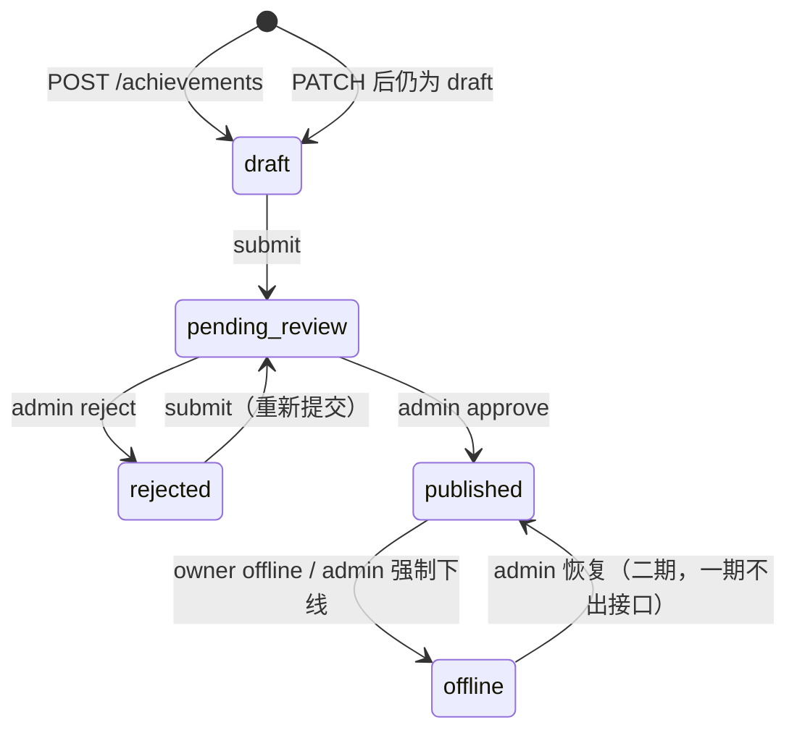
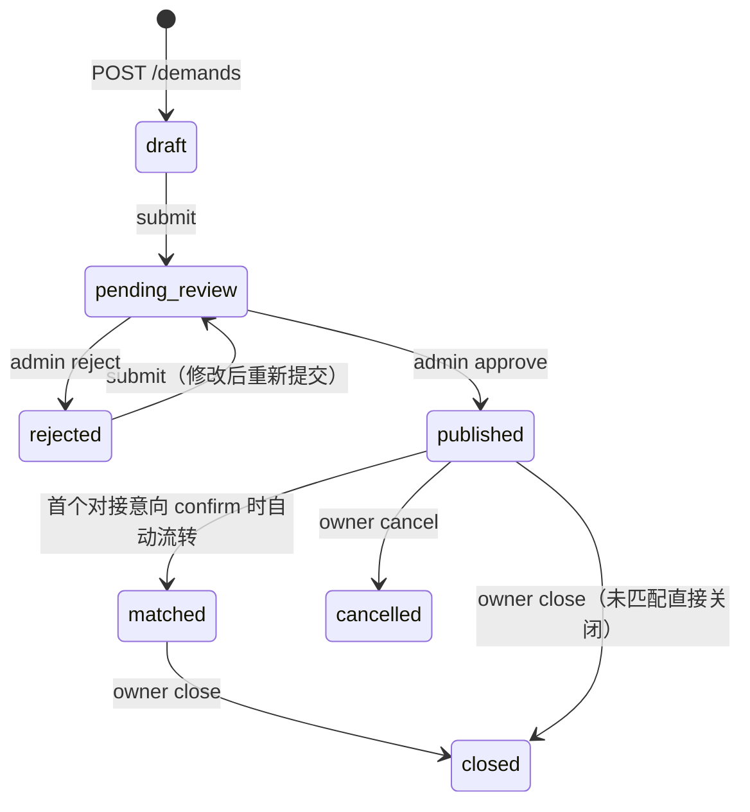
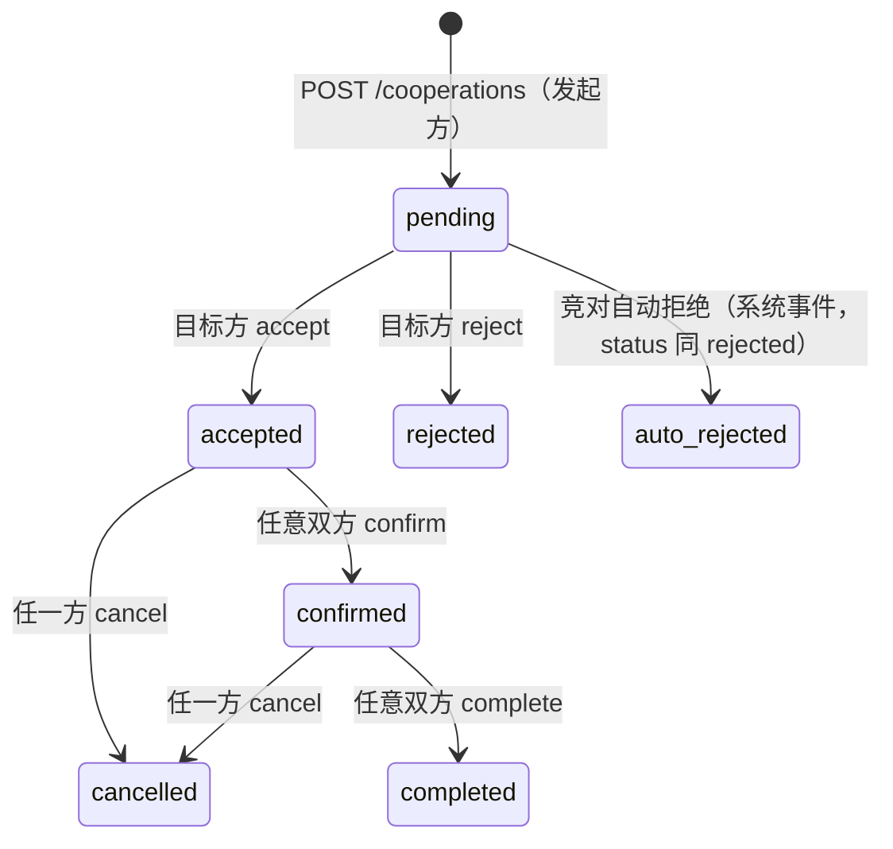
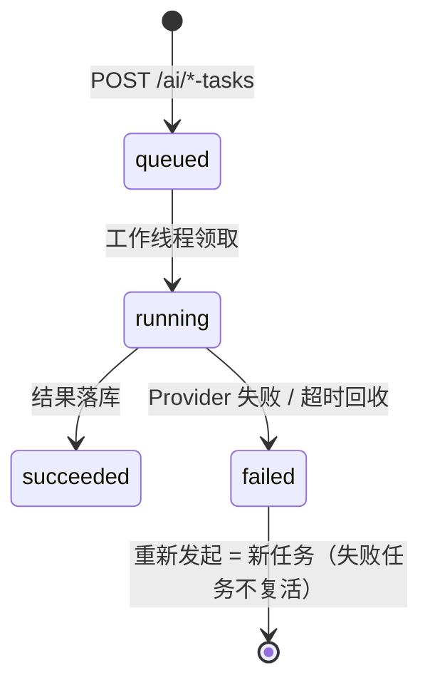

# 06 · API 设计（API Design）

> 文档状态：基线版
> 统一前缀：`/api/tech-transfer/v1`（下文路径省略前缀）
> 机器契约：`openapi.yaml`（OpenAPI 3.1，与本文逐路径对齐；冲突时以本文修订后再同步 yaml）
> 阅读前提：`02`（身份与环境）、`04`（模块）、`05`（表结构）

---

## 1. 总则

1. **同构双环境**：本地（LocalAdapter → `http://127.0.0.1:8787`）与正式（AiNanshanAdapter → 上级网关）访问**完全相同的路径、请求与响应结构**。宿主差异只体现在凭证获取方式（ADR-001）。
2. **版本策略**：路径版本 `/v1`。不兼容变更升 `/v2` 并保留 `/v1` 至少 6 个月；兼容性变更（新增可选字段/枚举值）不升版本。
3. **传输**：正式环境仅 HTTPS；本地开发允许 HTTP。
4. **现网接口迁移**：现有 Flask 三接口（`/api/platform-base`、`/api/service-orgs`、`/api/invest-orgs`）平移至本文资本资源组，响应包字段 `msg` 统一为 `message`（01 §6）；旧路径保留至阶段 D 结束返回 301。

## 2. 通用规范

### 2.1 认证头与会话生命周期（冻结评审后修订）

```http
Authorization: Bearer <accessToken>
```

双 token 模型（冻结评审决议，2026-09-02）：

| token | 形态 | 有效期 | 校验方式 |
|-------|------|--------|----------|
| accessToken | JWT HS256（sub=app_user.id） | 2 小时 | 无状态签名校验，无黑名单 |
| refreshToken | JWT HS256 + jti | 14 天 | 服务端 `auth_session` 表（active/revoked），可吊销、刷新时轮换 |

- 两者均由 `POST /auth/bootstrap` 签发；`POST /auth/refresh` 用 refreshToken 换新（旧 jti 一次性消费并吊销）；
- accessToken 过期返回 401 `TT_COMMON_40102`，前端**静默 refresh 一次**（每请求链路最多一次），仍失败则重走 bootstrap；
- `POST /auth/logout` 吊销 refreshToken；accessToken 2h 内自然过期（无黑名单，明示接受的无状态取舍）；
- 资本资源组等公开只读接口可不带 token（见各接口"认证"行）。`GET /achievements/{id}/evaluations` **已改为需登录**（冻结评审决议，见 §7）。

### 2.2 通用请求头

| 头 | 必填 | 说明 |
|----|------|------|
| `X-Request-ID` | 服务端强制生成；客户端可传 | 链路 ID。客户端传则透传（ULID 格式），不传服务端生成并回写响应；日志、audit_log、external_api_log 全部关联此值 |
| `X-Idempotency-Key` | **仅 6 个创建类接口必填**（见 2.2.1 矩阵） | 幂等键（ULID）。同一键 + 同一请求体 → 重复请求返回首次结果；同键不同请求体 → 409 `TT_IDEM_40901`。键有效期 24h；缺失时必填接口返回 400 `TT_COMMON_40001` |
| `Content-Type` | 有体时 | `application/json; charset=utf-8`（上传 complete 除外） |

#### 2.2.1 幂等键矩阵（冻结评审决议）

| 接口类别 | X-Idempotency-Key | 幂等性来源 |
|----------|-------------------|-----------|
| 创建类（POST /achievements、/demands、/cooperations、/ai/match-tasks、/ai/evaluation-tasks、/uploads/presign） | **必填** | 服务端按键缓存首次结果 24h |
| 状态流转类（submit/offline/cancel/close/accept/reject/confirm/complete/admin approve/reject） | 不要求 | 状态机前置校验：重复请求返回 409 `TT_*_40901` |
| PUT /favorites、DELETE /favorites | 不要求 | 天然幂等（唯一约束 user+target 兜底） |
| PATCH /me/profile、/achievements/{id}、/demands/{id} | 不要求 | 天然幂等（同请求体重复提交结果一致）+ 乐观锁 |
| POST /auth/bootstrap、/auth/refresh、/auth/logout | 不要求 | 唯一约束（bootstrap）/ jti 一次性消费（refresh）/ 幂等吊销（logout） |
| POST /uploads/{uploadId}/complete | 不要求 | uploadId 天然幂等，重复返回既有 fileId |
| POST /achievements/{id}/patents | 不要求 | 唯一约束 (achievement_id, patent_id) 兜底，重复挂接返回既有关联 |

### 2.3 分页、排序、筛选（列表接口统一 Query 约定）

| 参数 | 类型 | 默认 | 说明 |
|------|------|------|------|
| `page` | int ≥1 | 1 | 页码 |
| `pageSize` | int 1–50 | 10 | 每页条数，上限 50（防深翻页拖库） |
| `keyword` | string ≤64 | — | 关键词（标题/简介全文匹配，一期 MySQL FULLTEXT/LIKE） |
| `sort` | string | 各接口默认值 | 字段名前缀 `-` 为降序，如 `published_at.desc`；白名单字段见各接口 |
| 组合筛选 | — | — | 各接口自定义（categoryCode / maturityLevel / status 等），均为白名单枚举，非法值返回 `TT_COMMON_40001` |

分页响应模型（`Page<T>`）：

```json
{ "list": [], "page": 1, "pageSize": 10, "total": 223 }
```

### 2.4 字段命名与数据格式

| 规则 | 示例 |
|------|------|
| 命名 | camelCase（`maturityLevel`、`orgName`），与 05 表 snake_case 一一映射 |
| 时间 | ISO 8601 UTC：`2026-09-02T12:30:00Z`；纯日期字段（expectDeadline/applyDate）`2026-09-02` |
| 金额 | 数值，单位万元，最多 2 位小数（`priceMinWan: 60`）；"面议" → `budgetNegotiable: true` + 两金额字段 null |
| 评分 | 数值 0.0–100.0，1 位小数 |
| 空值 | 一律返回 null，**不返回空串/0 冒充缺失**；数组无值返回 `[]`；姓名为 null 时前端显示"未填写"（ADR-002 规则 3） |
| 枚举 | 字符串代码，取值即 05 各表枚举 |
| 布尔 | true/false |

### 2.5 成功与失败响应包

成功（HTTP 2xx）：

```json
{ "code": 0, "message": "ok", "data": {}, "requestId": "01J8Z9G2K5Q3X8V7M6N4P5R2T6" }
```

失败（HTTP 4xx/5xx）：

```json
{ "code": "TT_DEMAND_40901", "message": "当前需求状态不允许取消", "details": { "currentStatus": "matched" }, "requestId": "01J8Z9G2K5Q3X8V7M6N4P5R2T6" }
```

- **前端只允许依据 `code`（稳定错误码）分支**，禁止解析 `message`（中文文案可随时调整）；
- `details` 为结构化补充（如乐观锁冲突返回当前 version），可为 null；
- 服务端 5xx 响应体不含堆栈、SQL 状态等内部细节（修 01 §6 S5）。

### 2.6 乐观锁

- 带状态资源（achievement/demand/cooperation_intent）的 PATCH 与状态流转接口：请求体携带 `version`（GET 时返回）；
- 不匹配 → 409 `TT_COMMON_40902`，details 返回服务端当前 `version`，前端提示刷新后重试；
- 状态流转接口（submit/offline/accept 等）同样校验 version，防止双开页面并发操作。

### 2.7 限流、重试、超时、熔断

| 项 | 策略 |
|----|------|
| 限流 | 按用户维度令牌桶：读 60 次/分钟，写 20 次/分钟；AI 任务创建 5 次/小时；超限 429 `TT_COMMON_42901`（Retry-After 头）。一期进程内实现，触发量级后迁 Redis（02 §9） |
| 重试 | 前端仅对**幂等 GET** 与带 `X-Idempotency-Key` 的写重试，最多 2 次，指数退避（1s/4s）；网络错误与 5xx 可重试，4xx 不重试 |
| 超时 | 前端请求超时 10s；AI 同步等待类接口（无）——AI 一律异步任务制 |
| 熔断 | 服务端对 AiProvider/PatentProvider：10 分钟窗口错误率 > 50% 熔断 5 分钟，期间直接返回降级错误码（`TT_AI_50301`/`TT_PATENT_50301`），不发起外部调用；熔断事件写 external_api_log |

## 3. 认证与授权模型

| 层 | 机制 |
|----|------|
| 认证（你是谁） | bootstrap 交换会话 token；每请求认证中间件解析 → IdentityContext（ADR-002 §2.2） |
| 授权（你能干什么） | RBAC（user_role：user/admin）+ 资源归属校验（owner/被发起方）+ 可见性规则（draft 仅本人） |
| 数据权限注入 | owner 类字段一律服务端从 IdentityContext 注入；请求体携带的 `ownerUserId`/`userId` 被忽略并记告警日志 |

## 4. 错误码总表

格式 `TT_<域>_<HTTP前三位><序号>`。**一经发布即冻结，只增不改义**。

| 错误码 | HTTP | 含义 |
|--------|------|------|
| TT_COMMON_40001 | 400 | 参数校验失败（details.field 指明字段） |
| TT_COMMON_40101 | 401 | 会话凭证缺失或无效（仅受保护接口；与 bootstrap 阶段的 40103 分域，冻结评审澄清） |
| TT_COMMON_40102 | 401 | accessToken 过期（前端静默 POST /auth/refresh 一次，仍失败重走 bootstrap） |
| TT_COMMON_40301 | 403 | 已认证但无权限 |
| TT_COMMON_40401 | 404 | 资源不存在或不可见（不区分两者，防探测） |
| TT_COMMON_40902 | 409 | 乐观锁版本冲突 |
| TT_COMMON_42901 | 429 | 触发限流 |
| TT_COMMON_50001 | 500 | 服务内部错误 |
| TT_IDEM_40901 | 409 | 幂等键冲突（同键不同体） |
| TT_AUTH_40103 | 401 | bootstrap/refresh 阶段宿主凭证或 refreshToken 无效（**仅用于 POST /auth/bootstrap、POST /auth/refresh**；与会话级 40101/40102 分域，冻结评审澄清） |
| TT_ACH_40301 | 403 | 非成果所有者 |
| TT_ACH_40401 | 404 | 成果不存在 |
| TT_ACH_40901 | 409 | 成果状态不允许该操作 |
| TT_DMD_40301 | 403 | 非需求所有者 |
| TT_DMD_40401 | 404 | 需求不存在 |
| TT_DMD_40901 | 409 | 需求状态不允许该操作 |
| TT_FAV_40401 | 404 | 收藏目标不存在 |
| TT_COOP_40001 | 400 | 不能对自己发布的内容发起对接 |
| TT_COOP_40301 | 403 | 无权操作该意向（非双方/admin） |
| TT_COOP_40401 | 404 | 意向不存在 |
| TT_COOP_40901 | 409 | 意向状态不允许该操作 |
| TT_COOP_40902 | 409 | 已存在活跃意向（防重复提交） |
| TT_AI_40401 | 404 | AI 任务不存在 |
| TT_AI_40301 | 403 | 无权查看该任务 |
| TT_AI_42901 | 429 | AI 任务创建频率超限 |
| TT_AI_50201 | 502 | AI Provider 调用失败（任务已置 failed，可重新发起） |
| TT_AI_50301 | 503 | AI 能力未配置或熔断中 |
| TT_PATENT_40401 | 404 | 专利不存在 |
| TT_PATENT_50301 | 503 | 专利服务不可用或熔断中（成果详情主体照常返回，patents 为空） |
| TT_FILE_40401 | 404 | 上传单不存在 |
| TT_FILE_40901 | 409 | 上传未完成/校验失败 |
| TT_FILE_50301 | 503 | 上传通道不可用 |
| TT_ADMIN_40301 | 403 | 非管理员 |
| TT_ADMIN_40001 | 400 | 审核驳回必须填写原因 |

## 5. 状态机设计

### 5.1 成果（achievement.status）



### 5.2 需求（demand.status）



### 5.3 对接（cooperation_intent.status）



> auto_rejected 不是独立状态，是 `rejected` + cooperation_event.event_type=`auto_rejected`（对方已接受其他意向）。

### 5.4 AI 任务（ai_task.status）



### 5.5 状态流转操作权限矩阵

| 操作 | 接口 | 允许角色 | 前置状态 | 目标状态 |
|------|------|----------|----------|----------|
| 成果提交 | submit | owner | draft / rejected | pending_review |
| 成果下线 | offline | owner / admin | published | offline |
| 成果审核通过 | admin approve | admin | pending_review | published |
| 成果驳回 | admin reject | admin | pending_review | rejected |
| 需求提交 | submit | owner | draft / rejected | pending_review |
| 需求取消 | cancel | owner | published | cancelled |
| 需求关闭 | close | owner | published / matched | closed |
| 需求审核通过/驳回 | admin approve/reject | admin | pending_review | published / rejected |
| 意向接受 | accept | 目标方 | pending | accepted |
| 意向拒绝 | reject | 目标方 | pending | rejected |
| 意向确认 | confirm | 双方 | accepted | confirmed（并触发需求 matched） |
| 意向取消 | cancel | 双方 | accepted / confirmed | cancelled |
| 意向完成 | complete | 双方 | confirmed | completed |

**全部状态流转由后端校验（上表即校验规则），前端按钮只是引导；非法流转一律 409 + 对应 `TT_*_40901`。**

---

## 6. 身份与当前用户组

#### POST /auth/bootstrap —— 宿主凭证换取科转通会话

| 项 | 值 |
|----|-----|
| 认证 | 无（本接口是认证入口） |
| 角色 | 任意持有宿主凭证者 |
| operationId | `bootstrapSession` |
| 请求头 | `X-Request-ID` |
| 请求体 | `{ "hostCredential": "..." }`（LocalAdapter=本地票据如 `local-dev-ticket-dev-user-001`；AiNanshanAdapter=上级 token/一次性票据，格式待 08 C-01） |
| 成功 | 200 `data: { "accessToken": "...", "refreshToken": "...", "expiresIn": 7200, "user": { ...UserProfile }, "isNewUser": true }` |
| 错误 | 401 TT_AUTH_40103（宿主凭证无效） |
| 幂等 | 天然幂等（UNIQUE(issuer, tenant_id, external_subject) 兜底"查或建"，并发首登冲突重查）；不要求 X-Idempotency-Key |
| 数据权限 | — |
| 状态机 | — |
| 异步 | 否 |
| 审计 | 是（首次建档 audit action=`identity.bootstrap`） |
| 前端页面 | App 启动 + mine.vue（登录态初始化） |

#### POST /auth/refresh —— 刷新会话（冻结评审新增）

| 项 | 值 |
|----|-----|
| 认证 | 无（用 refreshToken 而非 accessToken） |
| 角色 | 任意持有效 refreshToken 者 |
| operationId | `refreshSession` |
| 请求体 | `{ "refreshToken": "..." }` |
| 成功 | 200 `data: BootstrapResult`（新 accessToken + 轮换的新 refreshToken；isNewUser 恒 false） |
| 错误 | 401 TT_AUTH_40103（refreshToken 无效/已吊销/已消费/过期） |
| 幂等 | jti 一次性消费（重复用旧 refreshToken 返回 401） |
| 审计 | 否（会话续期不入审计） |
| 前端页面 | API 层统一处理（页面无感） |

#### POST /auth/logout —— 注销会话（冻结评审新增）

| 项 | 值 |
|----|-----|
| 认证 | 需登录 |
| 角色 | user |
| operationId | `logout` |
| 请求体 | `{ "refreshToken": "..." }`（吊销当前会话的 refreshToken） |
| 成功 | 200 `data: { "revoked": true }`（重复吊销同一 token 幂等返回 200） |
| 错误 | 401 TT_COMMON_40101/40102（accessToken 校验失败） |
| 幂等 | 幂等吊销 |
| 审计 | 是（identity.logout） |
| 前端页面 | mine.vue（退出登录；accessToken 2h 内自然过期，无黑名单——明示取舍） |

#### GET /me —— 当前用户信息

认证：需登录；角色：user。Query/请求体：无。成功 200 `data: { userId, userNo, displayName, userType, phone, email, orgId, orgName, orgTitle, roles }`（displayName 为 null 前端显示"未填写"）。错误：401 TT_COMMON_40101/40102。幂等（读）。审计：否。页面：mine.vue。

#### PATCH /me/profile —— 更新资料

认证：需登录；角色：user。请求体：`{ displayName?, userType?, phone?, email?, orgId?, orgTitle?, version }`（version 必填）。成功 200 `data: UserProfile`。错误：400 TT_COMMON_40001 / 409 TT_COMMON_40902。幂等：天然幂等（同请求体重复提交结果一致），不要求 X-Idempotency-Key（冻结评审修订，原"可选"废止）。数据权限：仅本人。审计：是（手机/邮箱变更记录 before/after 脱敏快照）。页面：mine.vue。

#### GET /me/demands、GET /me/achievements、GET /me/favorites、GET /me/cooperations

认证：需登录；角色：user。Query：分页 + `status`（可选过滤）+ `role=initiator|target`（仅 cooperations，默认 both）。成功 200 `data: Page<相应 Summary>`。favorites 支持必填 Query `targetType=achievement|demand`。数据权限：强制限定 owner=当前用户（服务端注入，忽略任何前端 user 过滤参数）。审计：否。页面：my-list.vue、mine.vue。

---

## 7. 成果组

#### GET /achievements —— 成果列表

| 项 | 值 |
|----|-----|
| 认证 | 需登录 |
| 角色 | user |
| Query | 分页 + keyword / categoryCode / maturityLevel / `includeMine=true|false`（默认 false：仅 published；true 时附带本人 draft/pending_review/rejected/offline 并标 `isMine`）/ sort（白名单：`published_at.desc`默认、`created_at.desc`、`view_count.desc`） |
| 成功 | 200 `data: Page<AchievementSummary>`（含 id/title/orgName/categoryName/maturityLevel/maturityDesc/priceMinWan/priceMaxWan/pricingMode/applicationFields/tags/status/isMine/viewCount） |
| 错误 | 400 TT_COMMON_40001 / 429 TT_COMMON_42901 |
| 幂等 | 读幂等 |
| 数据权限 | includeMine=false → 仅 status=published；true → published + 本人各状态 |
| 状态机 | 无 |
| 审计 | 否 |
| 页面 | index.vue（成果 Tab）、search.vue、my-list.vue |

#### GET /achievements/{id} —— 成果详情

认证：需登录。Path：id。成功 200 `data: AchievementDetail`（Summary 字段 + techIntro/techRoute/innovationPoints/inventors[]（name/orgName/personType/sortOrder）/contact*（脱敏规则：仅 owner、已 confirmed 意向对方、admin 可见完整手机号；其余 `138****1111`）/patents[]（可空+降级标记）/latestEvaluation/publishedAt）。错误：404 TT_ACH_40401（含"不可见"情形——draft 非本人访问同样 404，防探测）。幂等：读。审计：**是**（完整联系方式展示给非 owner 时记 sensitive_view）。页面：dock-detail.vue（成果态）。

#### POST /achievements —— 创建成果

| 项 | 值 |
|----|-----|
| 认证 | 需登录 |
| 角色 | user |
| 请求体 | `{ title*, categoryId, orgId, techIntro, techRoute, maturityLevel*, applicationFields[], innovationPoints[], pricingMode*, priceMinWan, priceMaxWan, contactName..., tags[], inventorRefs[], mediaFileIds[] }`（`*` 必填；**不含 ownerUserId——传入即忽略并告警**） |
| 成功 | 201 `data: AchievementDetail`（status=draft） |
| 错误 | 400 TT_COMMON_40001 / 429 TT_COMMON_42901 |
| 幂等 | **X-Idempotency-Key 必填**（防双击重复发布；无键的重复提交由限流兜底） |
| 数据权限 | owner=IdentityContext 注入 |
| 状态机 | 创建即 draft |
| 异步 | 否 |
| 审计 | 是（achievement.create） |
| 页面 | post-result.vue |

#### PATCH /achievements/{id} —— 编辑成果

认证：需登录；角色：**owner only**（403 TT_ACH_40301）。请求体：POST 可选字段子集 + `version*`。前置状态：**draft / rejected**（published 编辑需先 offline，一期不允许——409 TT_ACH_40901）。成功 200 `data: AchievementDetail`。幂等：天然幂等 + 乐观锁，不要求 X-Idempotency-Key（冻结评审修订）。审计：是。页面：post-result.vue（编辑态）。

#### POST /achievements/{id}/submit —— 提交审核

认证：owner only。请求体：`{ version* }`。前置：draft/rejected。成功 200 `data: { status: "pending_review" }`。错误：403/404/409。幂等：状态机校验保证（重复请求 409 TT_ACH_40901）。审计：是（状态流转）。页面：post-result.vue、my-list.vue。

#### POST /achievements/{id}/offline —— 下线

认证：owner 或 admin（admin 走 admin 组接口）。请求体：`{ version*, reason? }`。前置：published。成功 200 `data: { status: "offline" }`。幂等：状态机校验保证（重复请求 409）。审计：是。页面：my-list.vue。

#### GET /achievements/{id}/evaluations —— 成果评估历史

认证：**需登录**（冻结评审决议：评估结果是平台模型对成果的商业化判断，属增值输出，不开放匿名访问防爬取；任意认证用户可看，一期不限 owner。原"公开只读"设计废止）。成功 200 `data: Page<AchievementEvaluation>`（含 totalScore/四维分/summary/modelVersionLabel/createdAt）。错误：401 TT_COMMON_40101/40102 / 404 TT_ACH_40401。页面：ai-eval-detail.vue、dock-detail.vue。

#### GET /achievements/{id}/patents —— 成果专利列表

认证：需登录。成功 200 `data: { patents: [PatentSummary], degraded: false }`；**PatentProvider 故障时：200 + `patents: []` + `degraded: true` + 响应头 `X-Deprecation: TT_PATENT_50301`**（详情主体不失败，02 §10）。页面：dock-detail.vue（成果态）。

#### POST /achievements/{id}/patents —— 挂接专利

认证：成果 owner only。请求体：`{ patentId* }` 或 `{ publicationNo*, title*, patentType*, applyDate? }`（后者为"检索无果时手工建档"，建档同时关联）。幂等：唯一约束兜底（重复挂接返回既有关联 200）。错误：404 TT_PATENT_40401 / 409 TT_ACH_40901（成果非 published/draft 时禁止变更关联）。审计：是。页面：post-result.vue（专利管理）。

#### DELETE /achievements/{id}/patents/{patentId} —— 解除关联

认证：成果 owner only。幂等：是（已解除返回 204）。审计：是。页面：post-result.vue。

---

## 8. 需求组

#### GET /demands —— 需求列表

同成果列表模式：Query = 分页 + keyword / categoryCode / `includeMine` / sort（published_at.desc 默认）。成功 200 `Page<DemandSummary>`（id/title/orgName/region/coopMode/budgetMinWan/budgetMaxWan/budgetNegotiable/deadlineDesc/categoryName/tags/status/isMine）。页面：index.vue（需求 Tab）、search.vue、my-list.vue。

#### GET /demands/{id} —— 需求详情

认证：需登录。成功 200 `DemandDetail`（Summary + description/expectDeadline/contact*（脱敏同成果）/orgIntro/matchedAt）。404 含不可见。审计：敏感联系方式可见时记 sensitive_view。页面：dock-detail.vue（需求态）。

#### POST /demands —— 创建需求

认证/角色/幂等/审计：同 POST /achievements。请求体：`{ title*, categoryId, orgId, orgName, orgIntro, categoryName, description*, region, coopMode[], budgetMinWan, budgetMaxWan, budgetNegotiable, expectDeadline, deadlineDesc, contactName..., tags[], attachmentFileIds[] }`（orgName/orgIntro/categoryName 为过渡期便捷字段：服务端按名称 get-or-create organization/demand_category 后落 org_id/category_id，映射规则同 §12.2 演示数据，供无 ID 选择器的小程序表单使用）。成功 201（status=draft）。页面：post-demand.vue。

#### PATCH /demands/{id} —— 编辑需求

owner only + 前置 draft/rejected + version。页面：post-demand.vue（编辑态）。

#### POST /demands/{id}/submit —— 提交审核

owner only，前置 draft/rejected。幂等：状态机校验保证（重复请求 409）。页面：post-demand.vue、my-list.vue。

#### POST /demands/{id}/cancel —— 取消发布

owner only，**前置 published**（draft 直接删除走 PATCH 置删除或 DELETE 草稿接口——一期用 cancel 语义收窄：draft 不可 cancel）。请求体 `{ version* }`。错误：TT_DMD_40901（如 matched 状态不允许取消）。页面：my-list.vue。

#### POST /demands/{id}/close —— 关闭需求

owner only，前置 published/matched。页面：my-list.vue。

#### GET /demands/{id}/matches —— 需求的 AI 匹配结果

认证：需登录；数据权限：owner 或 admin（匹配结果是发布方私有工作台数据）。Query：分页。成功 200 `Page<MatchItem>`（achievementId/achievementTitle/orgName/score/matchReasons/modelVersionLabel）。错误：403 TT_DMD_40301。页面：ai-match.vue（结果面板）、my-list.vue。

---

## 9. 收藏组

#### PUT /favorites/{targetType}/{targetId}

认证：需登录。Path：targetType ∈ {achievement, demand}（白名单，非法 400）、targetId。成功 200 `data: { id, favoritedAt }`（**重复 PUT 幂等返回既有记录**，唯一约束兜底）。错误：404 TT_FAV_40401（目标不存在/不可见）。审计：否（关系数据）。页面：index.vue、dock-detail.vue。

#### DELETE /favorites/{targetType}/{targetId}

认证：需登录。幂等：是（已取消返回 204）。页面：my-list.vue、dock-detail.vue。

#### GET /me/favorites

认证：需登录。Query：`targetType*` + 分页。成功 200 `Page<FavoriteItem>`（内嵌目标 Summary + 目标当前 status——已下线目标仍返回并标注）。页面：my-list.vue（收藏 Tab）。

---

## 10. 对接组

#### POST /cooperations —— 发起对接意向

| 项 | 值 |
|----|-----|
| 认证 | 需登录 |
| 角色 | user |
| 请求体 | `{ targetType* ∈ {achievement, demand}, targetId*, message ≤1000 }`（**不含 initiatorUserId**） |
| 成功 | 201 `data: CooperationIntent`（status=pending） |
| 错误 | 400 TT_COOP_40001（对自己内容发起）/ 404 TT_ACH_40401 或 TT_DMD_40401（目标不存在或未发布）/ 409 TT_COOP_40902（已有活跃意向） |
| 幂等 | **Idempotency-Key 必填**（活跃意向唯一约束 + 幂等键双保险） |
| 数据权限 | initiator 服务端注入；目标必须 status=published |
| 状态机 | 创建即 pending |
| 异步 | 否 |
| 审计 | 是（coop.create + cooperation_event created） |
| 页面 | dock-detail.vue（意向表单） |

#### GET /cooperations/{id} —— 意向详情

认证：需登录；数据权限：**initiator / target_owner / admin**（其他人 404 TT_COOP_40401）。成功 200 `CooperationIntentDetail`（含对方 display_name、目标摘要、当前状态、时间线摘要）。页面：dock-detail.vue、my-list.vue（意向 Tab）。

#### POST /cooperations/{id}/accept | reject | confirm | cancel | complete —— 状态流转

统一模板（差异项列表如下）：

| 项 | accept | reject | confirm | cancel | complete |
|----|--------|--------|---------|--------|----------|
| 允许角色 | 目标方 | 目标方 | 双方 | 双方 | 双方 |
| 前置状态 | pending | pending | accepted | accepted/confirmed | confirmed |
| 请求体 | version* | version* + reason* | version* | version* + reason | version* + remark? |
| 成功 | 200 status=accepted | 200 status=rejected | 200 status=confirmed（**同时触发目标需求 matched**） | 200 status=cancelled | 200 status=completed |
| 副作用 | **同目标其他 pending 意向自动拒绝**（event=auto_rejected，事务内） | — | 需求 status→matched（若目标为 demand） | — | — |
| 通知 | 通知发起方 | 通知发起方 | 通知对方 | 通知对方 | 通知对方 |

公共：认证需登录；幂等：状态机校验保证（重复请求 409 TT_COOP_40901），不要求 X-Idempotency-Key（冻结评审修订）；错误 403 TT_COOP_40301 / 404 / 409 TT_COOP_40901；审计是（cooperation_event + audit_log）；页面 dock-detail.vue、my-list.vue。

#### GET /cooperations/{id}/events —— 事件时间线

认证：同意向详情权限。成功 200 `Page<CooperationEvent>`（event_type/fromStatus/toStatus/operatorRole/remark/createdAt；operator 身份仅显示角色不显示姓名——保护双方）。页面：dock-detail.vue（时间线区块）。

---

## 11. 搜索与 AI 组

#### GET /search —— 统一搜索

认证：需登录。Query：`q*` + `type=achievement|demand|all`（默认 all）+ categoryCode + maturityLevel + 分页。成功 200 `data: { achievements: Page<AchievementSummary>, demands: Page<DemandSummary> }`（type=all 时各返回前 pageSize 条）。数据权限：仅 published + includeMine 同成果列表语义。页面：search.vue。**搜索历史仍存前端本地缓存（纯 UI 状态，不建后端表——05 §5.1）。**

#### POST /ai/match-tasks —— 创建需求匹配任务

| 项 | 值 |
|----|-----|
| 认证 | 需登录；数据权限：需求 owner only |
| 请求体 | `{ demandId* }` |
| 成功 | 202 `data: { taskId, status: "queued" }` |
| 错误 | 403 TT_DMD_40301 / 404 / 429 TT_AI_42901 / 503 TT_AI_50301（未配置/熔断） |
| 幂等 | **Idempotency-Key 必填**；且服务端限流：同一需求 10 分钟内重复创建直接返回进行中任务（200 而非重复排队） |
| 异步 | **是**（任务制；前端轮询 GET） |
| 审计 | 是（ai.task.create；AiProvider 调用写 external_api_log） |
| 页面 | ai-match.vue |

#### GET /ai/match-tasks/{taskId} —— 查询匹配任务

认证：任务创建者。成功 200 `data: { taskId, status, results?: [MatchItem], failReason?, createdAt, finishedAt, modelVersionLabel, inputDataVersion }`（status=queued/running 时 results 为 null）。页面：ai-match.vue。

#### POST /ai/evaluation-tasks —— 创建成果评估任务

认证：需登录；数据权限：**成果 owner only**（评估触发权归成果方，结果公开可见）。请求体 `{ achievementId* }`。成功 202 `{ taskId, status: "queued" }`。幂等同上（同成果 10 分钟窗口）。异步：是。错误含 TT_AI_50301。**正式模式禁止假评分回退（04 §5.2）**。页面：post-result.vue（评估入口）、my-list.vue。

#### GET /ai/evaluation-tasks/{taskId} —— 查询评估任务

认证：任务创建者。成功 200 `{ taskId, status, evaluation?: { 四维分/totalScore/summary/suggestions/modelVersionLabel/inputDataVersion }, failReason? }`。页面：ai-eval-detail.vue。

## 12. 资本资源组（平移自现网 Flask 三接口）

| 接口 | 认证 | Query | 数据源表 | 页面 |
|------|------|-------|----------|------|
| GET /capital/platforms | **无需登录**（公开数据） | 分页 + `type=poc\|pilot\|all` + keyword | capital_platform | capital-list.vue（概念验证/中小试） |
| GET /capital/platforms/{id} | 无需登录 | — | capital_platform | capital-list.vue（详情弹层） |
| GET /capital/investment-organizations | 无需登录 | 分页 + keyword | capital_organization (kind=invest) | capital-list.vue（投资机构） |
| GET /capital/financial-organizations | 无需登录 | 分页 + keyword | capital_organization (kind=financial) | capital-list.vue（银行融资） |
| GET /capital/service-organizations | 无需登录 | 分页 + keyword | capital_organization (kind=service) | capital-list.vue（服务机构） |

成功结构沿用现列表字段（name/intro/logoUrl——改为经 `GET /files/{fileId}/url` 的稳定代理地址/detailInfo 详情正文）。幂等：读。审计：否。**现接口 `msg` 字段名迁移为 `message`（§1.4）。**

## 13. 专利组

| 接口 | 认证 | 说明 |
|------|------|------|
| GET /patents | 需登录 | Query：分页 + `keyword*`（公开号/名称）+ patentType + legalStatus。数据源：patent 表 + PatentProvider（一期优先本地，miss 再查 Provider 并落库 source=provider） |
| GET /patents/{id} | 需登录 | 专利详情 + 年费计算结果（`annualFees[]` 按 patent-fee.js 迁移的服务端费率规则 + `latestPayDate`） |

Provider 故障：GET /patents 退化为仅本地库命中（响应头 X-Deprecation: TT_PATENT_50301）；详情页主体可用。页面：post-result.vue（挂接专利搜索）、fee-detail.vue。

## 14. 文件组

#### POST /uploads/presign —— 申请上传

认证：需登录。请求体：`{ fileName*, contentType*（白名单：image/jpeg,png,webp + application/pdf + doc/docx ≤20MB）, fileSize* }`。成功 200 `data: { uploadId, uploadUrl, uploadMethod, expireAt, headers? }`。本地模式：uploadUrl = 本地直传接口；正式模式：上级统一上传或对象存储预签名 URL（待 08 C-04）。幂等：Idempotency-Key 建议（同键同文件返回既有 uploadId）。审计：否。页面：post-result.vue / post-demand.vue（附件选择）。

#### POST /uploads/{uploadId}/complete —— 确认上传完成

认证：需登录（上传者本人）。请求体：`{ contentHash? }`。服务端校验文件存在 + 大小一致 → file_object.status=uploaded。成功 200 `data: { fileId, url }`（fileId 供成果/需求创建引用）。错误：409 TT_FILE_40901（文件缺失/校验失败）。幂等：是（重复 complete 返回既有 fileId）。审计：是（file.upload）。页面：同上。

## 15. 管理审核组

统一：认证需登录 + **角色 admin**（非 admin 403 TT_ADMIN_40301）；写操作幂等由状态机校验保证（重复审核 409），不要求 X-Idempotency-Key（冻结评审修订）；全部记审计。

| 接口 | 说明 |
|------|------|
| GET /admin/achievements/review-queue | Query：分页 + categoryCode。返回 pending_review 成果队列（含提交人、提交时间）。页面：管理后台（一期可先用接口工具/简易页） |
| POST /admin/achievements/{id}/approve | 前置 pending_review → published。请求体 `{ version*, remark? }`。副作用：通知提交人 |
| POST /admin/achievements/{id}/reject | 前置 pending_review → rejected。请求体 `{ version*, reason* }`（**reason 必填，否则 400 TT_ADMIN_40001**）。副作用：通知提交人（含驳回原因） |
| GET /admin/demands/review-queue | 同成果队列 |
| POST /admin/demands/{id}/approve / reject | 同成果审核（approve 副作用：通知提交人 + published） |
| GET /admin/audit-logs | Query：分页 + actorUserId + targetType + requestId + 时间范围。**只读，导出记审计**（sensitive_export） |

## 16. 现有接口 → 目标接口迁移对照

| 现网（Flask app.py） | 目标 | 变化 |
|----------------------|------|------|
| GET /api/health | GET /health/live + /health/ready（不带 /api/tech-transfer 前缀，运维路径） | 拆分存活/就绪（02 §11.3） |
| GET /api/platform-base | GET /capital/platforms | 前缀迁移 + `msg`→`message` + type 参数枚举化 |
| GET /api/service-orgs | GET /capital/service-organizations（=financial） | 同上；现前端两个入口对应 kind=financial/service |
| GET /api/invest-orgs | GET /capital/investment-organizations | 同上 |
| GET /api/file/{file_id} | GET /files/{fileId}/url | 收编 file 模块 + 加频控 |

迁移期策略：阶段 B 起新旧路径并存；capital-list.vue 切换到新前缀并验证后，阶段 D 末下线旧路径。

## 17. 与其他文档的对应

- 本文档全部路径/Schema 的机器可读版：`openapi.yaml`
- 页面 → 接口 → 模块 → 表 的完整联调矩阵：`07-integration-and-testing.md` §2
- 环境硬保护（防 Mock 入生产）：`02-target-architecture.md` §8
