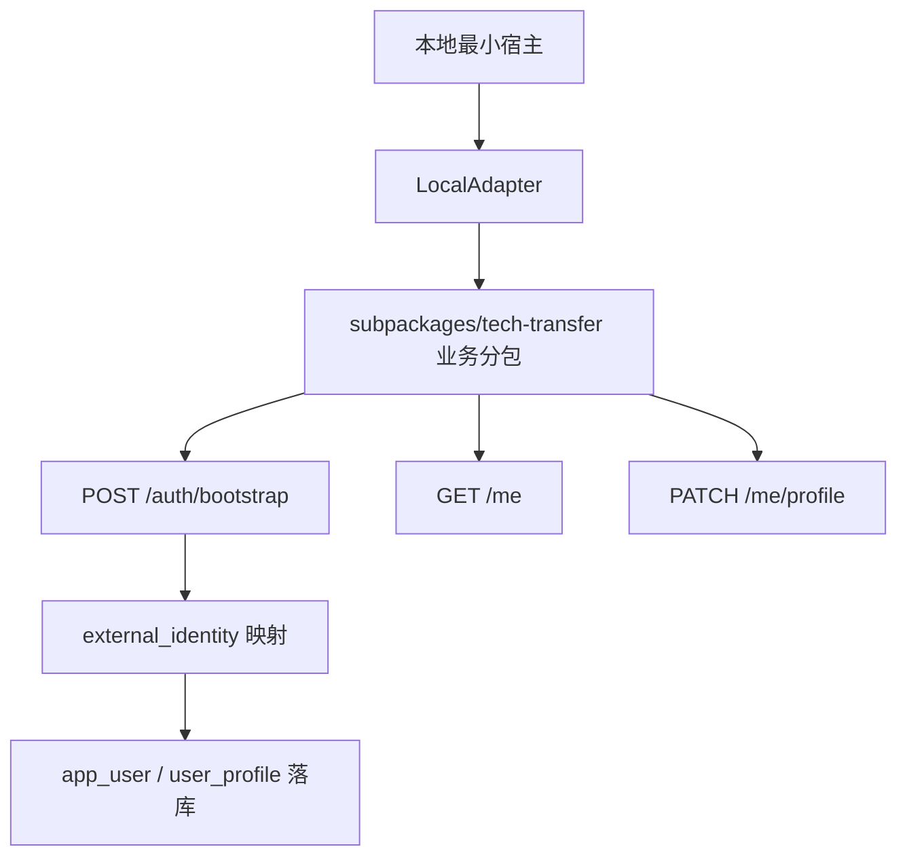

# 10 · 架构冻结评审纪要（Architecture Freeze Review）

> 评审日期：2026-09-02
> 评审范围：阶段 A 全部产出（01–09 文档 + openapi.yaml + 3 份 ADR）
> 评审结论：**通过，冻结**。本文记录冻结决议与收口修订；此后接口契约**只增不改**。
> 后续修订一律走本文末尾"冻结后变更记录"表，禁止直接改写已冻结契约字段语义。

---

## 1. 冻结对象与状态

| 冻结项 | 文档 | 冻结状态 |
|--------|------|----------|
| 双宿主、单业务代码源 | ADR-001 | **已冻结** |
| 本地用户 + 外部身份映射 | ADR-002 | **已冻结** |
| 模块化单体部署 | ADR-003 | **已冻结** |
| 认证基线（bootstrap 交换协议） | 02 §6 + 本文 §3 | **已冻结** |
| API 契约（52 路径 / 58 操作） | openapi.yaml + 06 | **已冻结**（本次收口后） |
| 数据模型（34 表含 auth_session） | 05 | **已冻结**（本次收口后） |

冻结含义：字段名、错误码语义、状态机流转、URL 路径不再变更；**允许新增**接口、字段、错误码、表（新增项须登记在 §8 变更记录）。

## 2. 评审发现的问题与收口决议

### 2.1 OpenAPI 五项收口（本次已全部完成）

| # | 问题 | 决议 | 落点 |
|---|------|------|------|
| F-01 | 56 个操作全部缺失 `operationId` | 补全 58 个（含新增 refresh/logout）；命名规范 camelCase 动词+资源，见 §4 | openapi.yaml 全部操作 |
| F-02 | 幂等键"必填/建议/可选"三种口径混用 | 统一为幂等键矩阵：**仅 6 个创建类接口必填**；状态流转由状态机保证；PATCH/PUT/DELETE 天然幂等；auth 由唯一约束/jti 兜底 | openapi.yaml info.description、XIdempotencyKey 组件、06 §2.2.1 |
| F-03 | `GET /achievements/{id}/evaluations` 原设计匿名可访问 | **改为需登录**（任意认证用户，一期不限 owner）。理由：评估结果是平台模型对成果的商业化判断，属增值输出，匿名开放会被无成本爬取；与平台核心交互均需登录一致。成果列表/详情仍公开 | openapi.yaml（security 收回）、06 §7 |
| F-04 | `TT_AUTH_40102` 与 `TT_COMMON_40102` 混用 | 权威口径以 06 §4 总表为准：**TT_AUTH_40103 仅用于 bootstrap/refresh 阶段**（宿主凭证/refreshToken 无效）；会话级缺失/无效/过期一律 TT_COMMON_40101/40102。文档 06 §2.1 原 `TT_AUTH_40102` 笔误已修正 | 06 §2.1/§4、openapi.yaml responses 组件（Unauthorized 与 BootstrapCredentialInvalid 分域） |
| F-05 | bootstrap 会话 Token 无刷新与注销机制 | **双 token 模型**：accessToken 2h（JWT HS256 无状态）+ refreshToken 14d（jti + auth_session 表可吊销，刷新轮换）；新增 `POST /auth/refresh`、`POST /auth/logout`；logout 吊销 refreshToken，accessToken 无黑名单自然过期（明示取舍） | openapi.yaml 新增 2 路径、06 §2.1/§6、05 §2.6 auth_session 表 |

### 2.2 认证基线（最终版，冻结）

```text
本地宿主生成 Mock 凭证（仅本地/测试环境）
    ↓
POST /auth/bootstrap { hostCredential }
    ↓
后端 IdentityProvider 验证凭证
（AUTH_PROVIDER=mock → MockIdentityProvider；=ainanshan → AiNanshanIdentityProvider）
    ↓
external_identity 映射（UNIQUE issuer+tenant_id+external_subject 查或建）
    ↓
创建/找到 app_user（+ user_profile 一并建档）
    ↓
返回 accessToken(2h) + refreshToken(14d) + user
```

硬性规则（不可违反）：

1. 后续请求只携带科转通 accessToken；**前端不提交、不相信上级 user_id**；
2. `ownerUserId` 等归属字段一律服务端从 IdentityContext 注入，请求体传入即忽略并告警；
3. MockIdentityProvider 在 staging/production 拒绝启动（02 §8.3 硬保护，代码级断言）；
4. external_subject 是机器标识，禁止显示为姓名；displayName 为空显示"未填写"；
5. 手机号、邮箱、姓名不是身份主键，业务表外键一律指向本地 `app_user.id`。

### 2.3 已冻结的三个 ADR

- **ADR-001 双宿主、单业务代码源**：本地最小宿主 + Ai南山宿主共用 `subpackages/tech-transfer`，差异收敛于 HostBridge 适配器；
- **ADR-002 本地用户 + 外部身份映射**：上级身份经 external_identity 映射为科转通 app_user，不复制上级账号、不直接使用上级 user_id 作业务主键；
- **ADR-003 模块化单体**：tech-transfer-service 单进程部署，内部 15 模块分层（基础/领域/编排），禁止跨层依赖与相互依赖，CI 静态扫描。

### 2.4 向上级立即索取清单（不阻塞本地开发，阻塞最终集成）

| 索取项 | 对应确认单 | 最晚确认时点 |
|--------|-----------|-------------|
| 小程序源码及合并规则 | 08 C-08 | 阶段 D 初 |
| Token/票据规范 | 08 C-01、C-03 | 阶段 D 初 |
| 网关身份传递方式 | 08 C-03 | 阶段 D 初 |
| 测试环境和数据库资源 | 08 C-07、C-10 | 阶段 D 初 |

索取动作由项目负责人发起；科转通按 08 默认安全方案先行开发，上级确认后仅调整 AiNanshanAdapter 与网关配置，业务分包不动。

## 3. 收口后的契约状态

| 项 | 冻结值 |
|----|--------|
| 路径数 | 52（50 原有 + /auth/refresh + /auth/logout） |
| 操作数 | 58（operationId 全覆盖，见 §4 命名规范） |
| 错误码 | 06 §4 总表 36 个（含澄清后的 TT_AUTH_40103 适用范围） |
| 幂等键必填接口 | 6 个：POST /achievements、/demands、/cooperations、/ai/match-tasks、/ai/evaluation-tasks、/uploads/presign |
| 匿名可访问接口 | 仅资本资源组 5 个只读接口（+ /auth/bootstrap、/auth/refresh 本身免 accessToken） |
| Token | accessToken 2h / refreshToken 14d 轮换 / logout 可吊销 |

## 4. operationId 命名规范（冻结）

- camelCase，动词开头 + 资源名（单数）或 list 前缀（列表）；
- 状态流转：`动作 + Cooperation/Achievement/Demand`（如 `submitAchievement`、`acceptCooperation`）；
- 认证组：`bootstrapSession` / `refreshSession` / `logout` / `getCurrentUser` / `updateMyProfile` / `listMy*`；
- 完整清单见 openapi.yaml 各操作 `operationId` 字段（前端 SDK 生成与联调以它为准）。

## 5. 冻结后变更规则

1. **只增不改**：新增字段默认可空/带默认值；新增错误码不改旧码语义；新增接口不动旧路径；
2. **破坏性变更**（改字段名/语义/删除）：需新评审，且必须走 `/v2` 前缀或字段双写过渡，禁止原地改；
3. 所有变更登记本文 §8，注明：变更内容、原因、影响面（openapi/06/05/前端/后端）、日期；
4. openapi.yaml 与 06 文档任何一方变更，另一方必须同步提交（校验脚本 `tools/validate_openapi.py` 路径对齐检查强制）。

## 6. 评审遗留事项（不阻塞冻结）

| 事项 | 责任方 | 期限 |
|------|--------|------|
| 08 C-01~C-12 上级确认项逐项回填 | 项目负责人 + 上级团队 | 阶段 D 初前 |
| OpenAPI 正式校验工具（如 redocly）接入 CI | 后端负责人 | 阶段 B 期间（当前用自研脚本校验语法/引用/对齐） |
| operationId 生成前端 SDK 的脚手架选型 | 前端负责人 | 阶段 B 期间 |

## 7. 下一步（阶段 B 第一条垂直链路，评审通过后立即启动）



验收标准：本地宿主进入同一份业务分包；Mock 的仅是上级凭证；用户资料真实写入本地 MySQL；切换测试身份后看不到另一用户数据。实施包拆分与任务分工见 07 §7（8 个独立实施包，首个为"本地宿主、分包和身份链路"）。

## 8. 冻结后变更记录

| 日期 | 变更 | 原因 | 影响面 |
|------|------|------|--------|
| 2026-09-02 | 冻结基线建立（本文档） | 架构冻结评审 | 全部契约文档 |
