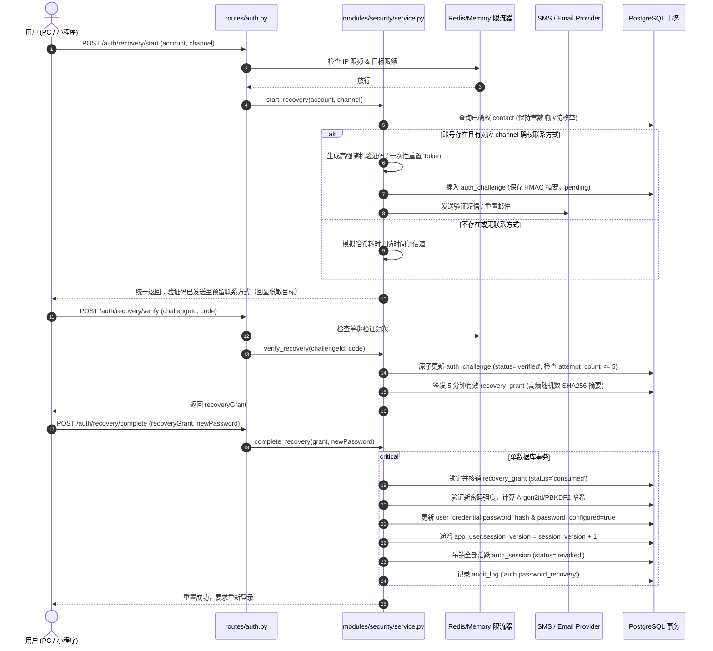

# 南山科转通统一身份安全架构目标设计 (02-target-architecture)

## 1. 架构核心原则

1. **单一用户主体**：
   - 全平台业务体系（成果、需求、对接、收藏、机构成员、管理员权限）始终且唯一以 `app_user.id` 作为外键主体。
   - 所有登录认证渠道（账号密码、手机号密码、短信OTP、邮箱重置、微信小程序、PC微信OAuth2）统一解析并映射到唯一的 `app_user.id`。
   - 严禁因引入新认证方式为同一自然人分流创建独立业务用户。

2. **凭证、资料与安全联系方式的三层物理隔离**：
   - **基础资料层 (`user_profile`)**：存放展示昵称、企业/机构抬头、合作画像等弱安全属性。用户可自主维护，字段变更不改变认证资格。
   - **登录凭证层 (`user_credential` / `external_identity`)**：存放登录用户名、密码哈希（Argon2id / PBKDF2）、微信 OpenID/UnionID 绑定。
   - **确权安全联系方式层 (`account_contact`)**：存放通过双向挑战（OTP / 邮件确认）验证过的手机号与邮箱。只有满足 `status='active' AND verified_at IS NOT NULL` 的联系方式才具备密码恢复和敏感操作核验资格。

3. **双重时效与即时会话失效**：
   - JWT Access Token 携带用户会话版本号 `ver` (`app_user.session_version`)。
   - 发生密码重置、密码修改或强制下线时：
     1. 单事务递增 `app_user.session_version`；
     2. 将用户所有活跃 `auth_session` 标记为 `revoked`；
     3. 立即清理内存/分布式鉴权缓存；
     4. 旧 Access Token 在下一次任何 API 调用时因版本不匹配立即被拒绝 (401)，杜绝传统 JWT“签发即不可撤销”的安全缺陷。

---

## 2. 身份认证与安全架构拓扑图

```
                         ┌──────────────────────────────────────────────┐
                         │                  多端交互入口                  │
                         │   PC Vue 3 后台  /  uni-app 微信小程序  /  H5   │
                         └──────────────────────┬───────────────────────┘
                                                │ (HTTPS / Bearer JWT)
                                                ▼
                         ┌──────────────────────────────────────────────┐
                         │          API 网关 / 路由接入层                │
                         │    routes/auth.py  /  routes/me.py           │
                         └──────┬───────────────────────────────┬───────┘
                                │                               │
                     (限流拦截 / CSRF)                     (Token 解析)
                                ▼                               ▼
                ┌───────────────────────────────┐ ┌───────────────────────────────┐
                │     分布式原子限流器           │ │     身份鉴权与会话版本校验      │
                │  Redis (Lua) + 进程内存滑动窗口 │ │  core/middleware.py (identity)│
                └───────────────────────────────┘ └──────────────┬────────────────┘
                                                                 │
                                ┌────────────────────────────────┘
                                ▼
┌────────────────────────────────────────────────────────────────────────────────────────┐
│                                   业务与安全服务核心层                                   │
│                                                                                        │
│  ┌───────────────────────┐  ┌───────────────────────┐  ┌────────────────────────────┐  │
│  │ modules/identity/     │  │ modules/security/     │  │ modules/security/provider/ │  │
│  │   service.py          │  │   service.py          │  │   SmsProvider              │  │
│  │   - 账号密码登录       │  │   - 联系方式确权绑定   │  │   - TencentSmsProvider     │  │
│  │   - PBKDF2 / Argon2id │  │   - 短信/邮件挑战发起  │  │   - MockSmsProvider        │  │
│  │   - 会话签发与轮转     │  │   - HMAC 挑战原子消费  │  │   EmailProvider            │  │
│  │   - 微信小程序登录绑定 │  │   - Recovery Grant签发│  │   - TencentSesProvider     │  │
│  │   - PC 微信 OAuth2    │  │   - 密码重置与会话吊销 │  │   - MockEmailProvider      │  │
│  └───────────────────────┘  └───────────────────────┘  └────────────────────────────┘  │
└───────────────────────────────────────────┬────────────────────────────────────────────┘
                                            │
                                            ▼ (单个原子事务)
┌────────────────────────────────────────────────────────────────────────────────────────┐
│                              PostgreSQL 统一身份存储引擎                                │
│                                                                                        │
│   app_user           ── (1:1) ──► user_credential (密码哈希/用户名)                      │
│      │               ── (1:1) ──► user_profile (个人展示资料)                           │
│      │               ── (1:N) ──► external_identity (wechat-mini / wechat-web)         │
│      │               ── (1:N) ──► account_contact (已确权安全手机/邮箱)                  │
│      │               ── (1:N) ──► auth_challenge (短信/邮件验证码挑战)                  │
│      │               ── (1:N) ──► recovery_grant (短期单次恢复授权)                     │
│      └───────────────── (1:N) ──► auth_session (RefreshToken 活跃会话)                 │
└────────────────────────────────────────────────────────────────────────────────────────┘
```

---

## 3. 密码找回与重置时序规范



---

## 4. 微信多端统一身份模型

- **小程序端**：`issuer = 'wechat-mini'`, `tenant_id = settings.WECHAT_APPID`, `external_subject = openid`。
- **PC 网页端**：`issuer = 'wechat-web'`, `tenant_id = settings.WECHAT_OPEN_APPID`, `external_subject = web_openid`。
- **跨端打通保障**：微信开放平台返回 `unionid` 时，`external_identity` 将在凭证中保存 `unionid`；仅在 UnionID 经过官方微信接口证实且在同一开放平台主体下时，才允许安全识别为同一自然人，严禁基于昵称或普通手机号自动合流。
