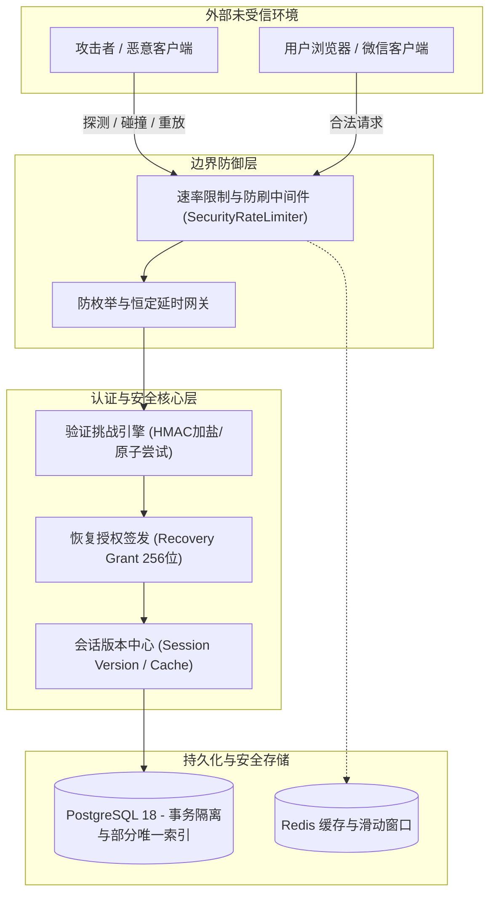
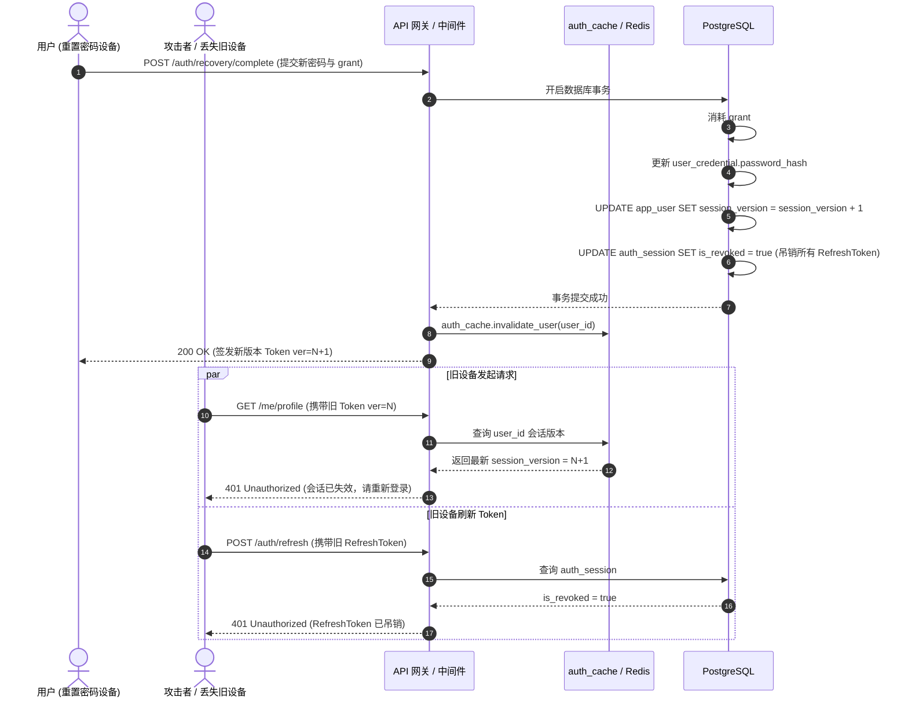

# 南山科转通统一身份认证系统安全威胁模型与防御架构

## 1. 概述与威胁分析方法

本威胁模型遵循 STRIDE 与 OWASP ASVS (Application Security Verification Standard) 4.0 认证与会话管理标准，针对南山科转通统一身份认证系统涉及的身份确权、密码重置、多端会话控制、微信 OAuth 及服务商通道进行系统性安全建模。



---

## 2. 威胁矩阵与防御机制 (STRIDE 分析)

| STRIDE 威胁分类 | 具体攻击场景 | 严重级别 | 平台防御机制 | 实现位置 |
| :--- | :--- | :--- | :--- | :--- |
| **S - 仿冒 (Spoofing)** | 1. 伪造已验证手机号/邮箱重置他人密码<br>2. 伪造微信 OAuth 回调 code/state<br>3. 冒用他人过期或旧 Access Token | **CRITICAL** | 1. 仅限 `account_contact` 中 `verified_at IS NOT NULL` 的联系方式具备重置资格；资料字段 (`user_profile`) 零特权。<br>2. OAuth2 state 采用 256 位 CSPRNG，10 分钟单次使用验证；回调必须通过微信开放平台后端 code exchange。<br>3. JWT payload 携带 `ver` (session_version)，网关与中间件毫秒级版本校验，版本不一致立即拒止 (401)。 | `modules/security/service.py`<br>`modules/identity/wechat_web.py`<br>`core/middleware.py` |
| **T - 篡改 (Tampering)** | 1. 并发请求多次消费同一验证码<br>2. 篡改 Recovery Grant 关联的 userId<br>3. 数据库内明文验证码被内网侧信道窃取 | **HIGH** | 1. 数据库行锁 `FOR UPDATE` + 原子状态迁移 `UPDATE ... SET status='consumed' WHERE status='pending'`。<br>2. Recovery Grant 随机密文字符串不承载明文 payload，服务端仅存 SHA256 摘要，与指定 user_id 严格关联。<br>3. 验证码在数据库存储为 `HMAC-SHA256(secret, challenge_id:purpose:code)`，加盐且不可逆。 | `modules/security/service.py`<br>`migrations/pg/033_unified_account_security.sql` |
| **R - 抵赖 (Repudiation)** | 1. 恶意用户重置他人密码后否认操作<br>2. 冒用他人已注销手机号发起登录 | **MEDIUM** | 1. 全生命周期安全审计日志：每次验证码申请、验证成功、密码重置、会话吊销均记录 `actor_user_id`、`client_ip`、`user_agent`、`destination_fingerprint` 与时间戳。<br>2. 联系方式撤销时记录 `revoked_at`，并在审计日志保留历史证据。 | `routes/auth.py`<br>`routes/me.py`<br>`modules/security/service.py` |
| **I - 信息泄露 (Information Disclosure)** | 1. 账号探测：根据找回密码返回推断用户是否存在<br>2. 手机/邮箱脱敏不规范泄漏用户真实隐私<br>3. 邮件重置链接被邮件网关扫描器预抓取、写入 Referer/服务器访问日志或缓存泄露 Token | **HIGH** | 1. **全链路防枚举 (Anti-Enumeration)**：账号不存在或未绑定有效联系方式时，系统模拟固定范围耗时延时，并返回完全一致的成功响应格式 (`sent: true`)，不泄露任何存在性线索。<br>2. 脱敏策略：手机号保留前 3 后 4 (`138****1234`)，邮箱仅保留首字符与域名 (`a***@example.com`)。<br>3. 邮件重置链接采用 URL Fragment (`#challengeId=...&token=...`) 避免上送服务端日志；`/reset-password` 响应强制下发 `Referrer-Policy: no-referrer` 与 `Cache-Control: no-store`；`ResetPasswordView.vue` 加载零核验请求且立即执行 `window.history.replaceState` 剥离 URL 凭据；`_DropNotFoundAccessLog` 对历史兼容 Query 参数做 `[REDACTED]` 脱敏。 | `modules/security/service.py`<br>`modules/security/email_gateway.py`<br>`app.py`<br>`core/exception_handlers.py`<br>`nanshan-frontend/src/views/auth/ResetPasswordView.vue` |
| **D - 拒绝服务 (Denial of Service)** | 1. 恶意轰炸短信/邮件接口消耗企业资费或触发域名信誉封禁<br>2. 并发爆破 6 位数字验证码 (100万可能)<br>3. Redis 宕机导致限流降级失效或被绕过<br>4. SMTP DATA 提交后断连重发造成双码并发风暴 | **HIGH** | 1. 多维 Redis Lua 原子风控 (`SmsRiskEngine` / `EmailRiskEngine`)：单目标 60s 冷却、滑动窗口及自然日预算、IP/设备不同目标检测，并设公共邮箱域名白名单防误杀。<br>2. 每个 Challenge 严格限制最多 5 次失败尝试，第 5 次失败后 Challenge 立即锁定；5 分钟硬超时。<br>3. `staging`/`production` 或 `REDIS_ENABLED=true` 时 `SecurityRateLimiter` 与风控引擎严格 **Fail-Closed**（503），禁止降级进程内存。<br>4. SMTP `DATA` 阶段断连或 SES 超时/5xx 标记 `send_state='unknown'` (`PROVIDER_OUTCOME_UNKNOWN`) 并抑制重发，严禁生成新验证码覆盖原挑战。 | `modules/security/risk_engine.py`<br>`modules/security/email_risk.py`<br>`modules/security/rate_limiter.py`<br>`modules/security/email_providers.py`<br>`modules/security/state_machine.py` |
| **E - 提权 (Elevation of Privilege)** | 1. 普通用户或管理员通过找回密码提权/绕过限制<br>2. 修改密码后旧设备会话仍可继续访问管理接口<br>3. 仅凭新邮箱验证码直接覆盖用户原有安全邮箱 | **CRITICAL** | 1. 密码找回通过统一 `EMAIL_ELIGIBLE_SQL` / `SMS_ELIGIBLE_SQL` 强制排除未设密码或管理员角色账号，且完全不触碰权限表。<br>2. 密码重置成功在单一事务内更新哈希、递增 `session_version`、吊销全部 `auth_session`，旧 Token 秒级失效。<br>3. 更换已确权安全邮箱强制校验绑定用户与当前登录会话的短期单次 `stepUpGrant`（`password` / `old_email_otp` / `old_phone_otp` / 无密码近距认证），换绑成功即原子消费 Grant 并吊销旧邮箱遗留的 `recovery_grant` 与待核验挑战。 | `modules/security/eligibility.py`<br>`modules/security/service.py`<br>`modules/security/step_up.py`<br>`core/middleware.py` |

---

## 3. 核心密码学与安全机制深度剖析

### 3.1 挑战验证码 HMAC 存储算法
针对传统系统直接存储 6 位数字验证码明文或使用无盐 SHA256 导致可使用彩虹表秒级破解的问题，本项目设计并实现了独立密钥隔离与上下文绑定的 HMAC-SHA256 存储规范（现行 `v2$` 规范同时向后兼容存量 `v1` 记录与密钥轮换窗口）：

$$\text{code\_hash}_{v2} = \text{"v2\$"} \parallel \text{HMAC-SHA256}\Big(\text{OTP\_SECRET},\; \text{JSON}([\text{"v2"}, \text{challenge\_id}, \text{purpose}, \text{channel}, \text{destination}, \text{code}])\Big)$$

- **防彩虹表破解**：引入 UUID 与独立 `SECURITY_OTP_HMAC_SECRET` 双重隔离；
- **防跨用途与跨渠道重放**：JSON 规范数组严格绑定 `purpose`、`channel` 与标准化目标联系方式，且彻底消除冒号分隔拼接可能带来的歧义。

### 3.2 恒定时间比较与定时攻击防御
验证过程采用 Python 标准库 `hmac.compare_digest(computed_hash, stored_hash)`，杜绝基于字符逐字节比对时间的侧信道探测。

在找回密码入口 (`start_password_recovery`)，当查询用户不存在或目标联系方式未绑定时，采用 `time.sleep(random.uniform(0.08, 0.15))` 模拟真实的数据库加盐哈希计算耗时，消除了因快速返回而暴露的账号枚举漏洞。

### 3.3 Recovery Grant 单次授权凭证
恢复授权凭证通过 `secrets.token_urlsafe(32)` 生成（256 位熵）。
- 凭证在服务端仅存储其 SHA256 摘要：
  $$\text{grant\_hash} = \text{SHA-256}(\text{token})$$
- 客户端提交明文 `token`，服务端计算摘要并在事务中执行原子核验与标记：
  ```sql
  UPDATE recovery_grant
  SET used_at = CURRENT_TIMESTAMP
  WHERE grant_hash = $1 AND user_id = $2 AND used_at IS NULL AND expires_at > CURRENT_TIMESTAMP
  RETURNING id;
  ```
- 任何并发提交均保证最多 1 个成功，且绝不赋予通用业务 API 访问权限。

---

## 4. 会话失效与全端实时撤销保障



该机制保证在不增加普通高频只读请求数据库负担的前提下（内存缓存 30 秒 TTL，写路径立即淘汰），实现秒级全端会话失效。
