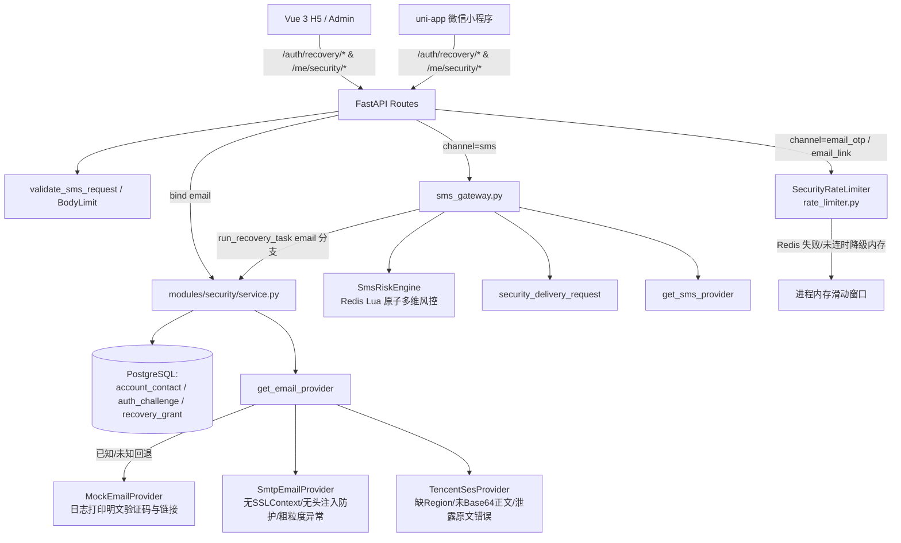

# Phase 0：邮箱安全模块基础审计与基线报告

## 1. 审计范围与仓库基线状态

| 项目 | 实测值 |
|---|---|
| Repository | `haohaizi233/nanshan-tech-transfer` |
| 起始基线 Branch | `main` (`github/main`) |
| 开发工作 Branch | `feat/email-security-gateway` |
| 远端最新 Commit SHA (`github/main`) | `ef95927431ae101063eae9b3a4bcec24ffd42a27` (`fix(ui): 移除成果详情页价格区面议兜底展示`) |
| 工作区初始状态 | `nothing to commit, working tree clean` |
| Python 环境 | Python 3.13.17 (`.venv/Scripts/python.exe`), pytest 9.1.1, ruff 0.17.3 |
| 前端/小程序环境 | Node v26.13.0, npm 11.20.0 |
| 本地基础设施 | PostgreSQL `127.0.0.1:5432` (可达), Redis `127.0.0.1:6379` (可达) |

---

## 2. 当前架构图（改造前）

---

## 3. 实际代码调用链

### 3.1 邮箱密码找回（`email_otp` / `email_link`）
1. **HTTP 入口** (`tech-transfer-service/routes/auth.py:88-107`):
   - `POST /api/tech-transfer/v1/auth/recovery/start` 经过 `validate_sms_request` 校验 JSON / HTTPS / Origin / `X-Device-Id`。
   - 当 `body.channel == "sms"` 时调用 `sms_gateway.request_gate(...)`；当 `body.channel in ("email_otp", "email_link")` 时**仅调用** `rate_limiter.check_recovery_start_rate(request, body.account)`。
   - 调用 `sms_gateway.enqueue_recovery_task` 写入 `security_delivery_request`，触发 `BackgroundTasks(run_queued_recovery_task, challenge_id)`，返回统一响应 `recovery_response`。
2. **后台任务执行** (`tech-transfer-service/modules/security/sms_gateway.py:363-378`):
   - `run_recovery_task` 对 `channel != "sms"` 分支直接回落调用 `modules.security.service.start_password_recovery(account, channel, challenge_id=challenge_id)`。
   - 返回的 `DeliveryTaskResult` 仅根据 `value.get("challengeId")` 判断 `COMPLETED` 或 `INELIGIBLE`，**没有区分投递未知、风险拦截或配置禁用**；且 `start_password_recovery` 在不存在账号时返回 `challengeId: None`（`service.py:158`），合法账号投递失败时直接 `raise`，由 `run_recovery_task` 捕获为 `PROVIDER_REJECTED` 或 `INTERNAL_ERROR`。
3. **业务执行** (`tech-transfer-service/modules/security/service.py:88-236`):
   - SQL 查询 `app_user` + `user_credential` + `account_contact`，**未检查** `uc.status = 'active'`、`uc.password_configured = true`、`user_role`/`organization_membership` 管理员禁用规则、`account_contact.verification_method`、多账号冲突检查。
   - 写 `auth_challenge` 前**未锁定** `app_user FOR UPDATE`；先 `UPDATE ... status='expired'` 再 `INSERT` (`status='pending'`)。
   - 邮件链接拼装为 `f"{settings.FRONTEND_URL.rstrip('/')}/reset-password?challengeId={challenge_id}&token={code}"`，Token 置于 URL query。
   - 调用 `get_email_provider().send_code(...)` / `send_reset_link(...)`（仅返回 `bool`）。
4. **挑战核验与密码重置** (`routes/auth.py:110-119`, `service.py:239-453`):
   - `POST /auth/recovery/verify` 仅受 `check_verify_challenge_rate(challengeId)` 保护。
   - `verify_recovery_challenge` 对 `email` 类型未校验 `verification_method IN ('email', 'manual')`。
   - `ResetPasswordView.vue:24-56` 在 `onMounted` 中读取 `route.query.challengeId` & `route.query.token` 并**立即自动 POST `/auth/recovery/verify`** 消费一次性链接 Token。
   - `app.py:160-165` 未托管 `/forgot-password` 与 `/reset-password` SPA 路由，生产同源托管会返回 404。

### 3.2 安全邮箱绑定与换绑
1. **发起绑定挑战** (`routes/me.py:61-75`, `service.py:531-595`):
   - `POST /me/security/contact/challenge` 对 `email` 仅调用 `check_send_code_rate(request, body.contactValue)`。
   - `start_contact_binding_challenge` 检查 `account_contact` 是否已被他人绑定，**未检查账号是否已绑定旧邮箱（无 Step-up 二次认证）**。
   - 未锁 `app_user FOR UPDATE`、未取消旧的 pending 绑定挑战，直接 `INSERT INTO auth_challenge(..., status='pending', ...)`，然后调用 `get_email_provider().send_code(...)`——**发送失败时不更新 Challenge 为 `failed`，Challenge 永久残留 `pending`**。
2. **核验与绑定** (`routes/me.py:77-81`, `service.py:598-683`):
   - `verify_and_bind_contact` 校验验证码后将挑战置为 `consumed`，撤销旧 `account_contact`，写入新 `account_contact (verification_method='email')`。
   - **未校验 Step-up Grant**；**未撤销受旧邮箱影响的未消费 `recovery_grant`**；未捕获 DB `IntegrityError` 并发换绑冲突。

### 3.3 历史接口与兼容层核查
- 全仓检索 `get_email_provider`、`MockEmailProvider`、`SmtpEmailProvider`、`TencentSesProvider`：除 `modules/security/service.py` 与 `tests/test_unified_auth_recovery.py` 外，**无其他业务路由或模块直接调用旧 Email Provider**。
- `modules/identity/service.py` (`register_password_user`) 和 `modules/profile/service.py` (`update_my_profile`) 仅写入 `user_profile.email`，不写入 `account_contact`，符合资料与安全联系方式分离原则。
- 小程序 `南山小程序/南山/subpackages/tech-transfer/pages/mine/mine.vue:404` 存在调用契约错位：点击邮件找回 tab 将 `recoveryChannel` 设为 `'email'` 而非后端要求的 `'email_otp'`。

---

## 4. 已确认问题清单与严重级别（源码实证）

| 编号 | 问题 | 源码位置（实证） | 严重级别 |
|---|---|---|---|
| D01 | 未知 `EMAIL_PROVIDER` 静默回退 `MockEmailProvider` | `modules/security/provider.py:700-716` (`else: _email_provider_instance = MockEmailProvider()`) | **P0** |
| D02 | `EMAIL_ENABLED=false` 仍返回已缓存实例或当 `EMAIL_PROVIDER=='mock'` 时跳过禁用检查 | `modules/security/provider.py:694-698` | **P0** |
| D03 | 邮箱绑定发送失败后 Challenge 残留为 `pending` | `modules/security/service.py:571-590`（INSERT 为 `pending` 后无 `try/except` 置 `failed`） | **P0** |
| D04 | 邮箱找回与绑定未接入 Redis Lua 多维原子风控 | `routes/auth.py:103`, `routes/me.py:73`（走旧 `rate_limiter`） | **P1** |
| D05 | `SecurityRateLimiter` Redis 初始化或运行异常时生产可降级进程内存；`ZADD` 同时间戳覆盖成员；无 `NoScriptError` 重载；key 含明文账号/邮箱 | `modules/security/rate_limiter.py:60-105,115-129` | **P0** |
| D06 | 邮箱 Challenge 创建缺少 `app_user FOR UPDATE` 串行化与绑定旧挑战清理 | `modules/security/service.py:179-208,571-583` | **P0** |
| D07 | `EmailProvider` 仅返回 `bool`，缺少结构化 `DeliveryReceipt`、`DeliveryProviderError` 及能力声明 | `modules/security/provider.py:464-474,499-648` | **P1** |
| D08 | 已绑定安全邮箱换绑缺少二次认证（Step-up Authentication / Step-up Grant） | `modules/security/service.py:531-683`, `routes/me.py:61-81` | **P0** |
| D09 | `MockEmailProvider` 日志输出明文邮箱、6 位验证码和完整重置链接 | `modules/security/provider.py:512,527` | **P0** |
| D10 | 邮箱找回密码未统一账号准入资格检查（缺少密码凭证校验、高权限账号限制、`verification_method` 检查、冲突检查） | `modules/security/service.py:117-152,282` | **P0** |
| D11 | SMTP 缺少 SSLContext 校验/头注入防护/DATA 中断分类；Tencent SES 缺少 `X-TC-Region`、未 Base64 编码正文、异常暴露完整响应；缺少邮件诊断与运维工具 | `modules/security/provider.py:531-648`, `tools/sms_gateway_ops.py` | **P1** |
| D12 | 重置链接 Token 放在 query 中；`ResetPasswordView.vue` `onMounted` 自动消费一次性 Token（易被邮件安全扫描器触发失效）；`app.py` 缺少 `/forgot-password`/`/reset-password` SPA 路由及 `no-referrer`/`no-store` 头 | `service.py:221`, `ResetPasswordView.vue:24-56`, `app.py:104-116,160-165` | **P0** |
| D13 | 缺少独立完整的邮箱专项自动化测试体系 | `tech-transfer-service/tests/` 无 `test_email_*.py` | **P1** |
| D14 | 代码与旧文档对环境变量、迁移状态、降级策略描述不一致 | `docs/auth/09-deployment-runbook.md:78-82` (`tencent_ses` / `TENCENTCLOUD_SES_*` 与 `config.py` 不符), `docs/auth/07-security-threat-model.md:69,102`, `docs/auth/10-final-acceptance.md:23,32` | **P1** |
| D15 | **额外发现**：微信小程序找回密码邮件通道传入 `'email'` 而非 `'email_otp'`，被后端 Pydantic `Literal["sms", "email_otp", "email_link"]` 拒绝 | `南山小程序/南山/subpackages/tech-transfer/pages/mine/mine.vue:404` | **P1** |
| D16 | **额外发现**：`_challenge_transaction()` 对任意 `BizError` 都执行 commit，且 `verify_and_bind_contact` 未将数据库唯一约束冲突转换为受控业务异常 | `modules/security/service.py:48-58,660-666` | **P0** |

---

## 5. 可复用模块与基础设施清单

| 模块路径 | 可复用能力 | 本次演进策略 |
|---|---|---|
| `modules/security/sms_risk.py` | `DecisionAction`, `RiskDecision`, `day_bucket`, `REQUEST_LUA`, `RESERVE_LUA`, `TRANSITION_LUA`, HMAC 盲索引 | 抽取为通用 `risk_engine.py`（`BaseRiskEngine`），`SmsRiskEngine` 与 `EmailRiskEngine` 共用底层脚本与模型，保留各自命名空间与阈值 |
| `modules/security/sms_delivery.py` | `DeliveryTaskResult`, `DeliveryStageError`, `safe_id`, `task_event` | 抽取至通用 `delivery_models.py`，新增 `DeliveryReceipt`、`ProviderCapabilities`、`DeliveryMetrics`，`sms_delivery.py` 保持兼容重导出 |
| `modules/security/sms_request.py` | `validate_sms_request`, `SmsBodyLimitMiddleware`, `DeviceRiskAdapter` | 复用请求边界校验；为 `/me/security/step-up/challenge` 增加请求体大小守卫 |
| `modules/security/sms_gateway.py` | `enqueue_recovery_task`, `run_queued_recovery_task`, `process_pending_recovery_tasks`, `cleanup_delivery_tasks`, `ELIGIBLE_SQL` 思想 | 复用持久化队列与原子 claim 机制，将邮件恢复分发至 `email_gateway.start_email_recovery`，逐步脱敏队列 payload |
| `modules/security/sms_diagnostics.py` | 只读脱敏诊断模型、Redis/PG 健康检查、状态核对模式 | 复用模式建设 `email_diagnostics.py` 与 `tools/email_gateway_ops.py` |
| `core/rate_limit.py` & `core/contact_validation.py` | `_client_ip`（可信代理链解析）、`validate_phone`、`validate_email` | 复用 `_client_ip`；在 `contact_validation.py` 增加 `normalize_email`（IDN Punycode、不删 `+tag`/点） |
| `migrations/pg/033-035` | `account_contact`, `auth_challenge`, `recovery_grant`, `security_delivery_request`, `audit_log` | 在 `036_email_security_gateway.sql` 增量扩展，新增 `step_up_grant` 表 |

---

## 6. 不允许破坏的现有功能与契约

1. **SMS Security Gateway 全套行为**：`SmsRiskEngine` 规则与返回值、`SendCloudSmsProvider` 参数签名与错误分类、`sms_gateway.py` 恢复/绑定/队列/核对逻辑，以及 `test_sms_gateway_postgres.py`（注意其仅执行 `033-035` 迁移）必须 100% 保持通过。
2. **微信登录与用户注册**：`modules/identity/wechat.py`、`wechat_web.py`、`register_user`、`register_password_user` 零破坏。
3. **JWT 鉴权中间件契约**：`core/middleware.py:_payload_to_actor()` 必须保持返回 `{"userId", "userNo", "roles"}` 精确三键字典（`test_middleware_exception.py:412` 锁定），且 `session_version` 实时查库撤销语义不变。
4. **未启用邮箱时已绑定邮箱展示**：`EMAIL_ENABLED=false` 时 `/me/security` 仍正常展示已脱敏的已绑定安全邮箱，`user_profile.email` 资料编辑不受影响。

---

## 7. 数据库增量迁移计划 (`036_email_security_gateway.sql`)

- 紧接 `035_sms_delivery_diagnostics.sql` 新增 `tech-transfer-service/migrations/pg/036_email_security_gateway.sql`，严格幂等（`ADD COLUMN IF NOT EXISTS`、`CREATE TABLE IF NOT EXISTS`、`CREATE INDEX IF NOT EXISTS`、约束先查 `pg_constraint`）。
- 变更内容：
  1. `auth_challenge` 增加 `code_hash_version`、`provider_name`、`delivery_failure_reason`；补充 `status` 与 `send_state` 安全 `CHECK` 约束；先安全收敛历史过期/重复激活挑战后创建部分唯一索引 `uk_auth_challenge_active_user_purpose_channel`；补充邮件状态索引与过期清理索引。
  2. `security_delivery_request` 增加 `channel`、`purpose`、`provider`（并由 `payload->>'channel'` 安全回填）及按渠道/状态查询、过期清理索引。
  3. 新增 `step_up_grant` 表（存储邮箱换绑等敏感操作二次认证单次授权摘要、会话指纹、用途、目标指纹、有效期与消费时间）。
  4. `recovery_grant` 增加活跃过期清理索引。
- 历史数据零破坏：不删除任何用户、联系方式、未过期合法 Grant。

---

## 8. 修改前基线测试结果

在 `ef95927431ae101063eae9b3a4bcec24ffd42a27` 干净基线上实际执行并通过以下基线测试：

| 测试套件 | 执行命令 | 实测结果 | 退出码 |
|---|---|---|---|
| 后端安全/认证全套（含真实 PG 18 + Redis） | `$env:SMS_TEST_POSTGRES='1'; $env:SMS_TEST_REDIS_URL='redis://127.0.0.1:6379/15'; ..\.venv\Scripts\python.exe -m pytest -p no:cacheprovider tests/test_unified_auth_recovery.py tests/test_sms_gateway.py tests/test_sms_gateway_service.py tests/test_sms_gateway_postgres.py tests/test_sms_risk.py tests/test_sms_delivery_results.py tests/test_sms_diagnostics.py tests/test_sms_request_security.py tests/test_sms_proxy_ip.py tests/test_sendcloud_security.py tests/test_wechat_login.py test_auth_register.py test_contact_validation.py -v` | **160 passed, 0 failed, 0 skipped** (21.23s) | `0` |
| 后端代码规范检查 | `..\.venv\Scripts\python.exe -m ruff check .` & `ruff format --check .` | **All checks passed! 242 files already formatted** | `0` |
| 管理端前端单元测试 | `Push-Location nanshan-frontend; node --test src/utils/*.test.mjs` | **32 passed, 0 failed** (356.99ms) | `0` |
| 小程序认证安全测试 | `Push-Location 南山小程序/南山; node --test tests/unified-auth-security.test.mjs tests/account-auth-registration.test.mjs tests/wechat-login.test.mjs` | **15 passed, 0 failed** (166.81ms) | `0` |
