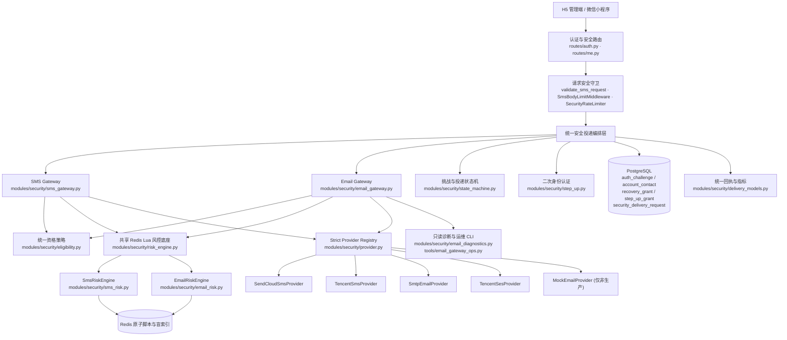

# 南山科转通统一投递基础设施与 Email Security Gateway 架构设计

## 1. 建设背景与重构目标

南山科转通将原本零散在认证服务中的邮件发送逻辑重构为生产级 **Email Security Gateway**，与现有 **SMS Security Gateway** 共享底层安全基础设施（统一投递回执模型、Redis Lua 多维原子风控底座、统一资格 SQL、持久化投递队列、状态机校验与低基数可观测指标），同时保留短信与邮箱各自独立的风控规则目录与渠道开关门禁。

核心安全设计原则：
1. **业务层与服务商彻底解耦**：路由与业务服务仅调用 `EmailGateway` / `SmsGateway` 编排能力与 `get_email_provider()` 注册工厂，禁止直接拼接 SMTP 或腾讯云 SES HTTP 协议。
2. **接受请求不等于最终投递成功**：区分 `accepted`（服务商受理）与 `delivered`（最终投递确认），引入 `DeliveryReceipt`、`DeliveryProviderError` 与 `ProviderCapabilities`。
3. **写前落库与未知状态保守语义**：`auth_challenge` 必须在调用外部网络前以 `pending_send / reserved` 状态持久化；若投递阶段进入 `PROVIDER_OUTCOME_UNKNOWN`（如 SMTP `DATA` 断连或 SES 超时/5xx），严禁自动重发或生成新验证码。
4. **Fail-Closed 安全底线**：在 `staging`/`production` 环境或启用 `REDIS_ENABLED=true` 时，风控引擎与限流器均严格拒绝静默降级至进程内存，并在配置启动门禁阶段阻止 `MockEmailProvider` 或本地非 HTTPS 重置基地址上线。

---

## 2. 统一安全投递网关架构图

---

## 3. 核心模块职责划分

| 分层 | 模块路径 | 共享 vs 专有 | 核心职责 |
| :--- | :--- | :--- | :--- |
| 配置与环境门禁 | `tech-transfer-service/config.py` | 共享 | 管理 `EMAIL_*`、`SMTP_*`、`TENCENT_SES_*`、`STEP_UP_*` 环境变量；提供 `validate_frontend_reset_base_url()` 与 `assert_environment()` 生产安全校验。 |
| 联系方式校验 | `tech-transfer-service/core/contact_validation.py` | 共享 | 提供 `normalize_email()`（控制字符阻断、IDN 转 Punycode、保留 `+tag`、小写规范化）与 `email_domain()`，同时保留存量 `is_valid_email()` 兼容性。 |
| 统一模型与指标 | `tech-transfer-service/modules/security/delivery_models.py` | 共享 | 定义 `DeliveryReceipt`、`DeliveryProviderError` (`ProviderError`)、`ProviderCapabilities`、`DeliveryTaskResult`、`DeliveryStageError`、低基数 `DeliveryMetrics` 与 `safe_id()` / `task_event()`。 |
| 邮件模板引擎 | `tech-transfer-service/modules/security/email_templates.py` + `templates/email/*.html` | Email 专有 | 渲染 `text/html` 与 `text/plain` 双格式邮件；`html.escape` 防注入；Subject 禁止包含 OTP；无外部追踪图片或脚本。 |
| 服务商适配器 | `tech-transfer-service/modules/security/email_providers.py` + `provider.py` | Email 专有 / 共享工厂 | `MockEmailProvider`、`SmtpEmailProvider`、`TencentSesProvider` 实现及严格顺序校验的 `get_email_provider()`。 |
| 共享风控底座 | `tech-transfer-service/modules/security/risk_engine.py` | 共享 | `BaseRiskEngine`、`REQUEST_LUA`、`RESERVE_LUA`、`TRANSITION_LUA`（`TIME` + UUID 成员 + `{gateway}` Hash Tag + `TTL < 0` 午夜守卫 + `NoScriptError` 自动重载 + Fail-Closed）。 |
| 邮箱风控引擎 | `tech-transfer-service/modules/security/email_risk.py` | Email 专有 | 15 条邮箱风控规则目录，内置 `PUBLIC_EMAIL_DOMAINS` 公共邮箱域免误伤白名单及非公共域名异常爆发监测。 |
| 统一限流器 | `tech-transfer-service/modules/security/rate_limiter.py` | 共享 | Redis 滑动窗口（UUID 成员、盲索引 Key），`is_production_like` 或 `REDIS_ENABLED=true` 时严格 Fail-Closed，禁止降级内存桶。 |
| 状态机与资格 | `modules/security/state_machine.py` & `eligibility.py` | 共享 | 显式 `auth_challenge.status` 与 `send_state` 转换约束、`can_verify_challenge()`、统一 SQL `EMAIL_ELIGIBLE_SQL` / `SMS_ELIGIBLE_SQL`。 |
| 二次认证服务 | `tech-transfer-service/modules/security/step_up.py` | 共享 | 会话指纹绑定（`session_fingerprint_from_request`）、Step-up 挑战发起与单次 `step_up_grant` 签发/核销。 |
| 网关编排层 | `modules/security/email_gateway.py` & `sms_gateway.py` | Email / SMS 协同 | `email_request_gate`、`start_email_recovery`、`start_email_binding`、`_send_email` 行锁串行化、`reconcile_email_delivery` 及持久化队列多通道分发与 PII 清理。 |
| 核心安全服务 | `tech-transfer-service/modules/security/service.py` | 共享 | 找回核验（v2/v1 HMAC 与密钥轮换兼容）、`_challenge_transaction()`、`complete_password_recovery`、邮箱绑定与带二次认证换绑、`get_recovery_capabilities()`。 |
| 诊断与运维 CLI | `modules/security/email_diagnostics.py` + `tools/email_gateway_ops.py` | Email 专有 | 12 个命令行运维动作、20 项失败码诊断词典、离线契约检查与只读风控快照；严禁公开 HTTP 导入。 |

---

## 4. 关键一致性边界（不得破坏原则）

- **SMS Security Gateway 向后兼容**：`modules/security/sms_delivery.py` 继续重导出所有共享符号；`sms_gateway.py` 在写入/更新 `036` 新增列时通过 `SAVEPOINT` 自适应降级，保证仅运行 `033~035` 迁移的场景或存量短信网关无破坏回归。
- **鉴权上下文冻结契约**：`core/middleware.py::_payload_to_actor()` 严格维持仅返回 `{"userId", "userNo", "roles"}` 三键字典，Step-up 会话指纹由独立函数从已校验 Bearer JWT 提取。
