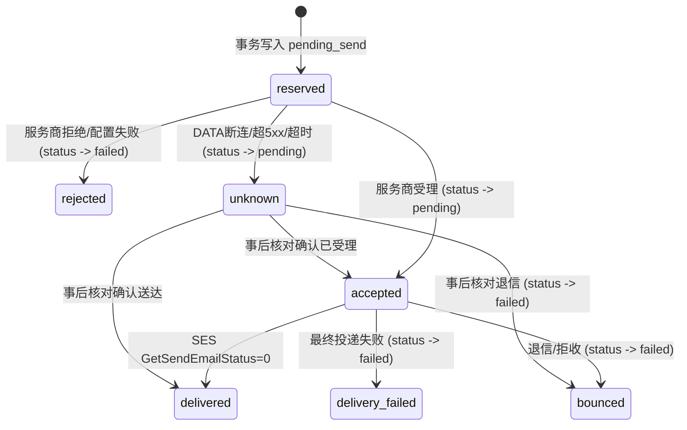

# 持久化投递队列、状态机与未知结果核对机制 (05-delivery-queue-and-state-machine)

## 1. 共享持久化投递队列 (`modules/security/sms_gateway.py` + `email_gateway.py`)

邮箱与短信复用现有 PostgreSQL 持久化投递队列表 `security_delivery_request`（零新增独立消息中间件），通过 `036_email_security_gateway.sql` 补全 `channel`、`purpose`、`provider` 字段与 `(channel, state, created_at)` 索引：

1. **统一入队与原子领取 (`enqueue_recovery_task` / `run_queued_recovery_task`)**：
   - `/auth/recovery/start` 仅在通过请求门禁后插入 `state='queued'` 任务，快速响应统一防枚举结果并在后台触发任务；
   - `run_queued_recovery_task` 通过单语句原子抢占：
     ```sql
     UPDATE security_delivery_request SET state='processing', claimed_at=NOW()
     WHERE id=%s AND state='queued' AND created_at>NOW()-INTERVAL '5 minutes'
     RETURNING payload
     ```
     防止多 Worker 并发重复领取或执行超时僵尸任务。
2. **多渠道分发**：`run_recovery_task` 按 `channel` 自动将 `'email_otp'` / `'email_link'` 委派给 `email_gateway.start_email_recovery(..., return_result=True)`，将 `'sms'` 保留由 `sms_gateway` 处理。
3. **完成后 PII 彻底脱敏清理**：任务进入终态写入回执时，服务端从 `security_delivery_request.payload` 自动剔除明文 `account`、`ip` 与 `device_id`（`payload - 'account' - 'ip' - 'device_id'`），仅保留脱敏审计结构字段。
4. **Worker 崩溃恢复与过期任务清理 (`cleanup_delivery_tasks`)**：
   - 未领取即超过 5 分钟的 `queued` 任务标记为 `DELIVERY_TASK_EXPIRED`；
   - 长期卡在 `processing` 超过 5 分钟的僵尸任务统一收敛为 `state='unknown'`、`failure_stage='worker'`、`failure_reason='PROVIDER_OUTCOME_UNKNOWN'`，禁止再次重发；
   - 同步清理超过保留期（7 天）的已完成/拦截/过期队列记录，并标记过期的 `auth_challenge`、`recovery_grant` 与 `step_up_grant`（036 表通过 `SAVEPOINT` 兼容存量仅含 035 的环境）。

---

## 2. 双层状态机严谨分离 (`modules/security/state_machine.py`)

系统严格区分 **认证挑战状态 (`auth_challenge.status`)** 与 **外部投递状态 (`auth_challenge.send_state`)**：



### `send_state == 'unknown'` 保守核验策略
`can_verify_challenge(status, send_state)` 明确规定：
- `rejected`、`delivery_failed`、`bounced`、`reserved`、`sending` 禁止通过核验；
- `accepted`、`delivered`、`None`（兼容存量历史行）允许核验；
- **`unknown` 且 `status == 'pending'`** 在原有效期（默认 300s）与最多 5 次试错上限内允许核验：如果上游实际已发出原邮件，用户使用收到的原验证码仍可正常完成验证；同时依赖 Redis `email.pending_outcome` 冷却锁定与 `uk_auth_challenge_active_user_purpose_channel` 唯一索引阻止自动重新生成并覆盖新验证码。

---

## 3. 投递状态事后核对 (`reconcile_email_delivery`)

针对 `TencentSesProvider`（`capabilities.delivery_status_query == True`），运维可通过内部 CLI 调用 `GetSendEmailStatus` 同步状态：
- 若上游返回 `SendStatus == 0`：原子更新 `auth_challenge.send_state = 'delivered'` 并转换 Redis `reservation -> delivered`；
- 若上游返回 `SendStatus IN (2, 3, 4)`：将 `send_state` 收敛为 `'bounced'` 或 `'delivery_failed'`，并将仍处于 `'pending'` 的挑战闭环为 `'failed'`；
- 对不具备状态查询能力的 `SmtpEmailProvider` / `MockEmailProvider`，明确返回 `supported=False, reason_code="unsupported_capability"`，绝不伪造送达确认。
