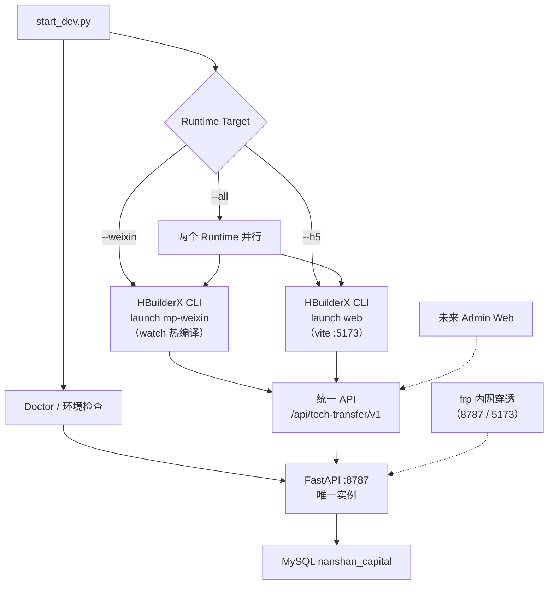

# 南山科转通 · Multi-Runtime 开发启动器指南

> `start_dev.py` —— FastAPI + uni-app 多 Runtime（微信小程序 / H5）一键联调启动器
>
> 更新日期：2026-09-03

## 1. 架构



要点：

- **一份 uni-app 源码，两个 Runtime**：mp-weixin 与 H5 共享 `南山/` 目录全部业务代码
- **后端唯一实例**：无论 `--weixin` / `--h5` / `--all`，FastAPI 只有一个（8787），禁止 8788
- **Admin（未来）**：独立 Web Client，直连同一 FastAPI，不由本启动器拉起
- **frp**：内网转发由 frp 承担（服务端转发 8787 API 与 5173 H5），本启动器只负责本机进程

## 2. CLI 命令

```bash
# 默认：FastAPI + 微信（保持既有开发习惯）
python start_dev.py

# FastAPI + 微信小程序
python start_dev.py --weixin

# FastAPI + H5
python start_dev.py --h5

# FastAPI + 微信 + H5
python start_dev.py --all

# 仅 FastAPI（不启动任何前端）
python start_dev.py --backend-only

# 仅前端（不起后端）
python start_dev.py --frontend-only --weixin
python start_dev.py --frontend-only --h5
python start_dev.py --frontend-only --all

# 手机局域网访问（H5 + FastAPI 绑 0.0.0.0，输出 LAN 地址）
python start_dev.py --h5 --lan

# 环境诊断（只检测，不启动；PASS / WARN / FAIL）
python start_dev.py --doctor

# 查看当前运行状态（不启动任何东西）
python start_dev.py --status

# H5 production build（不启动 FastAPI）
python start_dev.py --build-h5

# 恢复资本对接演示模式后退出
python start_dev.py --demo

# 严格模式：任何组件失败即退出非 0（联调验收用）
python start_dev.py --strict
```

## 3. 环境要求

| 组件 | 要求 | 检测方式（doctor） |
|---|---|---|
| Python | ≥ 3.10 | ✅ |
| FastAPI / uvicorn / PyMySQL / PyJWT | 按 `tech-transfer-service/requirements.txt` | ✅ |
| HBuilderX | 5.15+（cli.exe 可用） | ✅ 四级检测 |
| 微信开发者工具 | 已安装且开启「服务端口」 | ✅ |
| MySQL | nanshan_capital 库可连接 | ✅ |
| 前端工程 | manifest.json / pages.json / config.js 齐全 | ✅ |

HBuilderX CLI 检测顺序：环境变量 `HBX_CLI` > 默认路径 > `D:\HBuilderX` 扫描（取最新版本） > PATH。

## 4. 微信小程序开发

```bash
python start_dev.py            # 或 --weixin
```

流程：HBuilderX CLI `launch mp-weixin`（**watch 模式**：修改 `南山/` 源码自动重编译，微信开发者工具自动刷新模拟器）→ 启动器检测到「微信开发者工具已启动」标志后输出 READY。

模拟器内 API 访问 `http://127.0.0.1:8787`（`common/config.js` 的 `API_BASE` 默认值）。

**真机调试**：需将 `config/local.env.js` 的 API_BASE 改为电脑局域网 IP（启动器汇总面板会提示当前 LAN IP，如 `http://192.168.2.79:8787`）。

## 5. H5 开发

```bash
python start_dev.py --h5
```

- H5 dev server 由 HBuilderX 内置 vite（v5.2.8）提供，端口固定 **5173**（`manifest.json` → `h5.devServer.port`）
- 本工程是**纯 HBuilderX 工程**（无 package.json / node_modules），H5 构建只能走 HBuilderX CLI，不存在 `npm run dev:h5` 备选
- 启动器轮询 `http://127.0.0.1:5173/` 直到 HTTP 200 才输出 `[OK] H5 已就绪`（区分 process started 与 service ready）
- 修改源码 → vite HMR → 浏览器自动更新
- H5 → FastAPI 跨域由后端 CORS 处理（见第 8 节）

## 6. 局域网真机（--lan）

```bash
python start_dev.py --h5 --lan
```

- FastAPI 绑定 `0.0.0.0:8787`
- 输出手机可访问地址：`http://192.168.x.x:5173`（LAN IP 自动探测，排除 loopback / link-local，私有网段优先）
- 手机浏览器打开该地址即可预览 H5

## 7. FastAPI 后端

- 唯一实例，端口 **8787**，启动器含端口三分支：
  - **A 空闲** → 正常启动
  - **B 已有健康南山后端**（`/api/health` 返回南山特征）→ `[OK] 检测到现有 FastAPI :8787，直接复用`，不重复 spawn，退出启动器时**不会**终止它
  - **C 被其他程序占用** → `[ERROR] 端口 8787 已被非南山后端进程占用（PID=xxx）`，退出码 1，**不会**自动 kill 未知进程
- Health contract：`GET /api/health` 返回 `data.status`（ok/degraded）与 `data.database`（ok/unavailable），启动器据此分别输出 `[OK] FastAPI Ready` + `[OK] MySQL Ready` 或 `[WARN] MySQL Unavailable`
- 后端由 `python app.py`（内部 uvicorn，含热重载）直接启动——启动器不依赖任何 IDE

## 8. MySQL

- 连接配置：`南山小程序/tools/szte-crawler/db_config.json`
- 启动器启动前做连通性预检；MySQL 不可达时后端仍启动（DEGRADED），数据接口报错

## 9. API 配置（runtime-aware）

`南山/common/config.js` 使用 uni-app 条件编译：

| Runtime | API_BASE |
|---|---|
| MP-WEIXIN（模拟器） | `http://127.0.0.1:8787`（local.env.js） |
| MP-WEIXIN（真机） | 改为 `http://<电脑LAN-IP>:8787` |
| H5 开发 | `http://127.0.0.1:8787`（跨域走后端 CORS） |
| H5 staging/production | `''`（同源相对路径，`/api` 由网关转发到 FastAPI） |

生产部署形态：`https://example.com/` 托管 H5 静态资源，`https://example.com/api/` 转发到 FastAPI。

## 10. CORS（后端 `app.py`）

- `APP_ENV=local`：允许任意主机名的 `:5173` 端口来源（origin regex，覆盖 127.0.0.1 / localhost / 局域网 IP），另可用 `CORS_ORIGINS` 环境变量追加显式白名单
- `APP_ENV=staging/production`：仅 `CORS_ORIGINS` 环境变量显式白名单，无通配、无 regex
- 微信小程序请求无 Origin，不受 CORS 约束

## 11. 进程生命周期

- 启动器只终止**自己 spawn 并拥有**的进程（backend / weixin CLI / h5 CLI），Ctrl+C / SIGTERM / atexit 均走统一清理，Windows 下用 `taskkill /T /F` 连同子进程树（vite）一起回收
- 复用的后端、用户已开的微信开发者工具 / HBuilderX GUI **不会被关闭**
- `ask_demo_switch` 修改 `config.js` 前会备份原值，退出时自动恢复（不产生 git dirty）

## 12. 常见错误

| 现象 | 原因 / 处理 |
|---|---|
| `端口 8787 已被非南山后端进程占用（PID=xxx）` | 8787 被无关程序占用，`tasklist /FI "PID eq xxx"` 查明后自行处理 |
| `微信开发者工具未开启服务端口` | DevTools → 设置 → 安全设置 → 开启服务端口 |
| `HBuilderX 编译失败` | 看启动器回显的 HBuilderX 日志；删 `unpackage/dist/dev/mp-weixin` 后重试 |
| H5 打开后接口 401/网络错误 | 后端未起或 MySQL 未起；跑 `--status` 确认 |
| 首次 `launch web` 编译慢（20s+） | 正常，vite 按需编译；二次启动秒级 |
| `此功能需要先登录`（--build-h5） | HBuilderX `publish` 需要 DCloud 账号：打开 HBuilderX GUI 登录后重试 |
| PyCharm push 报 `Invalid proxy URL '[http'` | 代理地址被 markdown 括号污染；命令行用 `git -c http.proxy=http://127.0.0.1:7890 push` |

## 13. Production H5 Build

```bash
python start_dev.py --build-h5
```

调用 HBuilderX CLI `publish web`，产物自动定位到 `南山/unpackage/dist/build/h5/`（校验 `index.html` 存在）。

**当前限制**：HBuilderX 的 `publish` 命令要求 DCloud 账号登录（`launch` 不要求）。本机未登录时会报 `此功能需要先登录`——在 HBuilderX GUI 中登录后重试即可。

微信小程序 production 构建不提供（`publish mp-weixin` 需 appid + 上传私钥，属发行上传流程，不适合本地构建）。

## 14. 验证记录（2026-09-03，本机实测）

| 命令 | 结果 |
|---|---|
| `--doctor` | PASS（19 PASS / 0 WARN / 0 FAIL） |
| `--status` | PASS（FastAPI RUNNING / H5 STOPPED / MySQL RUNNING 三态正确） |
| `--backend-only` | PASS（冷启动 + READY，含 8787 冲突分支实测：明确报错 PID + exit 1；修复「误启微信」缺陷后复测：正确跳过前端，`[SKIP] 无前端 Runtime 目标`） |
| `--weixin` / `--frontend-only --weixin` | PASS（DevTools 启动 + watch 热编译 + ready 检测；复测：8787 健康复用分支正常） |
| `--h5` | PASS（vite :5173 ready check + H5→FastAPI→MySQL 全链路 + CORS 实测；复测：`127.0.0.1:5173` 与 `192.168.2.79:5173` 两个 Origin 的 `access-control-allow-origin` 均正确回显） |
| `--all` | PASS（微信 + H5 并行，H5 复用分支实测；复测：后端复用 → 微信 Runtime → H5 Runtime 串行拉起，双 Runtime 同时在线：5173 HTTP 200 + 8787 HTTP 200 + mp-weixin 编译产物存在） |
| `--demo` | PASS（写入并恢复） |
| `--build-h5` | NOT VERIFIED（本机 HBuilderX 未登录 DCloud 账号，publish 被拒） |
| 进程清理 | PASS（停止 `--all` 后 5173 即时释放；被复用的 8787 后端不受影响继续运行） |

H5 全链路实测：`Origin: http://localhost:5173` → CORS preflight 200（`access-control-allow-origin` 回显）→ `auth/bootstrap` 200 → `demands` 200（MySQL 5 条数据）。
