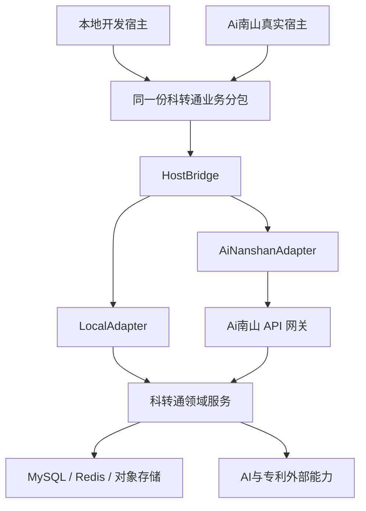
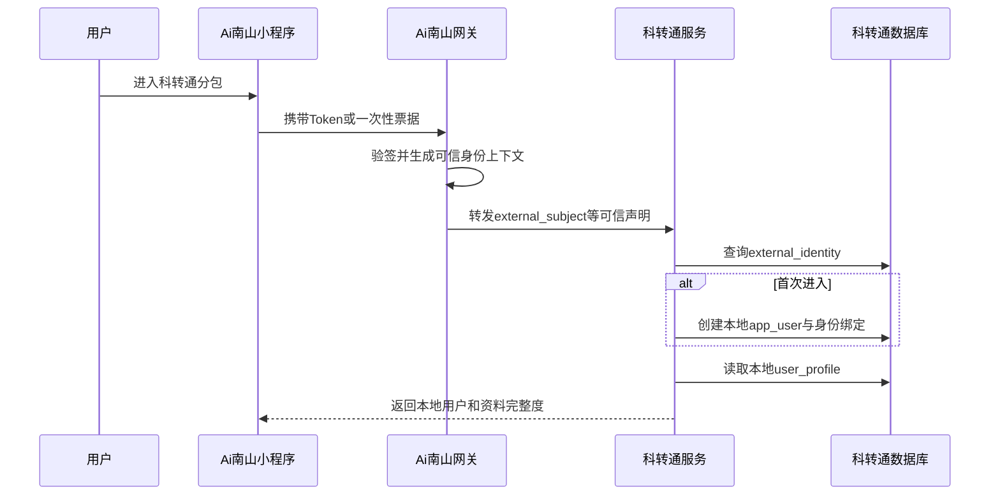
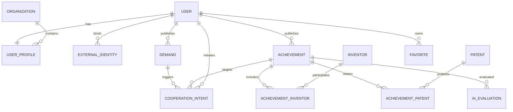

# 南山科转通 AI 智助平台架构与接口设计

> 文档状态：架构评审稿 V2（双宿主、单代码源）  
> 编写日期：2026-09-02  
> 适用范围：一期小程序源码合并、科转通业务服务建设、前后端联调及后续 Ai南山接入  
> 依据材料：现有 uni-app 演示源码、项目进度表、功能架构图、可行性方案及成果数据表

---

## 1. 文档目的

本文档用于统一南山科转通项目的一期技术基线，解决以下问题：

1. 现有独立 uni-app 演示工程如何合并到上级“Ai南山”小程序；
2. 科转通是否以及如何作为独立业务服务部署；
3. 上级用户身份与科转通本地用户、业务资料如何隔离和映射；
4. 成果、需求、收藏、对接、AI评估、专利及资本资源如何划分领域边界；
5. 前后端接口如何统一鉴权、分页、错误码、幂等和状态流转；
6. 在暂时拿不到上级源码和正式接入协议时，如何继续开发且避免返工。

本文档是架构和接口基线，不替代数据库详细 DDL、OpenAPI 文件、部署脚本和测试用例。

---

## 2. 当前项目现状

### 2.1 已有内容

现有交接源码包含：

- 基于 uni-app、Vue 3 的微信小程序演示工程；
- 4 个主包页面和 7 个分包页面；
- 首页、个人中心、成果/需求展示、发布、搜索、对接、AI匹配、资本资源等页面；
- 资本资源相关的轻量 Flask API；
- 3 张资本资源数据表及对应爬虫、导入导出脚本；
- 本地演示数据、规则式 AI 回复、AI 假评分和专利年费演示数据。

### 2.2 当前不具备的生产能力

当前工程仍属于前端演示阶段，主要缺口包括：

- 注册、登录、会话仍由 `uni.setStorageSync` / `uni.getStorageSync` 模拟；
- 账号和密码保存在小程序本地缓存，不是正式用户体系；
- 需求、成果、收藏、发布、对接意向主要使用 `mock-data.js`；
- AI匹配和AI评估未接入真实服务；
- 专利检索、专利法律状态、年费监控未接入正式数据源；
- 现有 Flask API 只覆盖资本资源的少量只读查询；
- 尚无完整的用户、成果、需求、对接、收藏、AI任务后端；
- 尚未获得上级 Ai南山 源码、统一认证协议、网关规范和发布流程。

### 2.3 关键判断

当前工作不是简单地把两个成熟系统“接起来”，而是：

```text
演示前端 + 少量只读接口 + 不完整数据模型
                    ↓
定义正式架构、建设业务后端、替换 Mock、完成上级系统集成
```

因此，必须先冻结架构和接口契约，再分别由前端、后端、数据、AI和测试负责人实施。

---

## 3. 已确认约束与架构决策

### 3.1 已确认约束

1. 科转通最终以源码合并方式嵌入上级 Ai南山 小程序；
2. 当前暂未拿到上级小程序源码；
3. 科转通需要保存自己的用户业务资料、需求、收藏和对接记录；
4. 不应复制上级账号密码，也不能直接信任前端提交的上级 `user_id`；
5. 上级用户标识不能直接作为科转通业务表的通用主键；
6. 一期数据规模较小，现有待转化成果约 223 条，不需要大规模分布式架构；
7. 在没有上级源码、Token和网关的阶段，科转通仍必须能够在本地完整运行；
8. 本地独立运行和未来嵌入运行必须共用同一份业务页面、API模型和后端接口，禁止维护两套业务代码。

### 3.2 核心架构决策

采用以下基线：

> **双宿主、单代码源：当前使用最小本地宿主加载科转通分包，未来使用 Ai南山 真实宿主加载同一份分包；宿主差异通过 HostBridge 隔离；后端保持独立科转通领域服务，服务内部采用模块化单体。**

“独立科转通领域服务”可以作为 Ai南山 平台中的一个微服务部署，但一期不将成果、需求、收藏、对接等继续拆成多个网络微服务。

本地宿主只用于开发、测试和演示，不形成第二套生产系统。未来合并时迁移的是同一份科转通业务分包，替换的是宿主适配器和环境配置。

### 3.3 为什么不拆成多个微服务

当前不建议拆为用户微服务、成果微服务、需求微服务、收藏微服务等，原因如下：

- 当前团队规模和数据规模不支持复杂服务治理；
- 领域之间存在较多事务关系；
- 多服务会增加网关、鉴权、注册发现、链路追踪和部署成本；
- 当前首要问题是完成业务闭环，而不是解决超大规模并发；
- 模块化单体后续仍可按访问量和团队边界逐步拆分。

---

## 4. 总体架构



### 4.1 分层职责

| 层级 | 主要职责 |
|---|---|
| 本地开发宿主 | 在没有上级源码时提供 App 入口、页面路由、开发配置和模拟上级身份 |
| Ai南山小程序宿主 | 登录、全局导航、公共组件、统一请求、统一上传、发布和审核 |
| 科转通业务分包 | 成果、需求、搜索、对接、个人工作台、AI匹配等业务页面 |
| HostBridge | 隔离身份凭证、请求、上传、导航、消息和环境信息等宿主差异 |
| Ai南山 API 网关 | Token验证、路由、限流、审计、Trace ID、可信身份上下文 |
| 科转通领域服务 | 科转通业务规则、数据权限、状态流转、外部能力适配 |
| MySQL | 用户映射、业务资料、成果、需求、意向、评估记录等事务数据 |
| Redis | 可选，用于限流、短期缓存、幂等键和异步任务状态 |
| 对象存储 | 成果图片、附件、证明文件、AI报告等文件对象 |
| AI/专利服务 | 评分、语义检索、需求匹配、专利检索及法律状态查询 |

### 4.2 部署边界

科转通后端应作为一个可独立部署单元：

```text
tech-transfer-service
```

一期建议独立 Schema、独立数据库账号。即使与 Ai南山 共用同一个 MySQL 实例，也不能直接共用表或允许双方服务跨库随意写入。

本地开发时允许小程序通过 `LocalAdapter` 直接访问本地科转通服务；正式集成时通过 `AiNanshanAdapter` 和上级网关访问同一个领域服务。两种模式必须使用相同的 API 路径、请求结构、响应结构和错误码。

---

## 5. 双宿主前端与源码合并设计

### 5.1 设计原则

科转通分包不能脱离小程序主包单独运行，因此当前必须保留一个最小本地主包作为开发宿主。该宿主负责启动小程序、注册分包路由和提供开发期宿主能力，但不承载正式业务逻辑。

唯一业务代码源是：

```text
subpackages/tech-transfer/
```

本地开发和未来 Ai南山 集成均加载该目录中的同一份页面、组件、API模型和业务逻辑。

### 5.2 本地开发工程目录

```text
nanshan-tech-transfer/
├─ App.vue                         # 本地开发宿主入口
├─ main.js
├─ manifest.json                   # 本地开发AppID/测试号配置
├─ project.config.json             # 本地微信开发者工具配置
├─ pages.json                      # 注册dev-home和科转通分包
├─ pages/
│  └─ dev-home/                    # 最小本地入口，只负责进入业务分包
├─ host/
│  ├─ local-adapter.js             # 本地身份、请求、上传、导航实现
│  └─ ainanshan-adapter.example.js # 上级适配器接口示例，不含正式实现
├─ config/
│  ├─ local.js
│  ├─ test.js
│  └─ production.js
├─ subpackages/
│  └─ tech-transfer/
│     ├─ pages/
│     ├─ api/
│     ├─ components/
│     ├─ composables/
│     ├─ models/
│     ├─ constants/
│     ├─ runtime/
│     │  └─ host-bridge.js         # 随业务分包迁移的稳定宿主契约
│     └─ assets/
└─ tools/
   ├─ api-server/                  # 本地科转通后端启动入口
   └─ mock-host/                   # 只模拟上级宿主能力
```

### 5.3 两种运行模式

| 项目 | 本地开发模式 | Ai南山集成模式 |
|---|---|---|
| 主包宿主 | 当前最小本地小程序 | Ai南山真实小程序 |
| 业务分包 | `subpackages/tech-transfer` | 同一份 `subpackages/tech-transfer` |
| 身份来源 | `LocalAdapter` 生成明确标记的开发身份 | 上级Token、一次性票据或网关身份 |
| API入口 | 本地科转通服务地址 | Ai南山 API 网关 |
| 业务数据库 | 本地开发数据库 | 测试/生产科转通数据库 |
| 成果、需求、对接 | 正式API和真实状态机 | 同一套正式API和状态机 |
| 构建发布 | 仅开发、测试和演示 | 随 Ai南山 一起编译发布 |

### 5.4 本地运行流程

```text
启动本地小程序主包
        ↓
LocalAdapter提供开发身份凭证
        ↓
进入同一份科转通业务分包
        ↓
调用本地 /api/tech-transfer/v1/*
        ↓
MockIdentityProvider验证开发凭证
        ↓
创建/读取科转通本地用户
        ↓
读写正式结构的本地业务数据库
```

本地身份示例：

```json
{
  "issuer": "local-dev",
  "subject": "dev-user-001",
  "tenantId": "default",
  "displayName": "本地测试用户"
}
```

该身份只能在 `local` 或 `testing` 环境被接受，不得出现在预发布和生产环境。

### 5.5 未来源码合并流程

拿到上级源码后执行：

1. 将 `subpackages/tech-transfer` 合并到上级约定分包目录；
2. 将科转通页面路由注册到上级 `pages.json`；
3. 实现 `AiNanshanAdapter`，接入上级认证、请求、上传和导航；
4. 将 API 入口切换为上级网关；
5. 删除生产构建对 `LocalAdapter` 和 Mock 身份的引用；
6. 在上级测试环境完成身份、权限、上传和全链路回归。

本地 `App.vue`、`manifest.json`、`project.config.json`、`dev-home` 不合并进上级项目，它们继续作为本地开发工具保留。

### 5.6 HostBridge 契约

业务页面只能依赖分包内部的 `runtime/host-bridge.js`，不能直接依赖本地宿主或 Ai南山 的具体实现。宿主在应用启动时向 HostBridge 注册当前适配器：本地注册 `LocalAdapter`，上级工程注册 `AiNanshanAdapter`。

```text
HostBridge
├─ registerAdapter(adapter)
├─ getEnvironment()
├─ getIdentityCredential()
├─ request(options)
├─ upload(file, options)
├─ navigate(path, params)
├─ showMessage(message)
└─ reportError(error, context)
```

约束：

- `getIdentityCredential()` 只提供凭证，不直接决定业务权限；
- 未注册适配器时，HostBridge 必须立即报出明确启动错误；
- 后端必须验证凭证并解析当前用户；
- `request()` 在本地指向本地科转通服务，在集成环境指向上级网关；
- `upload()` 返回统一 `fileId`，业务页面不关心底层对象存储；
- `navigate()` 屏蔽本地主包与上级主包的路由差异；
- `reportError()` 统一携带 `requestId` 和宿主环境信息。

### 5.7 Mock边界

本地只允许模拟以下上级能力：

- 上级已登录用户身份；
- 上级Token/票据的开发替身；
- 上级主包导航入口；
- 尚未提供的统一上传、消息和埋点能力。

以下内容不得长期使用前端 Mock：

- 用户业务资料；
- 成果和需求；
- 收藏；
- 对接意向及状态变化；
- AI任务及结果记录；
- 数据权限和审核状态。

它们必须通过正式接口写入正式结构的本地开发数据库。

### 5.8 生产保护

构建和服务启动必须包含硬性保护：

```text
APP_ENV=staging/production + HOST_MODE=local       → 构建失败
APP_ENV=staging/production + AUTH_PROVIDER=mock    → 服务启动失败
APP_ENV=staging/production + API_BASE=127.0.0.1    → 构建失败
```

不能只靠注释、人工记忆或前端开关防止 Mock 配置进入生产。

### 5.9 现有源码处理

| 当前内容 | 新架构处理 |
|---|---|
| `App.vue`、`main.js` | 保留为本地开发宿主 |
| `manifest.json`、`project.config.json` | 保留为本地开发配置，不并入上级 |
| 当前 `pages.json` | 重构为本地主包入口 + 科转通分包路由 |
| 当前 TabBar | 仅本地壳可保留简化入口，业务不得依赖其存在 |
| `start_dev.py` | 可保留为本地联调启动器，不作为生产启动方式 |
| `common/config.js` | 拆为环境配置，由 HostBridge 读取 |
| `common/user.js` | 删除本地账号密码，改为身份适配 + `/me` API |
| `common/mock-data.js` | 仅短期UI调试；主链路完成后移除业务依赖 |
| `common/ai-chat.js` | 接入AI任务API |
| `common/ai-eval.js` | 接入AI评估API |
| `common/patent-fee.js` | 一期关闭或接入专利服务API |
| `common/capital.js` | 统一使用 HostBridge.request |

### 5.10 前端调用规则

1. 页面不能直接拼接后端域名；
2. 页面不能直接使用上级 `user_id` 判断数据归属；
3. 创建需求、收藏、发起对接时，不允许在请求体中提交 `ownerUserId`；
4. 用户身份必须由后端验证宿主凭证后确定；
5. 分包内部统一通过 `api/` 层请求，页面不得散落 `uni.request`；
6. 本地与集成环境采用相同API模型、路径、响应和错误码；
7. 本地身份必须带有明显开发环境标识；
8. 业务页面不得通过 `if (isLocal)` 分叉出另一套业务规则；
9. 拿到上级源码后只替换 HostBridge 实现和路由接入，不整体重写页面。

---

## 6. 后端领域设计

### 6.1 模块划分

```text
tech-transfer-service
├─ identity              # 上级身份验证、本地用户绑定
├─ profile               # 科转通个人资料和企业关系
├─ achievement           # 成果、完成人、附件、标签
├─ demand                # 企业需求、附件、状态
├─ cooperation           # 对接意向及状态机
├─ favorite              # 收藏
├─ search                # 结构化搜索与语义召回
├─ ai                    # AI评估、匹配、模型适配
├─ patent                # 专利及第三方SaaS适配
├─ capital               # 概念验证、中试、银行、投资机构
├─ notification          # 站内/上级消息适配
├─ audit                 # 审计与操作日志
└─ admin                 # 审核、运营管理接口
```

### 6.2 模块依赖原则

- 业务模块不能直接依赖第三方 SDK；统一通过 Adapter 接口；
- AI模块只读取经过授权的成果和需求数据；
- 专利模块故障不能阻断成果、需求和对接主链路；
- 消息发送失败不能回滚已经成功的业务事务，应进入补偿队列；
- 资本资源属于独立只读域，不与用户主链路强绑定；
- 审计日志不得依赖前端传入操作者身份。

---

## 7. 用户身份与本地业务档案

### 7.1 核心原则

1. 上级 Ai南山 负责认证，即证明用户身份；
2. 科转通负责授权，即决定该用户能访问哪些业务数据；
3. 上级账号密码绝不复制到科转通；
4. 上级稳定用户标识只保存在身份映射表；
5. 科转通业务表统一引用本地 `app_user.id`；
6. 前端不能自行声明当前用户身份；
7. 手机号、邮箱和姓名都不能代替稳定身份标识。

### 7.2 正式集成身份流程



本地运行使用相同的业务流程，只将身份提供方替换为开发适配器：

```text
本地开发宿主
    → LocalAdapter生成开发凭证
    → MockIdentityProvider验证
    → 标准化为IdentityContext
    → 查询external_identity
    → 创建或读取本地app_user
    → 返回同结构的/me数据
```

本地和正式环境从 `IdentityContext` 开始的逻辑必须完全一致。

### 7.3 用户相关数据表

#### `app_user`

| 字段 | 类型建议 | 说明 |
|---|---|---|
| id | BIGINT/UUID | 科转通本地用户主键 |
| status | VARCHAR | active、disabled、deleted |
| profile_completed | BOOLEAN | 是否完成业务资料 |
| created_at | DATETIME | 创建时间 |
| updated_at | DATETIME | 更新时间 |

#### `external_identity`

| 字段 | 类型建议 | 说明 |
|---|---|---|
| id | BIGINT | 主键 |
| user_id | BIGINT/UUID | 关联本地用户 |
| issuer | VARCHAR(64) | 身份签发方，如 `ainanshan` |
| tenant_id | VARCHAR(128) | 上级租户/组织域；无租户时使用固定值 `default`，不得为 NULL |
| external_subject | VARCHAR(191) | 上级稳定、不可复用的用户标识 |
| last_login_at | DATETIME | 最近登录时间 |
| created_at | DATETIME | 创建时间 |

唯一约束：

```sql
UNIQUE (issuer, tenant_id, external_subject)
```

`tenant_id` 不允许为 NULL，是为了避免 MySQL 唯一索引对多个 NULL 值的处理导致同一上级身份被重复绑定。

#### `user_profile`

| 字段 | 类型建议 | 说明 |
|---|---|---|
| user_id | BIGINT/UUID | 本地用户主键 |
| real_name | VARCHAR(64) | 姓名 |
| phone_ciphertext | VARBINARY/TEXT | 加密后的手机号 |
| phone_masked | VARCHAR(32) | 用于展示的脱敏值 |
| email_ciphertext | VARBINARY/TEXT | 加密后的邮箱 |
| avatar_url | VARCHAR(512) | 头像 |
| organization_id | BIGINT | 当前所属机构 |
| job_title | VARCHAR(128) | 职务 |
| updated_at | DATETIME | 更新时间 |

#### `organization`

| 字段 | 类型建议 | 说明 |
|---|---|---|
| id | BIGINT | 主键 |
| name | VARCHAR(255) | 企业/机构名称 |
| unified_credit_code | VARCHAR(64) | 统一社会信用代码，可空 |
| type | VARCHAR(32) | 企业、高校、科研院所、服务机构等 |
| verification_status | VARCHAR(32) | unverified、pending、verified、rejected |
| created_at | DATETIME | 创建时间 |

#### `user_role`

| 字段 | 类型建议 | 说明 |
|---|---|---|
| id | BIGINT | 主键 |
| user_id | BIGINT/UUID | 科转通本地用户 |
| role_code | VARCHAR(64) | user、reviewer、operator、admin 等 |
| organization_id | BIGINT | 可选，角色生效的机构范围 |
| source | VARCHAR(32) | upstream、local |
| status | VARCHAR(32) | active、disabled |
| created_at | DATETIME | 创建时间 |

上级角色可映射为本地角色，但科转通后端必须使用白名单映射，不能直接相信前端传入的任意角色字符串。

### 7.4 页面展示规则

- `real_name` 有值：显示真实姓名；
- `real_name` 无值：显示“未填写”；
- 禁止将 `external_subject`、OpenID、UUID 等机器标识显示为姓名；
- 个人中心读取 `/me`，不得自行读取本地缓存拼装正式用户资料；
- 用户停用后保留审计关系，但禁止继续创建业务数据。

### 7.5 上级源码未到位时的身份适配

后端先定义统一接口：

```text
IdentityProvider
├─ verifyCredential(credential)
├─ getIssuer()
├─ getSubject()
├─ getTenantId()
└─ getBasicProfile()
```

开发环境使用 `MockIdentityProvider`；正式接入后使用 `AiNanshanIdentityProvider`。业务服务只能读取标准化后的 `IdentityContext`，不得依赖上级 Token 的具体字段名。

`MockIdentityProvider` 必须同时满足：

- 仅在 `local`、`development` 或专用自动化测试环境启用；
- 使用 `issuer=local-dev` 等明显标识；
- 不接收任意前端 `user_id` 直接冒充用户；
- 预发布和生产环境配置为 Mock 时拒绝启动；
- 本地用户资料、需求、收藏和对接数据仍写入正式结构的开发数据库。

---

## 8. 核心数据模型

### 8.1 核心实体关系



### 8.2 成果域

建议表：

```text
achievement
achievement_category
achievement_tag
achievement_tag_relation
achievement_media
inventor
achievement_inventor
patent
achievement_patent
```

重点约束：

- 成果和专利是两个独立实体；
- 成果完成人采用关联表，不使用“姓名1、姓名2、姓名3”列；
- 技术创新点、成熟度、应用领域应结构化存储，不长期埋在动态 JSON 文本中；
- 成果发布、审核、下架采用明确状态机；
- 图片和附件只保存对象存储 Key/URL及元数据，不存大二进制到业务表。

建议成果状态：

```text
draft → pending_review → published → offline
                  ↓
               rejected
```

### 8.3 需求域

建议表：

```text
demand
demand_category
demand_tag
demand_tag_relation
demand_attachment
```

建议需求状态：

```text
draft → pending_review → published → matched → closed
                  ↓             ↓
               rejected      cancelled
```

### 8.4 对接域

建议表：

```text
cooperation_intent
cooperation_event
```

`cooperation_event` 记录每次状态变化，确保可以审计“谁在什么时间做了什么”。

建议状态机：

```text
pending → accepted → confirmed → completed
    ↓          ↓          ↓
 rejected   cancelled   cancelled
```

所有状态流转必须由后端校验，前端只能发起动作，不能直接提交任意目标状态。

### 8.5 AI域

建议表：

```text
ai_evaluation
ai_match_result
ai_task
ai_model_version
```

AI结果必须保存：

- 输入数据版本；
- 模型或规则版本；
- 各维度评分；
- 总分和等级；
- 解释与匹配原因；
- 创建时间；
- 是否人工确认；
- 失败原因和重试次数。

禁止每次打开页面重新调用模型并覆盖旧结果。

---

## 9. API 总体规范

### 9.1 基础路径

建议统一版本路径：

```http
/api/tech-transfer/v1
```

正式域名由上级网关决定，前端不能写死后端服务地址。

### 9.2 通用请求头

```http
Authorization: Bearer <upstream_token>
X-Request-ID: <uuid>
X-Idempotency-Key: <uuid>        # 创建、提交、确认类接口使用
Content-Type: application/json
```

如果由网关注入身份，应满足：

1. 网关必须删除客户端伪造的同名身份头；
2. 网关与科转通服务之间使用可信内网或双向认证；
3. 科转通服务只信任来自网关的请求；
4. 身份头至少包含 issuer、subject、tenant 和 trace 信息。

### 9.3 通用成功响应

```json
{
  "code": 0,
  "message": "ok",
  "data": {},
  "requestId": "01J..."
}
```

### 9.4 通用失败响应

```json
{
  "code": "TT_DEMAND_40901",
  "message": "当前需求状态不允许取消",
  "details": null,
  "requestId": "01J..."
}
```

生产环境不得在响应中返回堆栈、SQL、Token、数据库地址或第三方账号信息。

### 9.5 分页格式

请求：

```http
GET /achievements?page=1&pageSize=20&keyword=机器人&categoryId=3
```

响应：

```json
{
  "code": 0,
  "message": "ok",
  "data": {
    "items": [],
    "page": 1,
    "pageSize": 20,
    "total": 223,
    "totalPages": 12
  },
  "requestId": "01J..."
}
```

`pageSize` 默认 20，最大 100。面向无限滚动的高频列表后续可改用游标分页，一期不强制。

### 9.6 幂等规则

以下操作必须支持幂等键：

- 发布需求；
- 发布成果；
- 发起对接；
- 接受、确认、取消对接；
- 提交 AI 评估任务；
- 文件完成绑定；
- 管理端审核动作。

同一用户在幂等有效期内使用相同 `X-Idempotency-Key` 重试，应返回第一次结果，不得重复创建数据。

### 9.7 并发与版本控制

可编辑资源建议返回 `version` 字段，更新时通过 `If-Match` 或请求体版本号进行乐观锁校验：

```json
{
  "version": 3,
  "title": "更新后的需求标题"
}
```

版本冲突返回 HTTP 409，避免多人或重复操作覆盖新数据。

---

## 10. 接口清单

### 10.1 当前用户与资料

| 方法 | 路径 | 说明 |
|---|---|---|
| POST | `/auth/bootstrap` | 首次进入时验证宿主凭证并完成本地用户绑定 |
| GET | `/me` | 获取当前本地用户、角色和资料完整度 |
| PATCH | `/me/profile` | 更新姓名、电话、邮箱、企业、职务 |
| GET | `/me/demands` | 我的需求 |
| GET | `/me/achievements` | 我的成果 |
| GET | `/me/favorites` | 我的收藏 |
| GET | `/me/cooperations` | 我的对接 |

`POST /auth/bootstrap` 的业务响应在本地和正式环境保持一致，但凭证来源不同：

| 环境 | 凭证来源 | 后端验证器 |
|---|---|---|
| local/development | `LocalAdapter`提供的开发凭证 | `MockIdentityProvider` |
| testing/staging/production | Ai南山 Token、票据或网关身份 | `AiNanshanIdentityProvider` |

该接口不接受前端自行传入可信 `userId`。开发凭证也必须经过本地验证器转换为 `IdentityContext`，不能直接把请求体中的用户ID当成当前用户。

示例：

```json
{
  "code": 0,
  "message": "ok",
  "data": {
    "user": {
      "id": "100001",
      "status": "active",
      "profileCompleted": false
    },
    "profile": {
      "realName": null,
      "phoneMasked": null,
      "emailMasked": null,
      "organization": null,
      "jobTitle": null
    },
    "roles": ["user"]
  },
  "requestId": "01J..."
}
```

### 10.2 成果

| 方法 | 路径 | 说明 |
|---|---|---|
| GET | `/achievements` | 成果列表、关键词和分类筛选 |
| GET | `/achievements/{id}` | 成果详情 |
| POST | `/achievements` | 创建成果草稿 |
| PATCH | `/achievements/{id}` | 修改本人可编辑成果 |
| POST | `/achievements/{id}/submit` | 提交审核 |
| POST | `/achievements/{id}/offline` | 下架本人成果或管理员下架 |
| GET | `/achievements/{id}/evaluations/latest` | 获取最新AI评估 |
| GET | `/achievements/{id}/patents` | 获取关联专利 |

创建和修改接口中的发布人由服务端根据当前用户确定，禁止前端提交 `ownerUserId`。

### 10.3 需求

| 方法 | 路径 | 说明 |
|---|---|---|
| GET | `/demands` | 需求列表与筛选 |
| GET | `/demands/{id}` | 需求详情 |
| POST | `/demands` | 创建需求草稿 |
| PATCH | `/demands/{id}` | 修改本人可编辑需求 |
| POST | `/demands/{id}/submit` | 提交审核 |
| POST | `/demands/{id}/cancel` | 取消需求 |
| POST | `/demands/{id}/close` | 关闭需求 |
| GET | `/demands/{id}/matches` | 获取匹配成果 |

### 10.4 收藏

| 方法 | 路径 | 说明 |
|---|---|---|
| PUT | `/favorites/{targetType}/{targetId}` | 收藏成果或需求，幂等 |
| DELETE | `/favorites/{targetType}/{targetId}` | 取消收藏，幂等 |
| GET | `/me/favorites` | 获取当前用户收藏 |

`targetType` 一期只允许 `achievement` 和 `demand`。

### 10.5 对接意向

| 方法 | 路径 | 说明 |
|---|---|---|
| POST | `/cooperations` | 发起对接意向 |
| GET | `/cooperations/{id}` | 获取对接详情 |
| POST | `/cooperations/{id}/accept` | 接收方接受 |
| POST | `/cooperations/{id}/reject` | 接收方拒绝 |
| POST | `/cooperations/{id}/confirm` | 发起方最终确认 |
| POST | `/cooperations/{id}/cancel` | 有权限的一方取消 |
| POST | `/cooperations/{id}/complete` | 标记完成 |
| GET | `/cooperations/{id}/events` | 获取状态变化记录 |

发起示例：

```json
{
  "demandId": "D202609020001",
  "achievementId": "A202609020023",
  "message": "希望进一步了解技术成熟度和合作方式"
}
```

发起人、所属企业和权限由后端从当前用户上下文读取。

### 10.6 搜索与AI匹配

| 方法 | 路径 | 说明 |
|---|---|---|
| GET | `/search` | 结构化统一搜索 |
| POST | `/ai/match-tasks` | 创建需求—成果匹配任务 |
| GET | `/ai/match-tasks/{taskId}` | 查询匹配任务状态 |
| GET | `/demands/{id}/matches` | 获取已保存的匹配结果 |
| POST | `/ai/evaluation-tasks` | 创建成果评估任务 |
| GET | `/ai/evaluation-tasks/{taskId}` | 查询评估任务状态 |
| GET | `/achievements/{id}/evaluations` | 获取历史评估记录 |

AI任务建议异步执行：

```json
{
  "code": 0,
  "message": "accepted",
  "data": {
    "taskId": "AIT202609020001",
    "status": "queued"
  },
  "requestId": "01J..."
}
```

任务状态：

```text
queued → running → succeeded
                 ↓
               failed
```

### 10.7 资本资源

| 方法 | 路径 | 说明 |
|---|---|---|
| GET | `/capital/platforms` | 概念验证和中试平台 |
| GET | `/capital/platforms/{id}` | 平台详情 |
| GET | `/capital/investment-organizations` | 投资机构 |
| GET | `/capital/financial-organizations` | 银行/融资机构 |
| GET | `/capital/service-organizations` | 科技及知识产权服务机构 |

现有 Flask 查询接口的数据可以迁移到以上正式接口，旧路径不作为生产契约。

### 10.8 专利

| 方法 | 路径 | 说明 |
|---|---|---|
| GET | `/patents` | 专利号、关键词、申请人等检索 |
| GET | `/patents/{id}` | 专利详情和法律状态 |
| GET | `/achievements/{id}/patents` | 成果关联专利 |
| POST | `/achievements/{id}/patents` | 管理端建立成果—专利关联 |
| DELETE | `/achievements/{id}/patents/{patentId}` | 管理端解除关联 |

如果第三方专利 SaaS 暂时没有稳定 API，专利接口应返回明确的“服务暂不可用”，不能阻塞成果详情主体数据。

### 10.9 文件上传

优先复用 Ai南山 统一上传服务：

| 方法 | 路径 | 说明 |
|---|---|---|
| POST | `/uploads/presign` | 获取上传授权或上传任务 |
| POST | `/uploads/{uploadId}/complete` | 确认上传完成 |

业务接口只接收已完成上传的 `fileId`，不得接收任意公网 URL 直接入库。

### 10.10 管理与审核

| 方法 | 路径 | 说明 |
|---|---|---|
| GET | `/admin/achievements/review-queue` | 成果审核队列 |
| POST | `/admin/achievements/{id}/approve` | 审核通过 |
| POST | `/admin/achievements/{id}/reject` | 审核拒绝 |
| GET | `/admin/demands/review-queue` | 需求审核队列 |
| POST | `/admin/demands/{id}/approve` | 审核通过 |
| POST | `/admin/demands/{id}/reject` | 审核拒绝 |
| GET | `/admin/audit-logs` | 审计日志查询 |

管理权限必须来自上级角色映射或科转通本地授权，禁止仅依赖前端隐藏按钮。

---

## 11. 错误码设计

错误码格式：

```text
TT_<DOMAIN>_<HTTP语义><序号>
```

示例：

| HTTP状态 | 错误码 | 说明 |
|---:|---|---|
| 400 | `TT_COMMON_40001` | 参数格式错误 |
| 401 | `TT_AUTH_40101` | 未登录或凭证无效 |
| 401 | `TT_AUTH_40102` | 上级身份验证失败 |
| 403 | `TT_AUTH_40301` | 无权访问该资源 |
| 404 | `TT_ACHIEVEMENT_40401` | 成果不存在 |
| 404 | `TT_DEMAND_40401` | 需求不存在 |
| 409 | `TT_COMMON_40901` | 资源版本冲突 |
| 409 | `TT_COOPERATION_40901` | 重复发起对接 |
| 409 | `TT_COOPERATION_40902` | 当前状态不允许该操作 |
| 422 | `TT_PROFILE_42201` | 个人资料未完善 |
| 429 | `TT_COMMON_42901` | 请求过于频繁 |
| 502 | `TT_AI_50201` | AI服务调用失败 |
| 503 | `TT_PATENT_50301` | 专利服务暂不可用 |

前端根据错误码处理业务，不应解析中文 `message` 判断逻辑。

---

## 12. 搜索与AI架构

### 12.1 一期搜索

当前数据量不需要立即建设 Elasticsearch 集群。建议：

```text
MySQL结构化筛选
        ↓
标题、关键词和标签召回
        ↓
可选Embedding语义召回
        ↓
规则/模型重排
        ↓
LLM生成匹配解释
```

### 12.2 AI评估

评分和解释必须分离：

```text
结构化成果数据
      ↓
规则或确定性评分器
      ↓
技术/应用/成熟度/合作可行性评分
      ↓
LLM生成优势和风险解释
```

所有评分必须记录 `model_version` 或 `rule_version`，确保可复现和可审计。

### 12.3 外部AI适配接口

```text
AiProvider
├─ evaluateAchievement(input)
├─ matchDemand(input)
├─ explainMatch(input)
└─ healthCheck()
```

业务模块不能直接依赖某个模型厂商或把 API Key 放在小程序前端。

---

## 13. 专利服务适配

定义统一适配层：

```text
PatentProvider
├─ search(query)
├─ getPatentDetail(patentNo)
├─ getLegalStatus(patentNo)
├─ getFamilyPatents(patentNo)
└─ healthCheck()
```

若一期只能采用第三方 SaaS 模拟登录，应将其隔离为独立适配器或任务服务，并明确：

- 登录会话和 Cookie 只保存在服务端；
- 账号并发、验证码、风控和页面改版均视为外部风险；
- 前端不感知第三方页面结构；
- 对外仍提供稳定的科转通 API；
- 第三方失败时返回可识别错误，不影响主业务数据。

---

## 14. 数据存储与缓存

### 14.1 MySQL

用于：

- 本地用户和上级身份映射；
- 用户资料、企业和角色；
- 成果、需求、专利及关联；
- 收藏、对接意向和状态事件；
- AI任务、评估、匹配结果；
- 审计和外部调用记录。

### 14.2 Redis

一期不是强制依赖。需要时用于：

- 接口限流；
- 幂等键；
- 短期热点缓存；
- 异步任务状态；
- 分布式锁。

不能将唯一业务事实只保存在 Redis 中。

### 14.3 对象存储

用于成果图片、附件、证明材料等。数据库保存：

```text
file_id
object_key
original_name
mime_type
size
sha256
uploader_user_id
created_at
```

下载必须经过权限校验或使用短时签名 URL。

---

## 15. 安全设计

### 15.1 身份安全

- 不复制上级密码；
- 不相信前端传入的 `user_id`、角色和企业ID；
- 上级身份必须通过验签、网关或服务端换票验证；
- 外部身份标识不作为姓名显示；
- 注销、停用和身份解绑必须保留审计记录。

### 15.2 数据权限

- 用户只能修改自己发布且处于可编辑状态的数据；
- 联系方式只在满足业务规则时返回；
- 管理端接口必须有后端角色校验；
- 企业数据访问必须校验成员关系；
- 下载附件必须校验资源权限。

### 15.3 隐私数据

- 手机号、邮箱等敏感字段加密存储；
- 页面和日志默认脱敏；
- 禁止在 URL 查询参数记录手机号、Token；
- 禁止在普通应用日志输出完整用户资料；
- 敏感资料修改记录操作者、时间和来源。

### 15.4 接口安全

- 统一 HTTPS；
- 参数校验和输出编码；
- 文件类型、大小和病毒风险校验；
- 限流和防重复提交；
- 服务端状态机校验；
- SQL参数化；
- 外部回调验签与防重放。

---

## 16. 日志、监控与审计

每个请求至少记录：

```text
request_id / trace_id
route
method
local_user_id
issuer
tenant_id
status_code
error_code
latency_ms
upstream_latency_ms
created_at
```

禁止记录完整 Token、密码、Cookie 和未脱敏联系方式。

关键业务事件应进入审计日志：

- 用户首次绑定；
- 资料修改；
- 成果/需求发布和审核；
- 对接发起及每次状态变化；
- 管理员操作；
- AI结果人工调整；
- 专利关联变更；
- 敏感信息查看和导出。

外部服务调用需单独记录供应商、请求摘要、耗时、结果、重试次数和错误类型。

---

## 17. 部署设计

### 17.1 环境

至少划分：

```text
local
development
testing
staging
production
```

不同环境使用独立数据库、对象存储目录和第三方凭证。

建议至少显式配置：

```text
APP_ENV=local|development|testing|staging|production
HOST_MODE=local|ainanshan
AUTH_PROVIDER=mock|ainanshan
API_BASE=<科转通服务或上级网关地址>
```

推荐组合：

| APP_ENV | HOST_MODE | AUTH_PROVIDER | API入口 |
|---|---|---|---|
| local | local | mock | 本地科转通服务 |
| development | local | mock | 开发科转通服务 |
| testing | local或ainanshan | mock或ainanshan | 测试服务/测试网关 |
| staging | ainanshan | ainanshan | 预发布网关 |
| production | ainanshan | ainanshan | 生产网关 |

任何非法组合必须在构建或启动阶段失败，不能等到运行时才通过页面提示发现。

### 17.2 服务接口

科转通服务至少提供：

```http
GET /health/live
GET /health/ready
GET /metrics             # 若上级监控体系支持
```

### 17.3 数据库权限

- 应用账号只允许访问科转通 Schema；
- 迁移账号与运行账号分离；
- 生产环境禁止使用 root；
- 数据库变更通过版本化迁移执行；
- 禁止应用启动时无条件重建表或清空数据。

### 17.4 技术栈选择

当前 Flask 演示服务不能直接视为生产后端基线。正式技术栈应优先服从 Ai南山 现有规范：

- 若上级采用 Java/Spring Cloud，应使用其网关、注册、配置和监控体系；
- 若上级允许独立 Python 服务，可使用 FastAPI/Flask 的生产化部署方案；
- 无论框架如何变化，本文定义的领域边界和 API 契约保持稳定。

本地宿主属于前端开发工具，不改变后端生产化要求。即使上级源码尚未到位，科转通领域服务也应按正式接口、数据库迁移、权限和日志规范建设。

---

## 18. 数据迁移方案

### 18.1 成果数据

现有成果 Excel 需要经过 ETL：

1. 读取原始字段；
2. 清洗空值、乱码、重复项和无效链接；
3. 将动态 JSON 内容拆为创新点、成熟度、应用领域等字段；
4. 将成果完成人拆到 `inventor` 和关联表；
5. 将专利拆到独立 `patent` 表；
6. 导入暂存表；
7. 执行数据校验；
8. 审核后迁移到正式表；
9. 保存原始来源和导入批次，支持追溯。

### 18.2 当前本地用户数据

现有小程序本地缓存用户属于演示数据，默认不迁移到正式用户库，原因：

- 身份真实性无法验证；
- 密码为本地演示数据；
- 不存在跨设备稳定身份；
- 可能包含测试手机号和假资料。

如确有业务数据需要保留，必须单独制定人工认领流程，不能自动绑定上级用户。

### 18.3 资本数据

现有三张资本资源表可作为迁移来源，但需要：

- 修复乱码和字符编码；
- 去重；
- 校验来源和更新时间；
- 将图片迁移到正式对象存储；
- 记录数据来源和抓取时间。

---

## 19. 联调策略

### 19.1 上级源码到位前

1. 将当前工程整理为“本地主包壳 + 科转通业务分包”；
2. 本地主包通过 `LocalAdapter` 加载业务分包；
3. 后端仅使用 `MockIdentityProvider` 模拟上级身份；
4. 成果、需求、收藏、对接等全部调用正式本地 API；
5. 页面逐步移除对业务 `mock-data.js` 的依赖；
6. 使用正式结构的本地 MySQL 数据库；
7. 冻结 OpenAPI、错误码和状态机；
8. 建立 HostBridge 和 API 契约测试；
9. 在不依赖上级源码的情况下跑通完整主链路。

### 19.2 上级源码到位后

1. 获取上级分支和构建说明；
2. 将同一份 `subpackages/tech-transfer` 合并到上级工程；
3. 实现 `AiNanshanAdapter`，替换 `LocalAdapter`；
4. 注册科转通分包路由并接入上级入口；
5. 接入网关测试地址；
6. 验证用户身份映射；
7. 验证文件上传、消息通知和权限；
8. 完成全链路回归。

### 19.3 最小业务闭环

一期优先保证：

```text
本地：开发身份进入本地宿主
正式：真实用户登录Ai南山
  → 进入同一份科转通业务分包
  → 完善个人资料
  → 浏览成果
  → 发布需求
  → 获取匹配结果
  → 发起对接
  → 对方处理意向
  → 个人中心查看状态
```

AI、专利第三方或消息服务短时不可用时，该主链路仍应可演示和验收。

在上级源码到位前，“本地宿主 + 正式业务后端 + Mock身份”必须能够完成上述闭环；在上级源码到位后，再使用真实宿主和真实身份重复同一组验收用例。

---

## 20. 测试要求

### 20.1 契约测试

- API 请求、响应字段与 OpenAPI 一致；
- 错误码稳定；
- Mock Server 与正式后端返回结构一致；
- `LocalAdapter` 与 `AiNanshanAdapter` 对业务层暴露相同契约；
- Mock身份与上级身份均映射为相同结构的 `IdentityContext`；
- 网关身份上下文映射正确；
- 同一套主链路用例可以分别在本地宿主和上级宿主执行。

### 20.2 环境隔离测试

- 本地宿主可以独立启动并进入科转通分包；
- 本地模式只模拟宿主身份，业务数据仍通过正式API读写；
- `staging/production + AUTH_PROVIDER=mock` 必须启动失败；
- `staging/production + HOST_MODE=local` 必须构建失败；
- 生产构建包不得包含本地测试身份和开发密钥；
- 环境切换不能改变业务请求、响应和状态机规则。

### 20.3 权限测试

- 用户不能读取他人私有资料；
- 修改请求体中的用户ID不能越权；
- 普通用户不能调用审核接口；
- 已下架成果不能被普通列表查询；
- 文件不能通过猜测 URL 越权下载。

### 20.4 状态机测试

- 重复发起对接不会创建重复记录；
- 已拒绝意向不能再次直接确认；
- 已关闭需求不能继续发起对接；
- 并发接受、取消时只允许一个合法结果；
- AI任务重试不会生成无法解释的重复结果。

### 20.5 数据测试

- 成果总量和分类数量与清洗结果一致；
- 成果完成人无“姓名2/姓名3”重复列结构；
- 专利关系可追溯；
- 导入失败可回滚；
- 敏感信息在日志和响应中正确脱敏。

---

## 21. 团队责任边界

| 工作项 | 主责 | 架构/联调角色 |
|---|---|---|
| 上级源码、Token和网关规范 | Ai南山团队 | 评审并形成接入清单 |
| 科转通架构和API契约 | 技术架构 | 主责 |
| 数据库详细设计和迁移 | 后端/数据负责人 | 评审 |
| 分包页面改造 | 前端负责人 | 提供接口契约并联调 |
| 科转通业务接口实现 | 后端负责人 | 评审并联调 |
| AI模型和评分规则 | AI负责人 | 定义服务输入输出边界 |
| 专利SaaS接入 | 后端/第三方负责人 | 定义稳定适配接口 |
| 数据清洗 | 数据工程师 | 定义目标数据模型 |
| 功能、权限和安全测试 | 测试/安全负责人 | 协调问题归属 |
| 上线发布 | 项目经理和运维 | 提供架构与回滚说明 |

“前后端联调”不等于由同一个人补齐全部前端、后端、AI、数据和部署工作。每个接口都应明确提供方、消费方、交付时间和验收条件。

---

## 22. 分阶段实施建议

### 阶段A：架构与契约冻结

- 确认上级接入形态；
- 确认身份协议；
- 整理本地最小宿主和科转通业务分包边界；
- 定义 HostBridge、LocalAdapter 和 AiNanshanAdapter 契约；
- 冻结核心数据模型；
- 输出 OpenAPI；
- 建立 Mock Server；
- 明确责任人。

### 阶段B：主链路建设

- 本地用户与资料；
- 成果列表和详情；
- 需求发布；
- 收藏；
- 对接状态机；
- 个人工作台。

### 阶段C：数据与AI

- 223条成果清洗导入；
- 成果—专利关系；
- AI评估；
- 需求—成果匹配；
- 结果版本与解释。

### 阶段D：上级系统集成

- 源码分包合并；
- 统一用户和网关；
- 统一上传和消息；
- 安全测试；
- 全链路联调。

### 阶段E：外部服务与验收

- 专利服务；
- 资本资源更新；
- 监控告警；
- 试点运行；
- 文档、培训和验收。

---

## 23. 上级团队待确认清单

以下内容没有确认前，不能声称“Ai南山集成设计已经完成”：

1. 上级小程序技术栈和源码仓库；
2. 分包目录、公共组件和构建规范；
3. 稳定且不可复用的用户标识；
4. Token或一次性票据格式；
5. Token验签方式、有效期和刷新机制；
6. 网关地址、路由前缀和限流规则；
7. 用户注销、停用和身份变更通知机制；
8. 是否提供姓名、手机号、企业等基础资料；
9. 统一角色和权限编码；
10. 文件上传和下载方式；
11. 消息、短信或站内通知能力；
12. 测试环境、发布审核和回滚流程；
13. 日志、监控、审计和安全规范；
14. 后端技术栈、注册发现和配置中心要求；
15. 数据库和对象存储资源归属。

---

## 24. 一期验收标准

满足以下条件才可以认为一期架构和联调完成：

- 在没有上级源码时，本地宿主可以独立加载科转通业务分包；
- 本地和上级环境使用同一份业务分包源码；
- 本地只模拟上级身份和宿主能力，业务主链路使用正式API和正式数据库结构；
- 科转通页面已经作为上级小程序分包运行；
- 不存在独立本地账号密码体系；
- 上级身份可以稳定映射到科转通本地用户；
- 页面不显示上级机器用户标识作为姓名；
- 成果、需求、收藏、对接均使用正式后端；
- 前端业务代码不再依赖 `mock-data.js`；
- 预发布和生产环境不能启用 `LocalAdapter` 或 `MockIdentityProvider`；
- 用户不能通过篡改 `user_id` 越权；
- 主业务闭环可以在测试环境完整走通；
- AI和专利故障不会拖垮主链路；
- 关键操作具备审计记录和 `request_id`；
- 接口文档、数据库迁移、部署和回滚说明齐全；
- 前端、后端、数据、AI和测试负责人完成签字或评审确认。

---

## 25. 最终架构结论

南山科转通一期不应建设成一个拥有独立账号、独立小程序入口和大量细粒度微服务的孤立系统。

推荐最终形态为：

> **采用“双宿主、单代码源”：当前保留最小本地小程序作为开发宿主，通过 LocalAdapter 和 MockIdentityProvider 模拟上级身份与宿主能力，加载同一份科转通业务分包并连接正式结构的本地后端；未来将该业务分包合并到 Ai南山，替换为 AiNanshanAdapter 和真实身份网关。科转通后端作为独立领域服务部署，保存自己的本地用户、业务资料和业务数据，上级用户标识只用于可信身份映射。**

该方案保证当前不依赖上级源码也能持续开发和完整联调，同时避免形成两套页面、两套接口和两套业务规则；上级源码到位后只发生宿主接入和身份适配变化，不推翻科转通业务实现。
